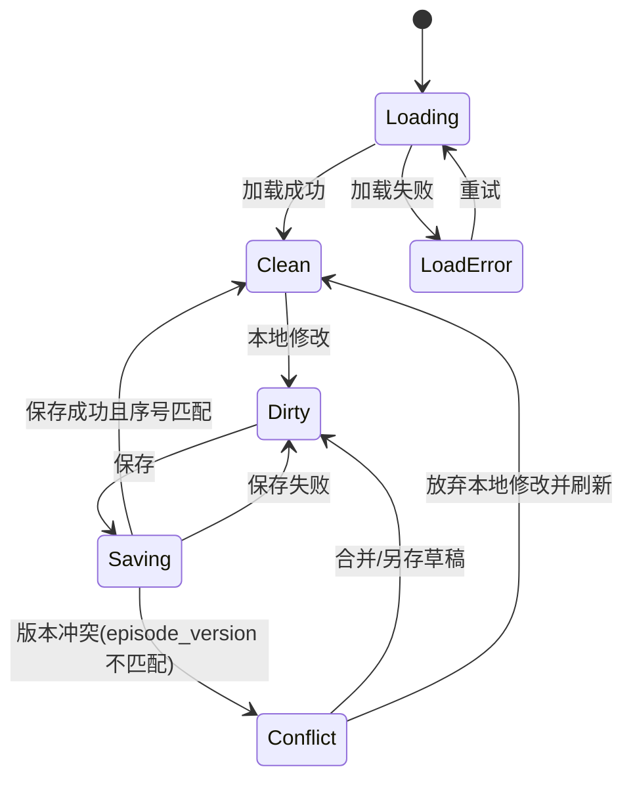
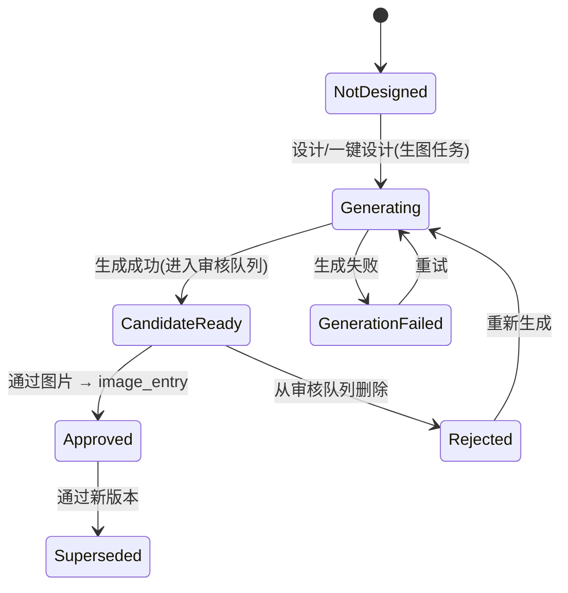

# 权限模型、状态机与验收标准

> 本文档在前向设计层面补充 `01`–`06`：那些文档描述"平台现状"，本文给出"复刻时应如何设计权限与状态机、如何验收"。
> 其中 `E1/E2` 为实测确认，`D` 为推荐设计，`U` 为待验证。详见 `07-研究方法与证据等级.md`。

---

## 1. 权限模型

### 1.1 两条独立权限轴 `E2 + D`

实测字段表明平台区分个人/团队剧本、用户/组织/部门、账户管理范围与当前用户项目角色，但完整角色枚举与权限矩阵未用多角色账号实测。两条轴必须分离：

- **组织轴**：组织 `org_id`、部门 `department_id`、账户管理范围 `management_scope`、`can_manage_accounts`、`is_admin`。`E2`
- **内容轴**：剧本 `owner_user_id` / `created_by_user_id`、`scope`（personal/team）、`current_user_project_role`。`E2`

组织管理员不应默认拥有个人剧本内容权限；项目编辑者也不应获得账户管理权限。`D`

### 1.2 推荐角色 `D`

| 角色 | 范围 | 说明 |
| --- | --- | --- |
| PersonalOwner | 单个个人项目 | 创建者/所有者，管理项目内容 |
| TeamViewer | 单个团队项目 | 只读查看 |
| TeamEditor | 单个团队项目 | 编辑剧本、主体、资产、创作内容 |
| TeamReviewer | 单个团队项目 | 审核资产与成片，不管理成员 |
| ProjectManager | 单个团队项目 | 管理项目角色与不可逆操作 |
| DepartmentManager | 部门 | 管理部门账户与额度，不自动读取项目内容 |
| OrganizationAdmin | 组织 | 管理组织、部门、账户与策略 |
| PlatformOperator | 全平台 | 受审计的运维权限，默认不读取创作内容 |

> 实测的 `management_scope` 枚举为 `none|department|org`，`can_manage_accounts` 为布尔，`current_user_project_role` 个人项目下为 `null`。`D`

### 1.3 推荐权限矩阵 `D`

| 动作 | Owner | Viewer | Editor | Reviewer | ProjectManager | OrgAdmin |
| --- | --- | --- | --- | --- | --- | --- |
| 查看项目 | 允许 | 允许 | 允许 | 允许 | 允许 | 需显式成员关系 |
| 编辑剧本/分集 | 允许 | 禁止 | 允许 | 禁止 | 允许 | 需显式成员关系 |
| 运行 AI 任务 | 允许 | 禁止 | 允许 | 禁止 | 允许 | 需显式成员关系 |
| 编辑主体 | 允许 | 禁止 | 允许 | 只读 | 允许 | 需显式成员关系 |
| 审核资产 | 允许 | 禁止 | 可配置 | 允许 | 允许 | 需显式成员关系 |
| 管理项目成员 | 个人项目不适用 | 禁止 | 禁止 | 禁止 | 允许 | 组织策略内允许 |
| 删除/归档项目 | 允许 | 禁止 | 禁止 | 禁止 | 允许 | 组织策略内允许 |
| 管理组织账户 | 禁止 | 禁止 | 禁止 | 禁止 | 禁止 | 允许 |
| 查看/调整积分 | 查看个人 | 禁止 | 查看项目预估 | 查看项目预估 | 查看项目流水 | 按组织策略 |

该矩阵须在真实团队账号 / 管理员账号下复核后才能成为兼容要求。`D`

### 1.4 授权检查顺序 `D`

1. 验证会话有效且用户 `enabled`。
2. 从服务端会话确定用户与活动租户。
3. 加载资源及其租户/所有者，不信任 URL 外的客户端归属字段。
4. 验证组织/部门成员关系。
5. 验证个人所有权或项目角色。
6. 验证具体动作与资源当前状态。
7. 对发布、删除、角色、积分变更追加审计事件。

---

## 2. 状态模型

### 2.1 编辑器保存状态 `D`（基于 `E2` 字段 `episode_version` / `client_save_seq` 乐观锁）



实测：剧本编辑器保存按钮在无未保存修改时处于禁用外观。`E1`

### 2.2 剧本处理流水线状态 `E2`

实测 5 阶段 `split / extract / merge / enrich / parents`，每阶段有 `state`（pending/done 等）与 `detail`，聚合字段 `running / failed / all_done`。`enrich` 可在 `parents` 已完成时仍为 pending —— **阶段按 DAG 校验，非严格串行**。`E2`

建议标准化 `D`：

```ts
type JobStatus  = "queued" | "running" | "succeeded" | "failed" | "canceled";
type StageStatus = "pending" | "running" | "done" | "failed" | "skipped";
```

规则：
- 聚合状态由阶段与活动任务推导，避免互相矛盾的布尔值。
- 任务绑定输入版本；旧任务成功不能覆盖新文本结果。
- 失败阶段保留结构化错误、可重试性与已消费积分。
- 用户重试时创建新 attempt，原记录不可改写。

### 2.3 资产/主体审核状态 `E2 + D`

实测 `review_status`：`not_designed`（标签"未通过/未设计"）/ `approved`（已通过）/ pending（待审，对应 `pending_candidate_count > 0`）；`image_entry` 为已通过的单张图片。`E2`



生成状态与审核状态应分表/分字段。`not_designed` 同时承载"未设计"与"未通过"的语义冲突由兼容层保留，不进入新领域模型。`D`

### 2.4 积分计费状态 `E2 + D`

实测 `CreditLog.log_type`：`settle`（结算）；账户有 `balance_points` 与 `frozen_points` 双字段；流水有 `reservation_id`、`points_delta`、`frozen_delta`、`balance_after`、`frozen_after`。`E2` 三段式：

| 状态 | 进入条件 | 离开条件 | 审计要求 |
| --- | --- | --- | --- |
| reserved | 任务启动按预估预扣 | settle/release | 不可变冻结流水（reservation_id） |
| captured(settle) | 任务成功按实际结算 | refund | 实际费用与任务结果 |
| released | 失败/取消/超时 | 终态 | 释放原因与时间 |
| refunded | 人工/系统退款 | 终态 | 原结算关联与操作者 |

实测示例：一次视频生成结算 `points_delta=-784, frozen_delta=-210`。`E2`

### 2.5 视频生成任务状态 `E2`

实测 `video-generation-jobs`：`status`（succeeded 等）、`progress`（0-100）、`progress_stage`、`progress_message`、`error_message`、`provider_key`（jianyu/modelsai）、`job_type`（all_reference）、`model`（doubao-seedance-2-0-260128）。`E2`

建议：`draft -> queued -> running -> succeeded/failed/canceled`；生成成功不自动等于发布（发布应为独立动作）。`D`

### 2.6 镜头组/分镜层级状态 `E2`

实测层级 `Episode → Scene → ShotGroup → Shot`；ShotGroup 有 `duration_seconds`、`materials`、`audio_elements`、`reference_frames`（first/last/reference）；`video-workbench` 与 `shot-hierarchy` 提供 `scenes[]`、`shot_groups[]`、`pending_shots[]`。`E2` 时间线 `video-timeline-arrangements` 有 `row_order`、`trim_start_seconds`、`trim_end_seconds`。`E2`

---

## 3. 页面验收标准（Given / When / Then）

### 3.1 全局与会话

| ID | Given / When / Then | 等级 |
| --- | --- | --- |
| AC-G01 | 已登录用户打开深层剧本路由时，加载当前资源并高亮"剧本页" | E1 |
| AC-G02 | 会话过期后任一写请求返回 401 `{"detail":"未登录"}` 时，保留本地草稿并引导登录 | D |
| AC-G03 | 无资源权限时，页面显示无权限状态，服务端同样拒绝直接 API | D |
| AC-G04 | 用户退出后刷新受保护路由，不能读取缓存中的敏感正文 | D |

### 3.2 剧本列表

| ID | Given / When / Then | 等级 |
| --- | --- | --- |
| AC-SL01 | 切换个人/团队时请求携带 `scope=personal|team`，列表不混入另一范围 | E2 |
| AC-SL02 | 搜索无结果时显示"无匹配"而非空态引导 | D |
| AC-SL03 | 加载下一页失败时已加载卡片保留并可重试 | D |
| AC-SL04 | Viewer 打开更多菜单时不显示写操作，直接调用 API 仍 403 | D |

### 3.3 分集编辑

| ID | Given / When / Then | 等级 |
| --- | --- | --- |
| AC-SE01 | 加载完成且正文未改动时保存按钮禁用 | E1 |
| AC-SE02 | 修改正文后保存可用；成功后返回新 `episode_version` | E2/D |
| AC-SE03 | 用过期 `episode_version` 保存时返回冲突，不覆盖服务端内容 | D |
| AC-SE04 | 切换分集时标题/正文/主体/URL 使用同一 `episode_id` | E2 |
| AC-SE05 | 角色/场景/道具/声音高亮同时有文本图例 | E1 |
| AC-SE06 | 添加重复集号时显示字段级冲突 | D |
| AC-SE07 | 删除分集前显示主体/镜头/资产/视频依赖 | D |

### 3.4 主体与流水线

| ID | Given / When / Then | 等级 |
| --- | --- | --- |
| AC-SU01 | 快照含不同主体类型时，面板数量等于对应卡片数量 | E1 |
| AC-SU02 | `extract` 运行时显示 `current/total`；完成或失败后停止轮询 | E2/D |
| AC-SU03 | `parents=done` 且 `enrich=pending` 时忠实展示两者并保持整体未完成 | E2 |
| AC-SU04 | 保存新文本后旧任务晚到时，旧结果不覆盖新输入版本 | D |
| AC-SU05 | 人工锁定主体名称后重新提取，提供差异建议而非直接覆盖 | D |

### 3.5 资产库与审核

| ID | Given / When / Then | 等级 |
| --- | --- | --- |
| AC-AL01 | 打开资产库卡片时以相同 `script_id` 进入对应详情 | E2 |
| AC-AL02 | 父主体有多个子形态时分组显示正确数量；无父项进入"其余子主体"分组 | E2 |
| AC-AL03 | 候选未选中时"通过图片"按钮禁用，选中后提交指定候选 | E2/D |
| AC-AL04 | 两审核者同时操作时后提交者收到冲突，不能覆盖新正式资产 | D |
| AC-AL05 | 替换被镜头引用的正式资产时先显示影响摘要并要求确认 | D |
| AC-AL06 | `background` 类型在 UI 统一显示为"场景" | E1 |

### 3.6 创作画布

| ID | Given / When / Then | 等级 |
| --- | --- | --- |
| AC-CV01 | 从资产库"去设计"经 `canvas-project/ensure` 创建/获取 materials 后进入 `/materials/<id>/canvas` | E2 |
| AC-CV02 | 节点拖动后通过 `canvas/delta` 增量保存，刷新后位置一致 | E2 |
| AC-CV03 | 主体设计生图任务异步轮询 `generation-jobs/<id>` 直至 succeeded | E2 |
| AC-CV04 | 未通过主体图不进入镜头组参考图汇聚 | D |

### 3.7 分镜与视频生成

| ID | Given / When / Then | 等级 |
| --- | --- | --- |
| AC-VG01 | "分镜生成"只为当前选中集生成 `scenes→shot_groups→shots` | E1/E2 |
| AC-VG02 | 镜头组 `materials` 引用的主体自动汇聚为 `reference_images`，`reference_image_names` 与主体名对应 | E2 |
| AC-VG03 | 视频生成按 `provider_key`/`model` 路由，进度 0-100 可轮询 | E2 |
| AC-VG04 | 时间线按 `row_order` 排列，`trim_start/end_seconds` 控制裁剪 | E2 |
| AC-VG05 | 任务失败时冻结积分释放 | D |

---

## 4. 横向验收标准

### 4.1 安全
- 任意用户改 URL 中 `script/episode/subject/materials/shot/job` ID 时，服务端执行资源级授权。`D`
- Cookie/供应商密钥/签名 URL 不进普通日志。`D`
- 上传内容校验真实 MIME 与媒体解析结果。`D`
- 删除/发布/权限/积分调整均有操作者/时间/资源/前后值审计。`D`

### 4.2 可靠性
- 同一幂等键重复创建任务，不产生重复作业或重复冻结。`D`
- Worker 崩溃后任务可经租约恢复；同一产物不会重复成为正式版本。`D`
- 积分冻结与任务创建不存在"任务没创建但积分永久冻结"的中间状态。`D`
- 页面刷新后通过服务端 `job_id` 恢复进度。`E2/D`

### 4.3 性能
- 基线数据集：分集数 / 主体数 / 资产数 / 时间线长度。`D`
- 测量首屏可交互、列表滚动、文本输入延迟、主体筛选、时间线拖拽。`D`
- 分别测任务 API 响应与后台实际执行，不把异步执行算作请求延迟。`D`
- 报告 P50/P95/P99 与失败率。`D`

---

## 5. 兼容完成门槛

| 门槛 | 本轮结果 |
| --- | --- |
| 所有 P0 页面有路由与接口证据 | 已满足（见 `01-06`） |
| 所有关键写操作有请求/响应与错误证据 | 部分满足（只读探索，未触发写操作） |
| 完整视频流程走到生成结果 | 已满足（观察到已完成视频与时间线） |
| 团队/组织权限矩阵经多角色验证 | 未满足（仅 personal 账号） |
| 积分冻结/结算/释放经真实任务验证 | 已满足（流水抓取） |
| 创作与视频状态机经刷新/失败测试 | 部分满足 |
| 文档已脱敏并通过一致性检查 | 已满足 |
