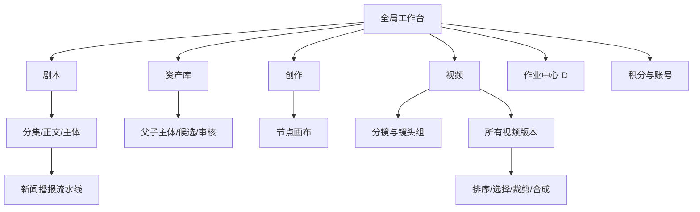
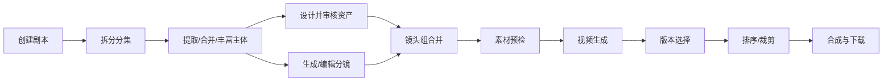

# 产品需求文档（PRD）

## 1. 产品概述

### 1.1 产品定义

本产品是一套面向短剧、漫剧和新闻播报内容团队的 AI 视频生产工作台。它将非结构化文案转化为可管理的分集、主体、资产、分镜、镜头组和视频版本，并通过异步 AI 作业、审核与时间线编排形成可下载成片。

### 1.2 核心价值

1. **结构化**：把剧本文本拆成稳定、可编辑、可追踪的制作对象。
2. **一致性**：以角色、场景、道具和声音资产约束跨镜头视觉与听觉一致性。
3. **可控生成**：生成前可检查素材，生成后保留多版本、失败原因和成本记录。
4. **流水线化**：把长耗时 AI 任务拆成可观察、可取消、可重试和可补偿的阶段。
5. **可交付**：通过版本选择、排序、裁剪和合成，将零散视频片段变成成片。
6. **模板化**：对新闻播报等固定场景，提供更短路径的配置式生产线。

### 1.3 成功指标（D）

| 维度 | 指标 | 建议目标 |
| --- | --- | --- |
| 激活 | 新用户首次创建剧本并完成主体提取 | 中位数 15 分钟内 |
| 生产 | 从剧本到首个可播放视频片段 | 中位数 60 分钟内 |
| 稳定 | AI 作业终态可解释率 | 100%，不得长期停留中间态 |
| 补偿 | 失败/取消后预占积分释放 | 99.99% 在 1 分钟内完成 |
| 一致性 | 有审核资产的镜头使用已通过资产 | 100% 可追踪 |
| 可恢复 | 页面刷新后恢复作业与编辑状态 | 100% |
| 交付 | 成片合成成功率 | 大于 99%，失败可重试且不重复扣费 |

## 2. 用户与角色

| 角色 | 主要目标 | 典型任务 |
| --- | --- | --- |
| 创作者 | 快速完成一部漫剧 | 编辑剧本、生成分镜、选择素材、生成视频 |
| 美术/资产设计师 | 保证视觉一致性 | 设计角色/场景/道具、提交候选、维护风格参考 |
| 音频设计师 | 保证声音可用 | 配置角色声音、音效和参考音频 |
| 审核员 | 控制资产与产物质量 | 审核候选资产、标记问题、退回重做 |
| 制片/项目负责人 | 控制进度与成本 | 查看作业、积分、失败、项目范围和成片 |
| 组织管理员 | 管理成员与配额 | 账号、组织、部门、角色、积分分配和审计 |
| 平台运营 | 管理模型和安全策略 | 提供商、模型、价格、内容安全、告警 |

`E1` 当前账号只验证了普通成员视角；审核员、管理员和运营角色是 `D/U`，需要复刻项目明确授权模型。

## 3. 范围

### 3.1 P0：可用闭环

- 登录、会话恢复、退出；
- 个人项目列表、搜索、创建、归档/删除保护；
- 剧本、分集、文本编辑和版本；
- 主体提取、主体分类、合并与人工修正；
- 角色/场景/道具/声音资产库；
- 图片/声音候选生成或上传、审核和版本；
- 分镜拆解、镜头组编辑、提示词和素材引用；
- 视频素材检查、异步生成、多版本结果和失败重试；
- 版本选择、排序、裁剪、合成和下载；
- 积分预占、结算、释放、流水和幂等；
- 作业中心、审计日志、基础 RBAC 和组织隔离。

### 3.2 P1：效率与模板

- 团队项目与成员协作；
- 新闻播报快捷生产线；
- 节点式创作画布；
- 批量生成、批量选择、打包下载；
- 模型/分辨率/比例预设；
- SSE/WebSocket 进度推送；
- 项目级成本和成功率报表；
- 草稿自动保存、版本比较与恢复。

### 3.3 P2：企业治理

- 细粒度角色、部门配额和审批；
- 多级内容安全、版权与肖像授权；
- 模型路由、供应商容灾、预算上限；
- 项目模板、批量导入、开放 API/Webhook；
- 发布渠道、排期、回调和效果数据；
- SSO、SCIM、数据保留和合规导出。

### 3.4 明确不在首版范围

- 自研基础图像/视频大模型；
- 专业 NLE 的全部能力，如多轨关键帧、调色和复杂音频混音；
- 对原站品牌、素材、内部提示词或 UI 像素级复制；
- 未经授权的第三方内容抓取和训练。

## 4. 信息架构

`E1` 原站顶栏只显示剧本、资产库、创作、视频。分镜页面具有 `E1` 页面证据和 `E2` 路由证据；账号管理仅确认 `E1` 认证加载态与接口 `E2` 403；新闻播报详情仅有 `E2` 路由/前端阶段表示，成功详情仍为 `U`。`D` 复刻时建议增加统一作业中心，并按权限显示管理入口。

## 5. 核心业务流程

### 5.1 普通漫剧

### 5.2 新闻播报

## 6. 功能需求

### 6.1 全局工作台

| 编号 | 优先级 | 需求 | 验收摘要 |
| --- | --- | --- | --- |
| GLB-001 | P0 | 登录后恢复原目标路由 | 会话有效时不重复登录；无权限时进入 403 页面 |
| GLB-002 | P0 | 顶栏提供核心模块、在线状态、账号、积分和退出 | 当前模块高亮；深层详情仍保留导航 |
| GLB-003 | P0 | 展示可用积分与冻结积分 | 展示值可追溯到账本；失败释放后自动更新 |
| GLB-004 | P0 | 所有长任务可跨页面恢复 | 刷新或重新登录后仍能看到最新状态 |
| GLB-005 | P1 | 全局作业中心 | 支持状态、项目、类型、发起人、时间筛选 |
| GLB-006 | P0 | 全局错误边界 | 401、403、404、429、500 和断网有不同恢复动作 |

### 6.2 项目与剧本

| 编号 | 优先级 | 需求 | 验收摘要 |
| --- | --- | --- | --- |
| SCR-001 | P0 | 个人/团队项目分页列表与服务端搜索 | 搜索无结果与真正空库使用不同空态 |
| SCR-002 | P0 | 创建普通剧本或新闻播报项目 | 未满足必填项时主按钮禁用并解释原因 |
| SCR-003 | P0 | 剧本包含有序分集 | 新增、重命名、排序、软删除均有版本与审计 |
| SCR-004 | P0 | 正文编辑与保存 | 脏状态明确；离开前提示；支持版本冲突检测 |
| SCR-005 | P0 | 主体提取流水线 | 显示拆分、提取、合并、丰富、父主体阶段 |
| SCR-006 | P0 | 主体分类和过滤 | 支持角色、场景、道具、声音及全部 |
| SCR-007 | P0 | 上游修改影响分析 | 修改正文或主体时列出需失效/重算的下游对象 |
| SCR-008 | P0 | 删除项目高风险保护 | 输入项目名或二次确认；优先软删除和恢复期 |

### 6.3 资产库

| 编号 | 优先级 | 需求 | 验收摘要 |
| --- | --- | --- | --- |
| AST-001 | P0 | 每个剧本拥有资产集合 | 列表不应为每个项目产生独立封面查询的 N+1 请求 |
| AST-002 | P0 | 支持父主体和子主体形态 | 父子关系可编辑；形态引用可追踪到分集与镜头 |
| AST-003 | P0 | 支持图片与声音候选 | 候选有来源、模型、提示词、状态和时间戳 |
| AST-004 | P0 | 审核候选并建立正式资产版本 | 已通过版本不可被无确认删除；切换版本有影响提示 |
| AST-005 | P0 | 区分未设计、可审核、已通过 | UI、API 和统计口径一致 |
| AST-006 | P1 | 风格参考与批量生成 | 仅继承风格和渲染特征，不默认复制人物外貌 |
| AST-007 | P0 | 素材授权与安全元数据 | 记录来源、授权、内容安全结果和保留策略 |

### 6.4 分镜与镜头组

| 编号 | 优先级 | 需求 | 验收摘要 |
| --- | --- | --- | --- |
| SHT-001 | P0 | 按分集/场次查看镜头 | 场次下拉显示镜头数；切换不丢编辑状态 |
| SHT-002 | P0 | 配置比例、分辨率和候选数量 | 比例支持横/竖屏；数量与成本实时联动 |
| SHT-003 | P0 | 表格化展示分镜字段 | 场景、景别、时长、画面、动作、台词、音效、叙事目的完整 |
| SHT-004 | P0 | 合并镜头为生成单元 | 保留原镜头引用、合并顺序和总时长 |
| SHT-005 | P0 | 编辑镜头组提示词和素材 | 修改有版本、撤销和下游失效提示 |
| SHT-006 | P1 | 插入、删除、排序镜头组 | 使用稳定顺序键；并发编辑可检测冲突 |
| SHT-007 | P0 | 高成本生成二次确认 | 显示模型、数量、预计积分和不可逆影响 |

### 6.5 视频生成与版本

| 编号 | 优先级 | 需求 | 验收摘要 |
| --- | --- | --- | --- |
| VID-001 | P0 | 生成前素材校验 | 图片、音频、视频和混合上限逐项说明 |
| VID-002 | P0 | 适配多提供商/模型 | 统一内部请求，提供商适配器处理差异 |
| VID-003 | P0 | 异步作业完整状态 | 排队、运行、成功、失败、取消都有时间和原因 |
| VID-004 | P0 | 每个镜头组保留多个视频版本 | 版本显示时长、生成时间、模型、作业和选中态 |
| VID-005 | P0 | 支持播放、截帧和打包下载 | 未选版本时命令禁用；下载采用短期签名 URL |
| VID-006 | P0 | 失败重试和积分补偿 | 幂等重试；失败不重复结算；释放可审计 |
| VID-007 | P1 | 批量生成 | 支持全选、反选、数量、并发上限和部分失败 |

### 6.6 时间线与交付

| 编号 | 优先级 | 需求 | 验收摘要 |
| --- | --- | --- | --- |
| TML-001 | P0 | 将选中视频按行排序 | 拖拽后持久化稳定顺序，不依赖数组下标 |
| TML-002 | P0 | 左右裁剪 | 裁剪范围不得越界；保留原始文件不破坏 |
| TML-003 | P0 | 时间线缩放 | 缩放只影响视图，不改业务时长 |
| TML-004 | P0 | 合成作业 | 固化输入版本快照；支持失败重试和产物校验 |
| TML-005 | P0 | 最终成片下载 | 记录导出格式、分辨率、时长、校验和与过期时间 |
| TML-006 | P1 | 预览与断点恢复 | 刷新后恢复选择、排序、裁剪和合成状态 |

### 6.7 新闻播报

| 编号 | 优先级 | 需求 | 验收摘要 |
| --- | --- | --- | --- |
| NWS-001 | P1 | 支持主持人播报/纯场景播报 | 模式切换动态显示对应字段 |
| NWS-002 | P1 | 配置 480p/720p/1080p 和 16:9/9:16 | 不支持组合需在提交前阻止 |
| NWS-003 | P1 | 可上传主持人图和固定音色样本 | 校验格式、时长、授权和安全结果 |
| NWS-004 | P1 | 支持片头/片尾英雄场景 | 同一时间只能选择一种位置或不使用 |
| NWS-005 | P1 | 场景素材绑定文案锚点 | 文案改动后提示锚点漂移并要求确认 |
| NWS-006 | P1 | 显示七阶段进度 | 每阶段显示状态、耗时、错误和产物 |
| NWS-007 | P1 | 运行中可取消 | 二次确认；取消后释放未消耗积分 |
| NWS-008 | P1 | 成片预览和下载 | 成功前按钮禁用；失败保留中间产物诊断 |

### 6.8 组织、权限与积分

| 编号 | 优先级 | 需求 | 验收摘要 |
| --- | --- | --- | --- |
| IAM-001 | P0 | 用户、组织、部门和项目作用域授权 | 每个资源接口服务端校验，前端隐藏不作为授权 |
| IAM-002 | P0 | 普通成员无管理权限时显示 403 | 不泄露成员列表、配额或组织数据 |
| IAM-003 | P1 | 管理员分配成员积分或配额 | 需要权限、幂等键、原因和审计 |
| CRD-001 | P0 | 积分账本支持获取、预占、结算、释放 | 每笔流水关联作业和操作者，不允许原地改余额 |
| CRD-002 | P0 | 并发扣费原子化 | 余额不足时无作业泄漏；重复请求只扣一次 |
| CRD-003 | P0 | 价格快照 | 作业保存创建时单价和规则，后续调价不影响历史 |

## 7. 关键业务规则

### 7.1 主体与资产

- 主体类型至少包括角色、场景、道具、声音；API 可使用稳定英文枚举，UI 负责本地化。
- 同一逻辑主体可以有父主体和多个形态/子主体；镜头应引用具体形态，无法确定时引用父主体并提示补全。
- 正式资产来源于已通过候选；候选和正式版本不能混用状态字段。
- 已被镜头或作业引用的资产不得硬删除，只能归档或创建替代版本。

### 7.2 视频素材限制（E2）

- 图片最多 9 张；
- 音频最多 3 条；
- 视频最多 3 条；
- 混合素材最多 12 个；
- 音频不能单独作为输入，至少还需图片或视频；
- 当前目标模型时长校验为 4-15 秒或特殊自动值；可见 UI 只提供 5-15 秒，属于 UI/API 差异；
- 某提供商适配器固定附加 720p，说明统一领域参数与提供商参数需要分层。

### 7.3 图片生成（E2）

- 当前前端包含多个图片模型键，并存在旧键到官方键的映射；
- 支持真人写实与 3D 动漫风格；
- 角色默认 3:4，场景默认 16:9，道具默认 1:1，其他默认自动比例；
- 默认 2K，支持 1K/2K/4K；
- 支持 auto、1:1、16:9、9:16、3:4、4:3、3:2、2:3、5:4、4:5、21:9；
- 前端图片任务并发数为 4；复刻时并发应由服务端配额控制，而非仅靠浏览器。

## 8. 非功能需求

### 8.1 性能

- 首屏核心 JS 建议压缩后小于 500 KB；画布和视频编辑器按路由懒加载。
- 列表接口必须聚合封面与统计，避免逐项目 N+1 请求。
- 任务状态优先推送；轮询必须可见性暂停、自适应退避并批量查询。
- 1000 个镜头或节点时使用虚拟列表/画布视口裁剪。

### 8.2 可用性

- 写操作使用幂等键；异步任务使用 outbox/队列和租约，防止丢任务与重复执行。
- 提供商超时应分类为可重试/不可重试，保留外部任务 ID 和原始错误摘要。
- 账本、作业、产物和业务状态使用同一事务边界或 Saga 补偿。
- 合成输入使用不可变快照，避免执行过程中版本漂移。

### 8.3 安全与合规

- 密码使用强哈希；会话 Cookie 为 HttpOnly、Secure、SameSite；短期 CSRF 令牌。
- 对象存储默认私有，所有预览/下载使用短期签名 URL 和租户前缀校验。
- 上传执行 MIME/魔数/病毒/尺寸/时长校验；图片和音视频进入内容安全流程。
- 模型密钥只存在服务端密钥系统；日志不得记录提示词中的敏感数据、令牌或签名 URL。
- 所有管理员、积分、审核、删除、导出和发布操作进入不可变审计日志。
- 提供数据导出、删除、保留期和模型训练用途声明。

### 8.4 可访问性与响应式

- 目标 WCAG 2.2 AA；所有图标按钮有可访问名称和工具提示。
- 表格、标签、弹窗、组合框和时间线可键盘操作。
- 复杂工作台最低建议宽度可设为 1280px，但窄屏必须提供可用的只读/审批视图，而不是内容重叠。

### 8.5 可观测性

- 统一 `trace_id` 贯穿 HTTP、队列、模型调用、对象存储、账本和合成。
- 指标至少包括排队时长、执行时长、成功率、外部提供商错误率、积分预占滞留和补偿延迟。
- 每个阶段记录结构化事件，不通过解析自由文本判断状态。

## 9. 体验原则与已发现问题

| 发现 | 证据 | 复刻要求 |
| --- | --- | --- |
| 搜索无结果复用“从未创建”空态 | E1 | 区分初始空态、筛选无结果和加载失败 |
| 资产列表产生逐项目附加请求 | E2 | 列表 API 聚合封面和统计 |
| 高成本分镜生成无二次确认 | E1 现场记录 | 显示成本估算并二次确认，支持防重复点击 |
| 已通过候选仍显示从队列删除入口 | E1 | 高风险动作按状态收敛，并提供引用影响提示 |
| 全局积分静止时持续轮询 | E2 | 使用事件推送或退避、可见性暂停 |
| 画布普通交互可能触发 PATCH | E2/E3 | 区分 UI 瞬态与业务数据、显示保存状态、可撤销和审计 |
| UI 时长选项与代码校验范围不同 | E1/E2 | 单一服务端能力定义驱动 UI 和 API 校验 |
| 部分入口是隐藏路由 | E1/E2 | 用信息架构和权限显式呈现，不依赖记忆 URL |

## 10. 发布与里程碑验收门槛

每个里程碑进入下一阶段前必须满足：

1. 契约测试覆盖所有公开 API 的成功和失败响应；
2. 状态机属性测试保证终态不可逆、重复事件幂等；
3. 租户越权、对象存储越权、积分并发扣费通过安全测试；
4. 对应端到端流程可以在无人工改库情况下完成；
5. 失败注入证明作业可恢复、积分可补偿、产物不泄漏；
6. 无真实凭据、模型密钥、签名 URL 和用户内容进入日志或仓库；
7. 关键页面通过桌面端视觉回归、键盘操作和无障碍检查。

## 11. 待产品决策（U）

以下不是调研缺陷，而是复刻项目必须主动确定的产品政策：

- 团队成员能否同时编辑同一剧本、主体或画布，以及采用锁还是乐观并发；
- 删除的恢复期、项目所有权转移和离职成员数据归属；
- 审核角色是否允许审核自己生成的资产；
- 积分是内部配额、付费货币还是二者组合，退款与税务如何处理；
- 最终发布渠道、审核门槛、版权责任和回调机制；
- 新闻播报主持人肖像与声音克隆的授权证明、保存期限和撤回机制；
- 提示词、用户素材和生成产物是否用于模型训练；
- 模型提供商不可用时是否自动降级，以及质量、价格和用户知情策略。
