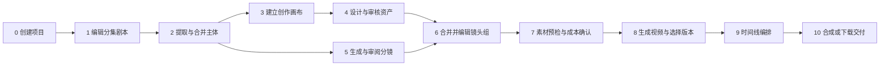
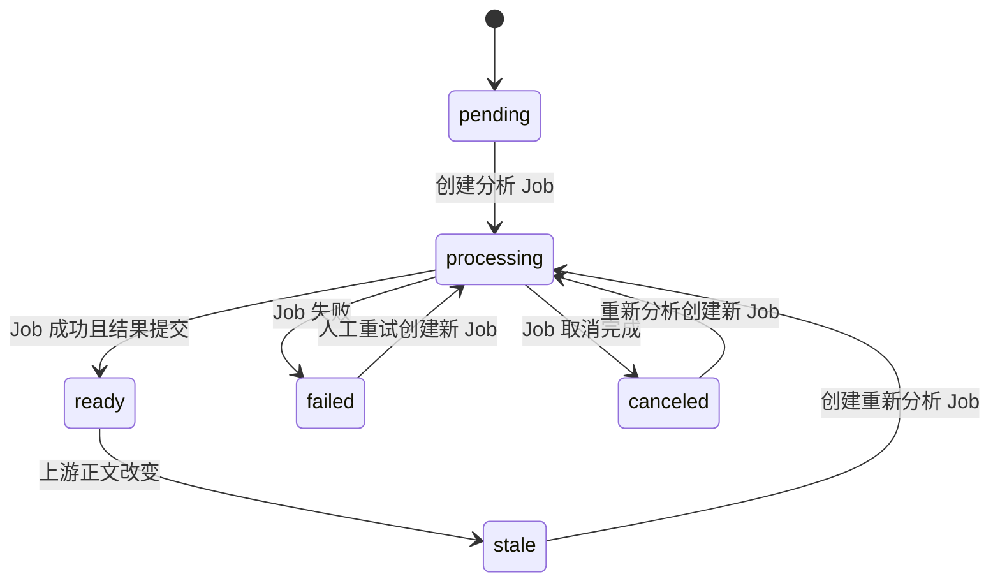
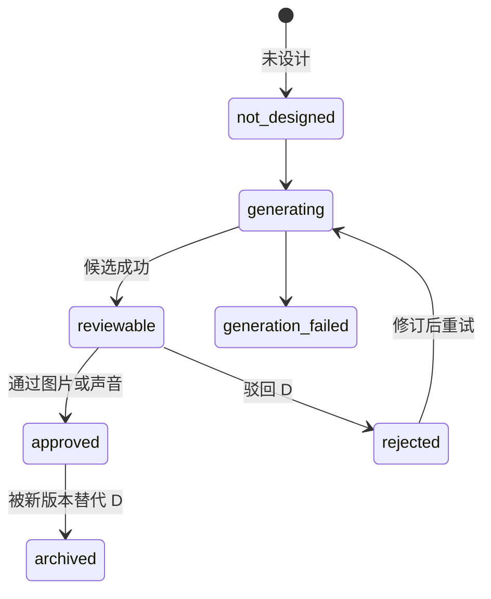
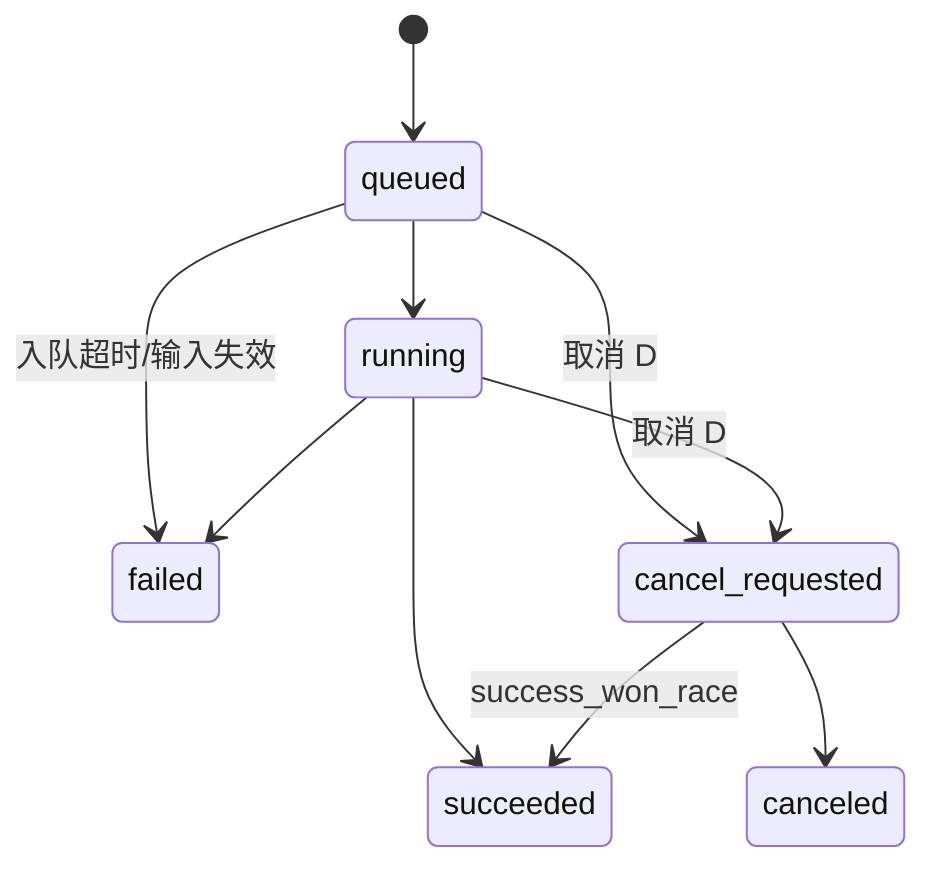
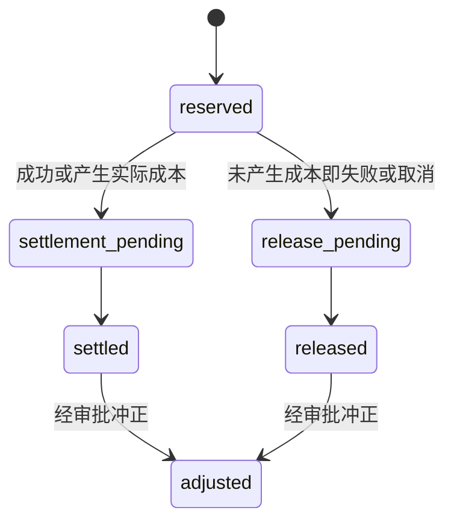

# 普通漫剧制作流程

## 1. 文档定位

本文定义普通漫剧从剧本草稿到可下载视频序列的完整生产流程，供产品、交互、前端、后端、算法、测试和 AI 开发代理共同使用。本文既记录当前平台可观察事实，也给出独立复刻时必须补齐的工程契约。

| 标记 | 含义 | 本文使用方式 |
| --- | --- | --- |
| `E1` | 页面直接实测 | 页面、控件、默认值、空态和可见状态 |
| `E2` | 网络/API/前端代码证据 | 路由、请求方法、字段、校验、状态和轮询 |
| `E3` | 基于多条证据的合理推断 | 跨模块关系、隐式保存和业务意图 |
| `D` | 独立复刻的目标设计 | 安全、成本、状态机、API 和验收要求 |
| `U` | 当前证据不足 | 未执行的写操作、权限和最终交付能力 |

未经标记的“必须”“不得”“应”均表示复刻产品要求，不代表原站已实现。

代表页面证据为 `EV-SCRIPT-DETAIL-01`、`EV-ASSET-DETAIL-01`、`EV-CANVAS-BASE-01`、`EV-SHOT-WORKBENCH-01`、`EV-VIDEO-WORKBENCH-01`、`EV-TIMELINE-01`；误触事件仅引用 `EV-FIELD-SHOT-GENERATE-01` 现场记录。写端点和模型规则引用 `EV-CODE-SCRIPT-01`、`EV-CODE-CANVAS-01`、`EV-CODE-VIDEO-01`，只能证明前端含对应调用，不能证明写流程成功。

本文省略前缀的 `E2` 原站 API 路径均相对 `/v3api`；省略前缀的 `D` 目标 API 路径均相对 `/api/v1`。页面路由会明确写出 `/v3`，不得与 API 混用。

## 2. 目标、边界与虚构示例

### 2.1 流程目标

普通漫剧流程需要把一份非结构化剧本文本逐步转换为以下稳定产物：

1. 有序分集；
2. 角色、场景、道具和声音主体；
3. 可审核的图片与声音资产；
4. 结构化分镜和镜头组；
5. 可追踪的视频生成作业及多个候选版本；
6. 具有固定顺序和裁剪范围的视频时间线；
7. 可验证、可下载、可审计的交付产物。

### 2.2 虚构示例

本文统一使用虚构项目《云港守夜人》说明流程。第 1 集名为《雾灯》，角色为“林澈”和“小灯”，场景为“云港灯塔”，道具为“铜制罗盘”。这些名称仅用于说明，不对应任何真实平台数据。

### 2.3 当前能力边界

- `E1/E2` 当前可见页面/控件链覆盖剧本、主体、资产、分镜、镜头组、视频候选、时间线预览和打包下载入口；生成、保存、审核和下载等写流程未形成成功实测闭环。
- `E1/E2` 当前视频页面未发现独立字幕编辑、背景音乐轨、转场、调色或专业多轨混音。
- `U` 未确认“正式发布”是否为独立模块；当前证据只能支持“生成、编排、下载”。
- `D` 复刻首版不得把未观察到的专业 NLE 能力伪装成原站事实，可作为后续产品扩展单独设计。

## 3. 端到端流程总览



### 3.1 关键质量门

| 质量门 | 进入条件 | 退出条件 | 阻断原因 |
| --- | --- | --- | --- |
| G1 剧本可分析 | 至少一个非空分集 | 主体提取作业成功 | 空文本、保存冲突、分析失败 |
| G2 主体可生产 | 主体已合并并分类 | 必需主体拥有可用描述 | 类型缺失、重复主体未合并 |
| G3 资产可引用 | 存在候选资产 | 必需资产已通过审核 | 无候选、审核未通过、授权缺失 |
| G4 分镜可生成 | 分镜字段完整 | 镜头均进入镜头组或明确搁置 | 未分组镜头、时长或台词超限 |
| G5 视频可提交 | 素材预检通过 | 用户确认成本并创建作业 | 素材超限、积分不足、未确认 |
| G6 时间线可交付 | 每个必需镜头有选中版本 | 顺序和裁剪已持久化 | 缺片段、裁剪越界、版本失效 |

## 4. 跨阶段核心对象

| 对象 | 职责 | 稳定引用要求 |
| --- | --- | --- |
| Script | 项目业务根对象 | 删除前必须检查全部下游引用 |
| Episode | 有序分集与正文 | 使用稳定 ID 和独立版本号，不用数组下标作为身份 |
| Subject | 角色、场景、道具、声音 | 合并后保留来源分集和原文位置 |
| AssetCandidate | 图片或声音候选 | 记录来源、模型、提示词、作业、审核状态 |
| AssetVersion | 已通过的正式资产 | 镜头引用具体版本，不能只引用可变“最新版本” |
| Shot | 单个结构化分镜 | 保留场次、景别、时长、动作、台词和叙事目的 |
| ShotGroup | 视频生成单元 | 保留成员镜头、顺序、提示词、素材、音频和参考帧 |
| Job | 异步分析或生成任务 | 关联幂等键、价格快照、状态、错误和时间戳 |
| VideoVersion | 某镜头组的一次成功结果 | 关联输入快照、模型、时长、封面和原始作业 |
| TimelineItem | 时间线片段 | 记录稳定顺序、选中态、裁剪起止和来源版本 |
| CreditEntry | 积分账本流水 | 关联作业，区分预占、结算、释放和冲正 |

## 5. 阶段 0：创建普通剧本项目

### 5.1 输入与页面

- `E1` 剧本列表提供个人/团队标签、搜索框和“新建剧本”。
- `E1` 新建弹窗支持“默认”和“新闻播报”两种模式；本流程选择“默认”。
- `E1` 默认模式只要求项目标题，空标题时“开始创作”禁用。

### 5.2 用户操作

1. 进入剧本列表；
2. 选择个人或团队作用域；
3. 打开新建弹窗并保持“默认”模式；
4. 输入虚构标题《云港守夜人》；
5. 查看创建后的作用域、所有者和默认分集；
6. 在成本和写入确认后提交创建。

### 5.3 输入约束

| 字段 | 约束 | 错误反馈 |
| --- | --- | --- |
| `title` | 去除首尾空白后非空 | 主按钮禁用并显示“请输入剧本名称” |
| `scope` | `personal` 或有权限的 `team` | 无团队权限时不得显示可提交选项 |
| `team_id` | `scope=team` 时必填，`scope=personal` 时禁止 | 目标团队不存在、不同组织或无成员关系时返回 403/422 |
| `mode` | 本流程固定为 `default` | 切换模式时应明确会重置哪些字段 |
| HTTP `Idempotency-Key` | 每次用户意图唯一，只通过 Header 传递 | 重复点击返回同一创建结果 |

`organization_id` 必须由认证上下文注入，客户端不得选择或提交。`U` 当前证据不足以确定标题最大长度、重名规则和创建后的默认分集命名；复刻产品应明确这些规则，而不是依赖数据库错误。

### 5.4 输出、API 与验收

- 输出：Script、默认 Episode、审计事件和项目权限关系。
- `E2` 列表读取形态为 `GET /scripts/page?scope=personal|team`。
- `D` 创建建议为 `POST /scripts`，请求体包含标题、作用域、可选 `team_id` 和模式；幂等键只放 HTTP Header。
- 验收：重复提交不产生第二个项目；越权团队作用域返回 403；成功后落到剧本详情并显示默认分集。

## 6. 阶段 1：编辑分集和剧本文本

### 6.1 输入与界面

- `E1` 左侧提供分集搜索、“新增一集”、分集切换和删除入口。
- `E1` 主区显示剧本正文；角色、场景、道具和声音可在正文中高亮。
- `E1` 未修改时“保存”禁用，说明页面存在脏状态判断。
- `E1` 顶部展示主体提取和合并进度。

### 6.2 用户操作

1. 将故事拆为有序分集；
2. 在第 1 集录入正文，包括场景标题、画面描述、动作、对白和音效；
3. 检查自动高亮是否误标主体；
4. 保存正文；
5. 切换分集，确认刷新后内容和顺序保持一致。

### 6.3 保存契约（D）

```text
客户端打开 Episode(version = 7)
  -> 用户编辑，进入 dirty
  -> PUT /episodes/{episode_id} 携带 HTTP If-Match: "7"
  -> 成功返回 version = 8，进入 saved
  -> 若服务端已是 version = 9，返回 409 和最新摘要
  -> 用户选择比较、合并或另存版本，不得静默覆盖
```

| 状态 | UI | 允许动作 |
| --- | --- | --- |
| `clean` | 已保存/保存禁用 | 编辑、切集 |
| `dirty` | 未保存 | 保存、撤销；离开前提示 |
| `saving` | 保存中 | 禁止重复提交 |
| `saved` | 显示保存时间 | 继续编辑 |
| `conflict` | 版本冲突 | 比较、合并、放弃本地或另存 |
| `save_failed` | 保留本地草稿 | 重试或导出草稿 |

### 6.4 下游影响

- `D` 正文修改后，已提取主体和已生成分镜不得静默视为最新。
- 系统应计算影响范围：新增/删除的主体、受影响场次、镜头组、视频作业输入和时间线片段。
- 用户可选择“只保存正文”或“保存并重新分析”；重新分析属于异步且可能计费的操作。

### 6.5 API 与验收

- `E2` 读取：`GET /scripts/{script_id}`、`GET /scripts/{script_id}/episodes`、`GET /scripts/{script_id}/episodes/{episode_id}/breakdown`。
- `D` 保存：`PUT /scripts/{script_id}/episodes/{episode_id}`，使用版本号和幂等键。
- 验收：刷新不丢正文；保存失败不清空本地内容；409 不覆盖其他编辑者；切集前能处理未保存状态。

## 7. 阶段 2：提取、合并和修正主体

### 7.1 处理目标

将剧本文本转换为角色、场景、道具和声音主体，并合并跨集同一逻辑主体。

### 7.2 输入与输出

| 输入 | 系统处理 | 输出 |
| --- | --- | --- |
| 已保存分集正文 | 分段、实体识别、类型分类 | 分集级主体候选 |
| 多集主体候选 | 名称归一、描述丰富、跨集合并 | Script 级主体 |
| 人工修正 | 类型、名称、描述、父子关系调整 | 可用于资产设计的主体版本 |

### 7.3 可见能力

- `E1` 页面按全部、角色、场景、道具、声音显示数量。
- `E1` 主体卡包含名称、类型、描述和所属集数。
- `E1` 页面提供新增和删除入口。
- `E1` 流水线状态显示“主体提取：已完成集数/总集数”和“合并：已完成”。

### 7.4 Episode 分析聚合状态机（D）



- `D` 上图只描述 `EpisodeAnalysisAggregateState`：`pending/processing/ready/failed/canceled/stale`。`processing` 从最新 Job 的 `queued/running/cancel_requested` 派生；阶段 `split/extract/merge/enrich/parents` 各自使用 `StageStatus`。
- `E2` 当前存在流水线状态和主体提取状态读取接口。
- `D` 每个分集独立记录状态，总状态由分集状态聚合；一个分集失败不应抹掉其他成功结果。
- `D` 失败后保留上次成功主体版本，重试生成新版本，用户确认后再替换。
- `D` 自动重试在同一 Job 下创建新 Attempt；失败终态后的人工重试创建新 Job，旧 Job 不回到 queued。

### 7.5 合并规则（D）

- 名称相同不等于同一主体，需结合类型、描述、上下文和人工确认。
- 合并保留 `source_episode_ids` 和原始名称，不破坏追溯。
- 父主体表示逻辑身份，子主体表示服装、年龄、时段或形态差异。
- 已被资产和镜头引用的主体只能归档或重定向，不能硬删除。

### 7.6 API 与验收

- `E2` 状态读取：`GET /scripts/{script_id}/pipeline-status`、`GET /scripts/{script_id}/extract-subjects-status`。
- `D` 作业创建：`POST /scripts/{script_id}/subject-extraction-jobs`。
- `D` 人工修正：`PATCH /subjects/{subject_id}`；合并：`POST /subjects/merge`，携带来源版本。
- 验收：同一角色跨集只形成一个逻辑主体；失败分集可单独重试；正文修改后相关主体标为 stale。

## 8. 阶段 3：建立素材项目和创作画布

### 8.1 新建素材项目

- `E1` 素材项目可关联一个剧本，也可选择“不关联”。
- `E1` 名称为空时“创建”禁用；关联剧本通过组合框选择。
- `E3` 关联剧本后，主体可以进入设计队列；未关联项目用于独立视觉创作。

### 8.2 画布能力

- `E1` 画布基于节点和连线，提供文本、图片、选择分镜节点，以及图片、视频、音频上传入口；上传未执行。
- `E1` 支持缩放、适配视图、交互开关和小地图。
- `E1` 侧栏按全部、未设计、可审核、已通过筛选主体，并支持按集数过滤。
- `E1` 主体按角色、背景、道具和声音分组。

### 8.3 隐式 PATCH 风险

- `E2` 在只进行节点选择或尺寸菜单探索后，网络出现 `PATCH /materials/{material_id}/canvas/delta`。
- `E3` 未保留请求体，无法确认写入的是选择/视口等 UI 瞬态，还是正式节点数据。
- `D` 复刻时必须把画布状态拆为：
  - 本地瞬态：选中节点、悬停、菜单、缩放、视口；
  - 用户偏好：是否记住视口，可单独保存；
  - 业务草稿：节点、边、提示词、素材引用；
  - 已发布版本：供下游作业引用的不可变快照。

### 8.4 保存要求（D）

1. 瞬态交互不得触发业务 PATCH；
2. 自动保存前显示脏状态和最近保存时间；
3. PATCH 携带 `base_version`、操作 ID 和可重放 delta；
4. 409 返回最新画布版本，客户端进行操作级冲突处理；
5. 提供撤销/重做、版本历史和审计；
6. 下游作业引用具体画布快照，而不是可变草稿。

### 8.5 API 与验收

- `E2` 读取：`GET /materials/{material_id}/canvas`。
- `E2` 增量保存：`PATCH /materials/{material_id}/canvas/delta`。
- 验收：仅选择节点和缩放时无业务写请求；断网编辑可恢复；冲突不丢任一方节点；版本可回滚。

## 9. 阶段 4：设计和审核主体资产

### 9.1 图片生成配置

| 配置 | `E1/E2` 当前可见值 |
| --- | --- |
| 风格 | 真人写实、3D 动漫（UE5） |
| 模型 | GPT Image 2、Banana 2、Banana Pro Official |
| 提交并发 | 默认 4 |
| 角色默认 | 3:4、2K |
| 背景默认 | 16:9、2K |
| 道具默认 | 1:1、2K |
| 其他默认 | auto、2K |
| 通用画质 | 1K、2K、4K |
| 通用比例 | auto、1:1、16:9、9:16、3:4、4:3、21:9 |
| 单节点附加比例 | 3:2、2:3、5:4、4:5 |
| 变体数量 | 1x、2x、3x、4x |

### 9.2 用户操作

1. 按集数和状态筛选主体；
2. 打开生图设置，配置风格、模型、并发和分类默认尺寸；
3. 可为角色、背景、道具和其他分别选择风格垫图或上传参考图；
4. 编辑补充风格提示；
5. 为单个主体检查自动提示词、输入图片、比例、画质和变体数量；
6. 创建候选后查看主图，必要时裁剪或下载；
7. 提交候选审核。

### 9.3 声音资产

- `E1` 主体队列中的声音类型提供上传入口。
- `E1/E2` 正式声音条目包含名称，并可被角色主体继承或直接引用。
- `D` 声音资产必须记录授权、说话人、语言、采样质量、时长、内容安全和撤回状态。

### 9.4 审核状态

`E2` 主体审核状态实测为 `not_designed`、`reviewable`、`approved`；候选条目样本状态为 `pending`。主体状态、图片通过状态、声音通过状态和候选状态必须分开理解。

以下是复刻推荐状态机（D），不是原站状态枚举的逐字复现：



- `E1` 资产审核弹窗分别展示图片审核和声音审核。
- `E1` 未选择候选时“通过图片/通过声音”禁用；选择候选后的实际启用行为未执行，标为 U。
- `E1` 主体状态区分未通过、已通过图片等状态。
- `D` 图片和声音审核应独立记录，不能用单个布尔值覆盖两个媒介。

### 9.5 API 与验收

- `E2` 主体读取：`GET /scripts/{script_id}/asset-library/subjects`。
- `E2` 候选读取：`GET /scripts/{script_id}/asset-library/subjects/{subject_id}/review-candidates`。
- `D` 图片/声音生成、上传、提交和审核均使用独立端点、幂等键和审计事件。
- 验收：未审核资产不能作为“正式资产”生成；切换正式版本前显示受影响镜头；审核员权限由服务端校验。

## 10. 阶段 5：生成和审阅分镜

### 10.1 高成本按钮风险

- `E1` 现场观察：“分镜生成”按钮单击后没有费用预览或二次确认，直接创建分析作业。
- `E1` 现场观察：作业经历 `queued -> running -> failed`；平台先临时预占积分，失败后释放。
- `E1` 页面未提供取消入口。
- `D` 复刻产品不得继承该行为。

### 10.2 提交前确认（D）

确认框必须展示：

- 目标项目和分集；
- 剧本版本及上次分镜版本；
- 使用模型和供应商策略；
- 预计镜头数量、预计积分和最大积分上限；
- 会失效或被替换的下游对象；
- 失败、取消、重试和积分释放规则；
- “仅预览计划”和“确认生成”两个明确动作。

关闭确认框不得创建作业或预占积分。确认请求必须携带幂等键，双击、刷新重发和网络重试只能创建一个作业。

### 10.3 分镜输出字段

`E1` 分镜结果表包含：序号、场/组、场景、景别、时长、素材、画面内容、动作/镜头、台词/音效、音频元素、叙事目的。

| 字段 | 复刻约束（D） |
| --- | --- |
| `scene_no` | 正整数，在分集内稳定 |
| `shot_no` / `display_no` | 身份与显示序号分离 |
| `background` | 引用主体或明确为待补全 |
| `shot_size` | 使用枚举并保留原始模型文本 |
| `duration_seconds` | 正数；进入视频生成前满足模型能力 |
| `content` / `action` | 不得只存拼接后的单一提示词 |
| `line` / `sfx` | 对白与音效分字段保存 |
| `narrative_purpose` | 可空，但生成提示词时不得误当动作 |

### 10.4 API 与状态

- `E2` 创建：`POST /scripts/{script_id}/episodes/{episode_id}/generate-shots`。
- `E2` 查询：`GET /analysis-jobs/{job_id}`。
- `E2` 层级读取：`GET /scripts/{script_id}/episodes/{episode_id}/shot-hierarchy`。
- `E2` 分镜层级带 `episode_version`，场次下包含镜头组和未分组镜头。
- `D` 取消建议：`POST /analysis-jobs/{job_id}/cancel`；当前是否支持为 `U`。

### 10.5 失败、重试与积分

| 场景 | 用户反馈 | 数据处理 | 积分处理（D） |
| --- | --- | --- | --- |
| 排队超时 | 可取消或继续等待 | 不生成新作业 | 继续预占或取消释放 |
| 提供商网关超时 | 显示可重试错误 | 保留旧分镜版本 | 释放未结算预占 |
| 部分场次失败 | 展示成功/失败场次 | 成功结果隔离保存 | 按实际完成量结算或全部释放，策略需明确 |
| 用户取消 | 显示取消进度 | 停止未开始步骤 | 释放未消耗积分 |
| 重复提交 | 返回原作业 | 不重复排队 | 不重复预占 |

## 11. 阶段 6：合并和编辑镜头组

### 11.1 目的

镜头组是视频生成的最小业务单元。它将一个或多个连续镜头组合成具有统一提示词、时长、素材、音频和参考帧的输入快照。

### 11.2 可见能力

- `E1` 页面提供“分镜结果”和“镜头组合并”两个标签。
- `E1` 镜头组表展示序号、时长、素材、文生视频提示词、音频元素、生成进度和操作。
- `E1` 页面提供新增/删除镜头组入口；`E2` 静态代码还包含插入分镜、移动镜头和合并节点命令，相关写动作未执行。
- `E2` 结构命令携带 `base_version`；409 可返回最新 hierarchy。

### 11.3 镜头组编辑

- `E2` 双击或编辑入口打开“编辑镜头组”。
- `E2` 可修改文生视频提示词、角色/背景/道具/其他素材引用和音频元素。
- `E2` 前端保存命令以当前镜头组为目标；写入是否成功以及服务端是否影响其他镜头组均为 `U`。
- `E1` 每个说话主体可独立选择声音资产；多角色对白显示多个选择器。

### 11.4 时长和台词约束

- `E1` 当前 UI 的视频时长选项为 5-15 秒。
- `E2` 素材检查代码接受 4-15 秒或特殊自动值 `-1`。
- `E1/E2` 这是 UI 与 API 能力不一致，复刻必须由一个服务端能力接口驱动两端。
- `E2` 前端按每秒约 6 个汉字/音节估算台词负载；超限时要求增加时长或拆分台词。

### 11.5 参考帧

- `E1/E2` 每个镜头组支持首帧、尾帧和参考帧。
- `E2` 可从已有视频截帧，选择目标镜头组和帧类型后“保存”或“保存并生成”。
- `D` 保存参考帧与触发生成必须是两个独立权限和两个审计动作；“保存并生成”仍需成本确认。

### 11.6 API 与验收

- `E2` 工作台读取：`GET /shots/{script_id}/episodes/{episode_id}/video-workbench`。
- `E2` 返回按场次组织的镜头组，包含 prompt、时长、分类素材、audio_elements、镜头 ID 和三类 reference_frames。
- `D` 结构修改使用统一 command API，支持插入、移动、合并、删除和提示词更新。
- 验收：未合并镜头明确列出且不会误生成；409 后可恢复操作；镜头组修改不会篡改历史视频输入。

## 12. 阶段 7：素材预检和视频生成配置

### 12.1 可见配置

- `E1` 视频比例支持 16:9 和 9:16。
- `E1` 支持批量生成、生成数量 1-5、全选和反选。
- `E1` 显示“已选数量/可选数量”，无可生成单元时提交按钮应禁用。

### 12.2 Seedance 素材约束（E2）

| 类型 | 上限 |
| --- | --- |
| 图片 | 9 张 |
| 音频 | 3 条 |
| 视频 | 3 条 |
| 混合素材总数 | 12 个 |

附加规则：

- 素材检查当前针对 `all_reference` 能力；
- 已识别提供商键包括 `volcengine`、`jianyu`、`modelsai`；
- 音频不能单独输入，至少同时有一张参考图片或一个参考视频；
- 时长必须满足提供商能力；
- 已审核资产和镜头组引用必须在提交前解析为不可变输入清单。

### 12.3 “检查素材”不是只读操作

- `E2` 静态代码显示素材检查可能返回“已修复目标图片”。
- `E3` 因此当前“检查素材”可能同时执行验证和自动修复，不应被视为纯读取。
- `D` 复刻应拆为：
  1. `dry-run`：只返回问题和修复计划；
  2. 用户勾选修复项并确认；
  3. `apply-repair`：创建新资产版本或引用，不原地覆盖；
  4. 再次 dry-run，全部通过后才允许生成。

### 12.4 成本确认和积分（D）

提交前显示每个镜头组的生成数量、模型、时长、分辨率、预计单价、预计总额和余额影响。创建作业时：

1. 在同一事务中校验权限、能力和可用积分；
2. 创建不可变输入快照；
3. 写入积分预占流水；
4. 写入作业和 outbox 事件；
5. 返回同一个幂等结果。

任何一步失败都不得留下“扣费但无作业”或“有作业但无预占”的孤儿状态。

### 12.5 API

- `E2` 提供商能力：`GET /video-generation/active-provider`。
- `E2` 素材检查：`POST /video-generation-jobs/material-check`。
- `E2` 创建视频作业：`POST /video-generation-jobs`。
- `D` 预估成本：`POST /video-jobs/estimate`，不得创建作业或预占积分。

## 13. 阶段 8：视频作业和版本选择

### 13.1 作业状态



视频产物删除属于独立 VideoArtifact 状态，不进入 Job 状态机。自动重试新建 Attempt，失败后的人工重试新建 Job，任何终态都不回退。

`E2` 视频作业包含作业 ID、项目/分集/场次/单元、提供商、任务类型、状态、进度、阶段、消息、错误、输入、结果、输出、封面、时长、外部任务号和时间戳。

### 13.2 查询风暴风险

- `E2` 本地网络证据曾出现 `GET /video-generation-jobs` 在必要查询参数未就绪时持续返回 `422`，并在数秒内重复发出数十次请求。
- `E3` 这通常意味着查询在依赖参数为空时仍被启用，且组件重渲染、失败重试或多个观察者共同触发了重复请求；现有证据不足以唯一确定触发源。
- `D` 查询必须设置启用门槛：`script_id`、`episode_id` 等必需上下文齐备后才允许发出请求。
- `D` `4xx` 参数错误不得自动重试；同一查询键只能有一个在途请求，页面隐藏或离开后立即停止轮询。
- `D` 轮询应按作业状态自适应，运行态使用事件推送或有限轮询，终态停止，网络错误使用带随机抖动的指数退避。
- `D` 前端和服务端均应记录每查询键的请求频率、错误率和重试原因，并为异常突增设置告警。

### 13.3 结果管理

- `E1` 每个镜头组可保留多个成功视频版本。
- `E1` 结果区显示版本编号、生成时间、运行中/完成/失败数量。
- `E1/E2` 下载入口以及上传 MP4/QuickTime、删除源视频、删除生成结果的前端调用可见；本轮未执行，写入或下载结果均为 `U`。
- `E1/E2` 结果视频的截帧入口/代码可见，可设计为后续生成的参考帧；本次未执行截帧保存。

### 13.4 失败和重试（D）

- 将失败分为用户输入错误、能力限制、内容安全、余额不足、限流、提供商超时、提供商终态失败、存储失败和内部错误。
- 仅可重试错误显示“重试”；不可重试错误显示具体修正入口。
- 系统对暂时性错误自动重试时，在同一 Job 下创建新 Attempt；Job 已进入失败终态后，用户重试必须创建带 `retry_of_job_id` 的新 Job。已有成功产物不得被重试覆盖。
- 若外部任务可能已创建，必须先按幂等键查询，不得盲目再次提交。
- 成功后按价格快照结算，失败/取消释放未消费预占；所有补偿进入账本和审计。

### 13.5 API 与验收

- `E2` 查询：`GET /video-generation-jobs?script_id=...&episode_id=...`。
- `E2` 上传：`POST /video-generation-jobs/upload`。
- `E2` 删除输出：`DELETE /video-generation-jobs/{job_id}/output`。
- `E2` 批量下载：`POST /video-generation-jobs/download-selected`。
- 验收：刷新后恢复进度；多个版本共存；失败原因可解释；重试不重复扣费；删除前显示引用影响。
- 验收：查询参数为空时请求数为 0；服务端返回 `422` 后不自动重试；多个组件订阅同一查询键只产生一个在途请求。

## 14. 阶段 9：时间线编排

### 14.1 当前可见能力

- `E1` “所有视频”页左侧按镜头组展示多个视频候选和勾选状态。
- `E1` 主区提供播放器、播放、截帧和时间线缩放。
- `E1/E2` 时间线按片段顺序显示已选视频。
- `E2` 时间线条目包含 `row_order`、`is_selected`、`trim_start_seconds` 和 `trim_end_seconds`。
- `E1` 页面提供打包下载；`U` 未验证服务端最终合成和正式发布。

### 14.2 编辑规则（D）

- 顺序使用稳定排序键，不能依赖当前数组下标。
- 裁剪起点必须大于等于 0，终点不得超过源视频时长，起点必须小于终点。
- 未填写终点表示使用源视频末尾。
- 修改选中版本、顺序或裁剪后进入 dirty，持久化成功后才显示“已保存”。
- 视图缩放只影响 UI，不写业务时长。
- 时间线保存携带版本号；409 时显示本地和远端差异。

### 14.3 API

- `E2` 读取：`GET /video-timeline-arrangements?script_id=...&episode_id=...`。
- `E2` 替换：`PUT /video-timeline-arrangements?script_id=...&episode_id=...`。
- `D` 更推荐命令式增量 API 与版本号，减少大数组覆盖冲突。

### 14.4 验收

- 刷新后顺序、选中态和裁剪保持一致；
- 删除被时间线引用的视频前必须阻止或要求替换；
- 片段裁剪越界在客户端和服务端均被拒绝；
- 两个编辑者并发保存不会静默覆盖。

## 15. 阶段 10：合成、下载与发布边界

### 15.1 当前事实

- `E1` 当前页面可预览既有时间线，并提供打包下载已选视频的入口；下载未执行。
- `E1/E2` 当前构建未发现独立字幕、背景音乐、转场、调色或正式发布入口。
- `U` 未验证是否存在隐藏的最终合成服务、审核门或发布渠道。

### 15.2 复刻交付设计（D）

复刻产品若提供“成片”，应创建独立 RenderJob，而不是在浏览器拼接：

1. 固化 Script、Episode、ShotGroup、VideoVersion 和 Timeline 版本快照；
2. 校验所有源文件存在、可读取且未过期；
3. 计算目标画幅、分辨率、帧率、音频采样率和编码；
4. 服务端渲染并生成校验和、封面和媒体探测报告；
5. 通过内容安全和人工审核后开放短期下载；
6. 发布渠道作为独立 P2 模块，不与“下载”混为一谈。

`D` 在字幕、音乐、转场和调色正式设计前，界面应明确标注“当前仅支持片段编排与基础合成”，不得暗示专业剪辑能力。

## 16. 跨阶段失效矩阵

| 上游变更 | 必须重新评估 | 不应自动删除 |
| --- | --- | --- |
| 剧本文本 | 主体、分镜、镜头组提示词 | 历史主体/分镜/视频版本 |
| 分集顺序 | 显示序号、导出顺序 | 稳定分集 ID |
| 主体合并/拆分 | 资产映射、镜头素材引用 | 旧主体审计记录 |
| 正式资产版本 | 新视频输入、受影响镜头 | 已生成视频版本 |
| 分镜字段 | 所属镜头组 prompt 和时长 | 原分镜版本 |
| 镜头组成员/顺序 | 参考帧、素材预检、视频输入 | 历史视频作业 |
| 镜头组提示词/音频 | 后续视频生成 | 已成功的视频结果 |
| 视频版本选择 | 时间线预览和交付快照 | 其他候选版本 |
| 时间线裁剪/顺序 | RenderJob | 源视频 |

## 17. 统一异步、取消、重试和积分规则（D）

### 17.1 作业公共字段

每类异步作业至少包含：业务类型、业务资源、输入版本、状态、进度、当前阶段、可取消标记、重试策略、幂等键、价格快照、积分预占流水、外部任务、错误代码、错误摘要、创建/开始/结束时间、发起人和组织。

### 17.2 取消语义

- `queued`：先以 CAS 记录 `cancel_requested`，再快速收敛到 `canceled`；不调用提供商并全额释放预占；
- `running`：进入 `cancel_requested`，尝试停止后续步骤；已不可撤销的外部成本按明确政策结算；
- `cancel_requested`：成功回调与取消确认使用 `state_version` CAS，首个终态胜出；若取消先完成，迟到成功产物按策略隔离且不得改写终态或重复结算；
- `succeeded/failed/canceled`：终态不可再次取消；
- 取消命令幂等，重复调用返回同一状态；
- 页面关闭不等于取消作业。

### 17.3 重试语义

- 只重试失败阶段，不重做成功且输入未变的阶段；
- 输入已变化时创建新逻辑作业，不冒充原重试；
- 提供商超时先查询外部任务，防止重复生成；
- 自动重试使用指数退避、随机抖动和最大次数；
- 每次 Attempt 可追踪，用户看到最终错误和已消耗成本。

### 17.4 积分账本

成本估算不是账务状态。创建作业后采用统一 `BillingState`：



- `E1` 现场观察：失败作业的临时预占随后释放。
- `D` 余额只是账本投影，不允许直接修改余额代替流水。
- `D` 作业、预占和 outbox 必须原子创建；失败补偿必须有告警和人工修复入口。
- `D` Job 终态与 BillingState 分离；计费 Job 在账务待收敛时保持产物结算锁，目标 99.99% 在 60 秒内结算或释放。`not_required` 的非计费 Job 不创建 Reservation，也不计入该 SLO 分母。

## 18. API 关联总表

| 阶段 | 当前证据端点（E2） | 复刻补充端点（D） |
| --- | --- | --- |
| 项目列表 | `GET /scripts/page` | `POST /scripts`、归档/恢复 |
| 分集编辑 | `GET /scripts/{script_id}/episodes` | 带版本的 `PUT /scripts/{script_id}/episodes/{episode_id}` |
| 主体流水线 | `GET /scripts/{script_id}/pipeline-status`、`GET /scripts/{script_id}/extract-subjects-status` | 创建/取消/重试分析作业 |
| 画布 | `GET /materials/{material_id}/canvas`、`PATCH /materials/{material_id}/canvas/delta` | 快照、版本历史、撤销 |
| 资产 | `GET /scripts/{script_id}/asset-library/subjects`、`GET /scripts/{script_id}/asset-library/subjects/{subject_id}/review-candidates` | 生成、上传、审核、归档 |
| 分镜 | `GET /scripts/{script_id}/episodes/{episode_id}/shot-hierarchy`、`POST /scripts/{script_id}/episodes/{episode_id}/generate-shots` | 成本预估、取消、重试 |
| 镜头组 | `GET /shots/{script_id}/episodes/{episode_id}/video-workbench` | 版本化 command API |
| 视频 | `GET/POST /video-generation-jobs` | 成本预估、attempt、取消 |
| 时间线 | `GET/PUT /video-timeline-arrangements` | 增量命令和历史版本 |
| 交付 | 打包下载 | RenderJob、审核、发布 |

## 19. 验收场景

| 编号 | 场景 | 验收结果 |
| --- | --- | --- |
| FLOW-001 | 创建普通项目 | 标题非空后可提交，重复请求只创建一次 |
| FLOW-002 | 空标题 | 主按钮禁用，服务端同样拒绝 |
| FLOW-003 | 保存正文 | 刷新后内容、顺序和版本一致 |
| FLOW-004 | 并发保存 | 旧版本返回 409，不静默覆盖 |
| FLOW-005 | 主体提取部分失败 | 成功分集保留，失败分集可单独重试 |
| FLOW-006 | 正文改动 | 受影响主体、分镜和镜头组显示 stale |
| FLOW-007 | 只选择画布节点 | 不产生业务 PATCH |
| FLOW-008 | 画布自动保存失败 | 本地草稿保留，可重试且不重复 delta |
| FLOW-009 | 审核资产 | 未选择候选时通过按钮禁用 |
| FLOW-010 | 未审核资产生成 | 素材预检阻止并定位主体 |
| FLOW-011 | 分镜生成关闭确认 | 不创建作业、不预占积分 |
| FLOW-012 | 分镜生成双击 | 幂等返回同一作业和同一预占 |
| FLOW-013 | 分镜提供商超时 | 作业失败、错误可读、未消耗预占释放 |
| FLOW-014 | 取消排队作业 | 进入 canceled，未调用提供商，预占释放 |
| FLOW-015 | 镜头组存在未合并镜头 | 明确提示且不纳入视频生成目标 |
| FLOW-016 | 台词负载超限 | 阻止提交并建议增加时长或拆分 |
| FLOW-017 | UI/API 时长边界 | UI 的 5-15 秒子集与 API 的 4-15 秒/自动值完整能力都由同一 profile 驱动，不出现未声明或硬编码漂移 |
| FLOW-018 | 素材数量超限 | 分别指出图片、音频、视频或总数问题 |
| FLOW-019 | 仅有音频 | 阻止 Seedance 提交并要求视觉参考 |
| FLOW-020 | 素材自动修复 | 先显示 dry-run 计划，用户确认后创建新版本 |
| FLOW-021 | 视频作业刷新恢复 | 状态和进度从服务端恢复，不重复提交 |
| FLOW-022 | 视频重试 | 自动重试的新 Attempt 与人工重试的新 Job 均可追踪，且不重复结算 |
| FLOW-023 | 时间线裁剪越界 | 客户端与服务端均拒绝，源视频不变 |
| FLOW-024 | 时间线并发修改 | 返回冲突并支持比较/合并 |
| FLOW-025 | 删除在用视频 | 阻止或要求先替换时间线引用 |
| FLOW-026 | 当前未实现能力 | 字幕、音乐、转场、调色和发布不显示虚假可用态 |
| FLOW-027 | 视频作业参数未就绪 | 不请求列表接口，不产生 `422` 轮询 |
| FLOW-028 | 视频作业查询返回 `422` | 立即停止自动重试，显示可修正的参数错误并记录一次诊断事件 |

## 20. 未验证与后续决策（U）

- 团队项目多人同时编辑时采用锁、乐观并发还是分支合并；
- 删除剧本、分集、主体、资产、镜头组和视频的恢复期；
- 审核员能否审核自己生成的资产；
- 内容安全、版权、肖像和声音授权的具体审核门；
- 分镜和视频的准确价格、部分成功结算方式和取消成本；
- 最终合成服务、成片审核和发布渠道是否存在；
- 字幕、背景音乐、转场、调色和多轨音频是否进入后续版本；
- 移动端、键盘操作、屏幕阅读器和大规模项目性能。

这些 `U` 项必须在复刻立项时转化为产品决策、接口契约和测试计划，不得由开发实现自行猜测。
