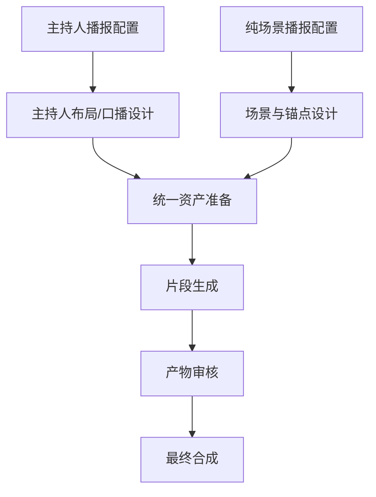
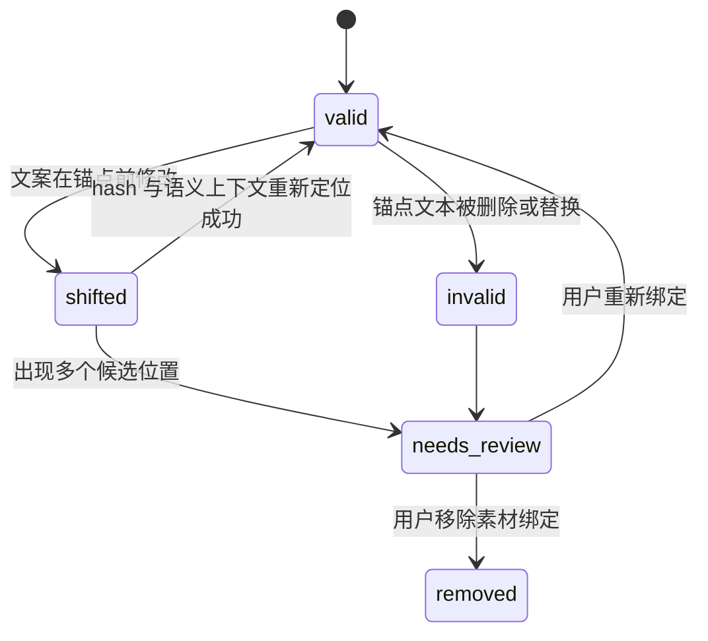
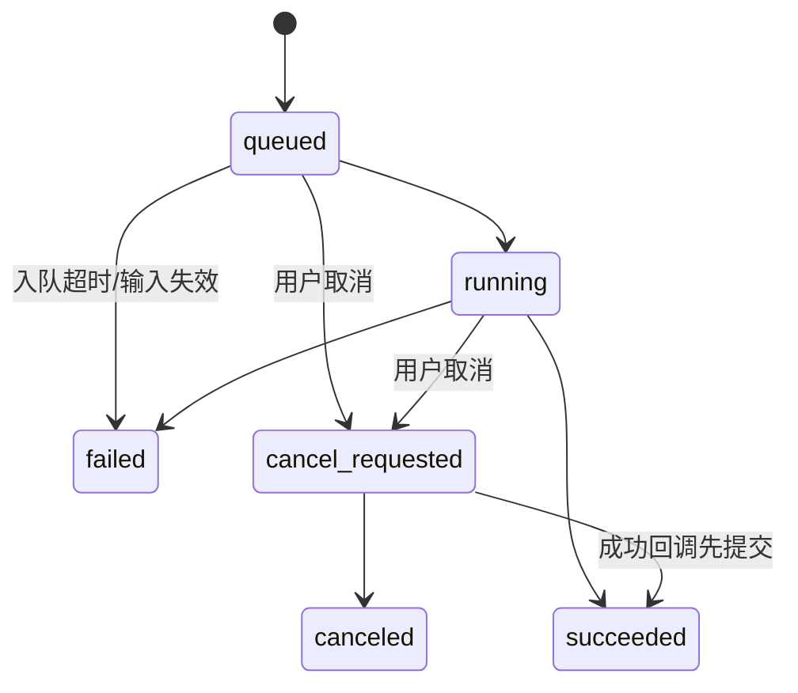
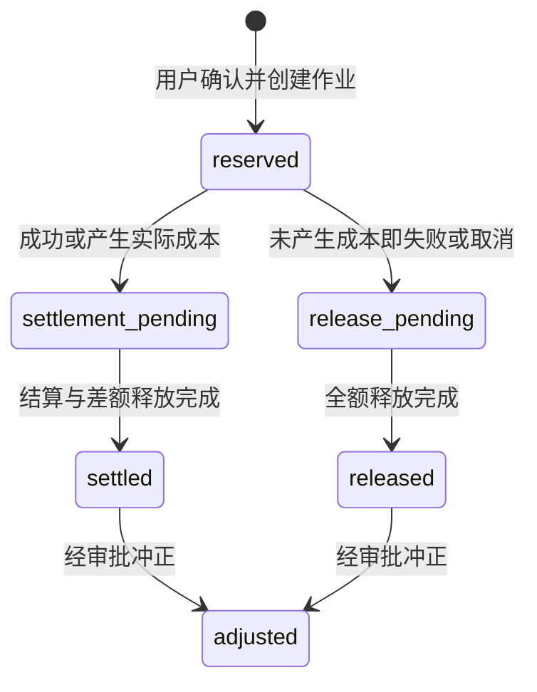

# 新闻播报制作流程

## 1. 文档定位

本文定义新闻播报从文案配置、素材上传、阶段化生成到成片交付的完整工作流，供产品、交互、前端、后端、算法、媒体、测试、安全和 AI 开发代理共同使用。本文同时记录当前平台能够被离线证据支持的事实，以及独立复刻时必须补齐的工程契约。

| 标记 | 含义 | 本文使用方式 |
| --- | --- | --- |
| `E1` | 页面直接实测 | 创建入口、可见字段、默认值、动态显隐和禁用态 |
| `E2` | 网络/API/前端代码证据 | 路由、字段、枚举、读取请求和代码中可见的操作 |
| `E3` | 基于多条证据的合理推断 | 阶段职责、分支产物关系和平台意图 |
| `D` | 独立复刻的目标设计 | 状态机、安全、授权、成本、API、可观测性和验收要求 |
| `U` | 当前证据不足 | 未执行的创建、取消、成功详情、最终下载和发布能力 |

未经标记的“必须”“不得”“应”均表示复刻产品要求，不代表原站已实现。

### 1.1 证据边界

- `E1` 创建新闻播报的配置入口、字段、默认值和部分动态显隐有直接页面证据。
- `E2` 新闻播报详情路由、七阶段枚举、运行中取消控件、图片/视频/最终产物结构来自前端代码；这些只能证明当前前端包含对应能力。
- `E2` 网络证据确认两个无参数读取请求：`GET /v3api/scripts/news-broadcast/jobs` 和 `GET /v3api/scripts/news-broadcast/readiness`。
- 代表证据为 `EV-NEWS-CONFIG-01`、`EV-NEWS-CONFIG-02`、`EV-NEWS-DISCOVERY-01`；七阶段、取消控件和产物结构引用 `EV-CODE-NEWS-01`，其原始 bundle 未留存，不能升级为页面成功实测。
- `U` 未保留成功任务详情、七阶段实际运行日志或最终视频响应；未执行创建、取消、审核、下载和发布。
- `U` 作业详情、阶段重试、取消与最终产物 API 的精确路径和响应契约未确认。

因此，本文不会把七阶段、成功预览、取消或下载写成完整 `E1` 实测闭环。复刻实现应以本文 `D` 契约为目标，并通过测试环境重新验证 `U` 项。

## 2. 目标、适用场景与能力边界

### 2.1 业务目标

新闻播报是一条配置较少、自动化程度较高的模板生产线。它需要把一段新闻文案稳定转换为：

1. 不可变的创建配置快照；
2. 可追踪的文案分析和视觉设计结果；
3. 可授权、可审核的主持人、声音和场景素材；
4. 具有文案锚点的镜头或场景计划；
5. 可取消、可重试、可结算的多阶段生成作业；
6. 可诊断的图片、音频和视频中间产物；
7. 经过质量与内容审核的最终视频；
8. 可验证、可下载、可审计的交付记录。

### 2.2 两种播报模式

| 模式 | 主要画面 | 必需输入 | 可选输入 | 核心风险 |
| --- | --- | --- | --- | --- |
| 主持人播报 `host` | 数字主持人或主持人形象主导 | 新闻文案、分辨率、画幅、主持人性别 | 主持人图、固定音色、英雄场景；身份/服装锁定为帮助文案提示 | 肖像与声音授权、口型同步、身份漂移 |
| 纯场景播报 `scene_only` | 新闻场景、图片或视频素材主导 | 新闻文案、分辨率、画幅 | 场景素材、文案锚点、英雄场景、固定音色 | 素材版权、锚点漂移、画面与文案错配 |

`E1` 创建入口明确提供“主持人播报 / 纯场景播报”切换。`E3` 两个分支共用文案分析、视频生成、审核和最终合成能力，但视觉设计与资产准备策略不同。

### 2.3 虚构示例

本文使用虚构栏目《云港早报》和虚构文案说明流程。示例中的地点、主持人、素材和事件均为构造数据，不对应任何真实平台项目或新闻事件。

### 2.4 当前能力边界

- `E1/E2` 当前证据支持创建配置入口、模式分支、分辨率、画幅、主持人、固定音色、英雄场景和纯场景素材锚点等能力；身份/服装锁定仅有帮助文案提示，上传后的实际控件为 U。
- `E2` 当前构建包含七阶段、阶段产物和最终视频的前端表示，但成功链路未实测。
- `E1/E2` 当前构建未发现独立字幕编辑、背景音乐轨、转场、调色、文字叠加或专业多轨混音。
- `U` 未确认正式发布、渠道分发、水印和外部审核回调是否存在。
- `D` 复刻首版应把未观察到的编辑能力列为独立范围，不得暗示原站已经提供专业非线性编辑器。

## 3. 端到端流程总览


### 3.1 两个分支的汇合点



### 3.2 关键质量门

| 质量门 | 进入条件 | 退出条件 | 阻断原因 |
| --- | --- | --- | --- |
| G1 配置可提交 | 文案和模式已选择 | 字段组合通过客户端与服务端校验 | 空文案、不支持的枚举、动态字段残留 |
| G2 素材可使用 | 上传已完成 | 媒体探测、安全、版权与授权通过 | MIME 伪造、病毒、无授权、转码失败 |
| G3 作业可创建 | 就绪性检查通过 | 价格确认、积分预占和作业原子创建 | 余额不足、配额不足、幂等冲突 |
| G4 文案可设计 | 配置快照冻结 | 文案片段、时长和锚点版本稳定 | 内容安全失败、空片段、锚点歧义 |
| G5 视觉可生成 | 视觉方案和资产提示完成 | 所有必需镜头拥有可执行输入 | 主持人缺失、场景无素材、参数不兼容 |
| G6 产物可合成 | 必需片段生成成功 | 自动和人工审核通过 | 黑帧、无声、口型异常、内容违规 |
| G7 成片可交付 | 合成输入快照完整 | 媒体探测、校验和与下载授权有效 | 源产物过期、编码失败、审核未通过 |

## 4. 阶段 0：打开新闻播报创建入口

### 4.1 入口和默认状态

- `E1` 剧本列表的“新建剧本”弹窗提供“默认 / 新闻播报”类型切换。
- `E1` 切换到新闻播报后显示新闻文案、播报模式和输出配置。
- `E1` 可观察默认值为：主持人播报、720p、16:9、女性、英雄场景片尾。
- `E1` 文案为空时“一键生成”禁用。
- `E1` 关闭弹窗不提交数据。

### 4.2 用户操作

1. 在剧本列表打开新建弹窗；
2. 切换到“新闻播报”；
3. 检查当前个人/团队作用域；
4. 选择主持人播报或纯场景播报；
5. 填写虚构新闻文案；
6. 继续配置输出、素材和授权；
7. 在就绪性与成本确认后提交。

### 4.3 复刻交互要求（D）

- 模式切换必须立即更新字段显隐、必填标记、成本估算和预览摘要。
- 隐藏字段不得继续参与校验或提交；用户返回原模式时可恢复本地草稿，但提交快照只能包含当前模式允许字段。
- 切换模式若会清除已上传文件、锚点或授权声明，必须二次确认。
- 默认值应由组织模板或用户偏好配置，而不是硬编码在多个前端组件中。
- 表单应显示“草稿 / 校验中 / 可提交 / 提交中 / 提交失败”状态，避免重复创建。

## 5. 阶段 1：填写文案并选择模式

### 5.1 新闻文案

| 字段 | 当前证据 | 复刻约束（D） |
| --- | --- | --- |
| `script_text` | `E1/E2` 创建字段存在，空值阻止提交 | 去除首尾空白后非空；服务端限制字符数和编码；保存内容版本与 hash |
| 文案语言 | `U` 未确认显式选择器 | 自动检测后允许用户确认；混合语言需标记片段级语言 |
| 标题 | `U` 未确认独立字段规则 | 可从文案生成建议标题，但创建前允许修改且保留来源 |
| 内容安全 | `U` 未实测 | 提交前和成片前分别检查，保存命中规则与人工复核结果 |

### 5.2 模式切换矩阵

| 字段 | 主持人播报 | 纯场景播报 | 说明 |
| --- | --- | --- | --- |
| 新闻文案 | 显示、必填 | 显示、必填 | 两个模式共用 |
| 分辨率 | 显示、必填 | 显示、必填 | 480p/720p/1080p |
| 画幅 | 显示、必填 | 显示、必填 | 16:9/9:16 |
| 主持人性别 | 显示 | 隐藏 | 女性/男性 |
| 主持人图片 | 显示、可选 | 隐藏 | PNG/JPEG/WebP |
| 身份锁定 | 帮助文案提示 | 隐藏 | `E1` 有提示；上传后的实际控件和提交行为为 U |
| 服装锁定 | 帮助文案提示 | 隐藏 | `E1` 有提示；上传后的实际控件和提交行为为 U |
| 固定音色 | 显示、可选 | 目标设计中可显示 | 原页面在不同模式下的精确显隐为 `U` |
| 场景素材 | 目标设计中可选 | 显示、可添加 | `E2` 纯场景支持图片/视频 |
| 文案锚点 | 目标设计中可选 | 随场景素材显示 | 绑定素材与文案位置 |
| 英雄场景 | 显示 | 显示 | 不使用/片头/片尾 |

`D` 表单逻辑应由服务端返回的能力描述驱动。若某个供应商不支持某种模式、分辨率、画幅或素材组合，前端应在选择时阻止，而不是提交后才报错。

### 5.3 文案版本规则（D）

- 创建作业时固化 `script_text`、规范化文本、内容 hash 和版本号。
- 阶段运行后修改文案必须创建新版本，并先展示受影响的锚点、视觉设计、提示词、音频和视频片段。
- 用户只能选择“保持当前作业”或“基于新文案创建派生作业”，不得在运行中的作业内静默替换输入。
- 文案编辑历史属于业务数据，需遵循租户隔离、审计、保存期限和删除政策。

## 6. 阶段 2：配置输出规格和主持人分支

### 6.1 通用输出字段

| 字段 | 可见值/默认值 | 复刻约束（D） |
| --- | --- | --- |
| `resolution` | `E1/E2` 480p、720p、1080p；默认 720p | 使用能力接口校验模式、画幅、模型和分辨率组合 |
| `ratio` | `E1/E2` 16:9、9:16；默认 16:9 | 映射到明确像素尺寸，不只保存展示字符串 |
| `mode` | `E1/E2` `host` / `scene_only` | 模式切换清理不适用的提交字段 |
| `scope` | `E2` multipart 包含作用域 | 服务端从会话校验所有者或组织权限 |
| `org_id` | `E2` 团队作用域可携带 | 个人作用域忽略；不得信任客户端决定租户 |
| `hero_scene_position` | `E1/E2` none/opening/ending；默认 ending | 三选一；无素材时不得产生空英雄片段 |

### 6.2 主持人字段

| 字段 | 当前证据 | 复刻约束（D） |
| --- | --- | --- |
| `host_gender` | `E1/E2` 女性/男性；默认女性 | 只作为模板筛选，不得推断真实人物身份或敏感属性 |
| `host_image` | `E1/E2` 可选 PNG/JPEG/WebP | 上传后做魔数、病毒、尺寸、透明度、面部数量与内容安全检查 |
| `voice_audio` | `E1/E2` 可选约 10 秒 WAV/MP3 | 校验真实编码、有效语音时长、噪声、说话人数和授权 |
| `lock_identity` | `U`；页面帮助文案提及锁定，未验证上传后控件 | `D` 明确作用于跨镜头身份一致性，失败时阻止或要求确认降级 |
| `lock_outfit` | `U`；页面帮助文案提及锁定，未验证上传后控件 | `D` 记录参考资产版本；不得把服装变化误判为身份变化 |

### 6.3 主持人播报用户流程

1. 保持或选择主持人播报；
2. 选择输出分辨率与画幅；
3. 选择主持人性别模板；
4. 可上传已授权主持人图；
5. 可上传已授权固定音色；
6. 若复刻产品实现该能力，设置身份与服装锁定（D；原站实际控件 U）；
7. 选择英雄场景位置；
8. 查看配置、授权和预计成本摘要；
9. 通过就绪性检查后提交。

### 6.4 主持人分支质量要求（D）

- 主持人图包含零张或多张主要人脸时必须阻止或要求明确选择。
- 人脸裁剪、背景移除或增强不得覆盖原始上传，必须创建派生资产版本。
- 语音生成与口型驱动使用同一个文本片段版本和时间码。
- 每个片段记录身份相似度、服装一致性、口型同步偏差、眨眼/表情异常和音画时长差。
- 身份或服装锁定无法满足时，系统不得静默关闭锁定；应进入审核或失败态。

## 7. 阶段 3：配置纯场景、锚点和英雄场景

### 7.1 纯场景素材

- `E2` 前端代码支持为纯场景模式添加图片或视频素材，并绑定文案锚点。
- `E2` 创建 multipart 可包含多个 `visual_material_files`。
- `U` 未执行上传，未确认单文件大小、数量、编码、视频时长、拖拽排序和删除行为。
- `D` 复刻时应先创建媒体上传会话并生成资产 ID，再使用 JSON 引用创建作业；不建议用一个超大 multipart 同时承担上传、安全扫描和高成本作业创建。

### 7.2 场景素材字段（D）

| 字段 | 类型 | 规则 |
| --- | --- | --- |
| `asset_id` | 稳定媒体 ID | 必须属于同租户、已完成探测且未删除 |
| `media_type` | `image` / `video` | 由服务端媒体探测确定，不信任扩展名 |
| `anchor` | `TextAnchor` | 指向创建文案的特定版本和片段 |
| `usage` | `reference` / `direct_insert` | 参考生成与直接入片必须区分 |
| `fit_mode` | `contain` / `cover` / `crop` | 默认值可按模板配置，裁剪需可预览 |
| `mute_source_audio` | boolean | 视频素材默认策略必须明确 |
| `display_duration` | 秒或自动 | 不得超过源视频可用范围 |
| `rights_declaration_id` | 授权声明 ID | 未授权素材不得进入生成阶段 |

### 7.3 文案锚点模型

```ts
interface TextAnchor {
  script_version: number;
  start_offset: number;
  end_offset: number;
  quoted_text: string;
  quoted_text_hash: string;
  semantic_context_before?: string;
  semantic_context_after?: string;
}
```

`D` 偏移量必须统一按 Unicode code point 或 UTF-16 code unit 定义，并在前后端契约中固定；不能一端按字节、一端按 JavaScript 字符索引。

### 7.4 锚点漂移处理



- `D` 文案变化后先用引用文本 hash 和上下文尝试重定位。
- `D` 唯一匹配可自动更新偏移，但必须记录审计；多匹配或无匹配进入 `needs_review`。
- `D` 存在漂移锚点时禁止创建新作业，运行中的旧作业继续使用原文案快照。
- `D` 用户界面同时高亮原锚点、候选新位置和对应素材，支持重新绑定或移除。

### 7.5 英雄场景

- `E1/E2` 英雄场景位置支持不使用、片头、片尾，默认片尾。
- `E3` 英雄场景用于在正文播报之外增加一个强调片段，但当前证据未确认其素材来源、时长和生成策略。
- `D` 英雄场景必须有独立配置对象，至少包含位置、素材或提示词、时长、声音策略和审核状态。
- `D` `none` 时不得提交残留英雄素材；`opening` 与 `ending` 互斥。
- `U` 未确认是否允许同一作业同时设置片头和片尾；复刻首版按当前三选一语义实现。

## 8. 阶段 4：就绪性、授权与成本预检

### 8.1 当前可观察读取

| 方法与路径 | 证据 | 可支持的结论 | 不能支持的结论 |
| --- | --- | --- | --- |
| `GET /v3api/scripts/news-broadcast/jobs` | `E2` 网络记录 | 存在新闻播报作业列表读取 | 详情字段、分页、完整状态或当前样本成功性 |
| `GET /v3api/scripts/news-broadcast/readiness` | `E2` 网络记录 | 存在新闻播报就绪性读取 | 具体响应字段、是否按组织/配额/供应商聚合 |

这两个请求均为无参数路径。`U` 当前证据不足以确认其查询参数、缓存策略、权限差异和响应结构。

### 8.2 提交前检查（D）

| 检查层 | 检查内容 | 失败处理 |
| --- | --- | --- |
| 表单 | 文案、模式、枚举、动态字段一致 | 定位到字段，不创建作业 |
| 权限 | 作用域、组织、项目、素材访问权 | 返回 403，不泄露资源存在性 |
| 媒体 | MIME、魔数、尺寸、编码、时长、音轨、可解码性 | 隔离文件，提供重新上传入口 |
| 安全 | 病毒、内容安全、提示词注入、真人与声音授权 | 阻断或进入人工复核 |
| 能力 | 模式、分辨率、画幅、供应商、素材组合 | 提供可选兼容组合 |
| 锚点 | 文案版本、偏移、hash、漂移状态 | 要求重新绑定 |
| 资源 | 队列、供应商、存储、配额、并发 | 显示暂不可用和可重试时间 |
| 成本 | 价格版本、预计区间、最大授权额、余额 | 余额不足或用户未确认时阻止 |

### 8.3 两阶段提交（D）

```text
POST /news-broadcast-jobs/estimate
  -> 只读校验并返回 readiness_token、配置摘要、价格快照和过期时间

用户确认模式、素材、授权与最大积分

POST /news-broadcast-jobs
  Idempotency-Key: client-generated-intent-key
  body: { readiness_token, expected_price_version, max_credits }
  -> 原子创建配置快照、积分预占、作业和 outbox 事件
```

- 成本预估不得上传新文件、创建作业或预占积分。
- `readiness_token` 必须绑定用户、租户、配置 hash、素材版本、价格版本和短有效期。
- 确认后配置改变时必须重新预估。
- 重复提交返回同一作业，不重复预占积分。

## 9. 阶段 5：创建作业与进入工作台

### 9.1 当前代码证据

- `E2` 前端创建形态为相对统一客户端基础路径的 `POST /scripts/news-broadcast`，展开后为 `POST /v3api/scripts/news-broadcast`；本轮未执行。
- `E2` 创建使用 multipart，已知字段包括 `request_json`、`scope`、`org_id`、`host_image`、`voice_audio` 和多个 `visual_material_files`。
- `E2` 详情前端路由形态为 `/v3/scripts/{script_id}/news-broadcast/{job_id}`。
- `U` 创建请求未执行，不能承诺成功响应、跳转参数、错误码或积分结果。

### 9.2 推荐请求对象（D）

```ts
interface NewsBroadcastRequest {
  script_text: string;
  mode: "host" | "scene_only";
  resolution: "480p" | "720p" | "1080p";
  ratio: "16:9" | "9:16";
  host_gender?: "female" | "male";
  host_image_asset_id?: string;
  voice_asset_id?: string;
  lock_identity?: boolean;
  lock_outfit?: boolean;
  hero_scene_position: "none" | "opening" | "ending";
  visual_materials: Array<{
    asset_id: string;
    anchor: TextAnchor;
    usage: "reference" | "direct_insert";
  }>;
  scope: "personal" | "team";
  team_id?: string;
}
```

该目标命令与 [05-领域模型与API.md](./05-领域模型与API.md) 的 `CreateNewsBroadcastCommand` 一致；`organization_id` 由服务端认证上下文注入，不接受客户端指定。

### 9.3 创建事务（D）

1. 重新校验会话、租户、作用域和素材所有权；
2. 验证 `readiness_token`、配置 hash 和价格版本；
3. 创建不可变 NewsBroadcastConfigVersion；
4. 创建 Job 和七个 Stage 记录；
5. 写入积分预占流水；
6. 写入 outbox 事件；
7. 同一数据库事务提交；
8. 返回作业 ID、配置摘要、状态和事件游标。

任一步失败都不得留下“有预占无作业”“有作业无配置”或“作业已创建但 worker 永远收不到事件”的孤儿状态。

## 10. 新闻播报工作台与统一作业状态

### 10.1 页面结构

`E2` 前端代码支持如下工作台结构；`U` 未保留完整成功任务的直接页面证据：

```text
[返回] 新闻播报标题                         [状态] [取消]
七阶段进度条
┌────────────────┬────────────────────┬──────────────────┐
│ 配置/文案/锚点   │ 阶段日志与中间产物    │ 选中产物预览/审核    │
└────────────────┴────────────────────┴──────────────────┘
完成态：最终视频预览与下载
```

### 10.2 作业状态机（D）



公开 Job 采用 `queued/running/cancel_requested/succeeded/failed/canceled`。需要人工审核时 Job 仍为 `running`，通过当前 Stage 的 `action_required` 和结构化 action 描述呈现；自动重试新建 Attempt，失败后的人工重试创建带 `retry_of_job_id` 的新 Job，旧 Job 终态不回退。

### 10.3 阶段状态机（D）

每个阶段独立使用权威 `StageStatus`：`pending`、`ready`、`running`、`action_required`、`succeeded`、`failed`、`skipped`、`cancel_requested`、`canceled`、`stale`。

- 上一个阶段成功后，下一个阶段从 `pending` 进入 `ready`。
- 阶段输入快照创建后进入 `running`，成功产物登记后才进入 `succeeded`。
- 需要人工审核时 Stage 进入 `action_required`，Job 保持 `running` 并返回动作类型、截止时间和允许命令。
- 可选阶段只有在明确规则下进入 `skipped`，并保存跳过原因。
- 上游配置版本改变时，下游成功阶段标为 `stale`，历史产物仍保留。

### 10.4 前端刷新策略（D）

- 首选 SSE 或 WebSocket 推送作业事件，断线后从最后事件游标续传。
- 兜底轮询仅在页面可见且作业非终态时启用；运行态可使用有限间隔，长期无变化逐步退避。
- `4xx` 参数或权限错误不自动重试；`429` 和暂时性 `5xx` 遵循 `Retry-After` 与指数退避。
- 多组件订阅同一作业时共享一个查询键和一个在途请求。
- 作业终态、页面离开或用户退出后停止轮询。

## 11. 七阶段输入、输出和恢复点

`E2` 前端代码枚举七个阶段：`preparing`、`copy_analysis`、`visual_design`、`asset_prompting`、`video_generation`、`artifact_review`、`final_assembly`。`E3` 以下阶段职责由代码枚举、创建字段和产物结构综合推导；表中输入、输出、失败和恢复点均为复刻契约 `D`，阶段实际成功执行仍为 `U`。

### 11.1 `preparing`：准备

| 项目 | 内容 |
| --- | --- |
| `D` 输入 | 配置版本、文案版本、素材 ID、授权声明、能力和价格快照 |
| `E3` 可能处理 | 解析配置、复制/固定素材、媒体探测、供应商路由、生成阶段计划 |
| `D` 输出 | 规范化配置、可执行计划、素材清单、风险清单、预计阶段成本 |
| `D` 失败 | 素材失效、授权撤回、供应商不可用、配置与能力不兼容 |
| `D` 恢复点 | 修正配置后创建新作业；同输入的暂时性故障可重试当前阶段 |

`D` 此阶段不得重新信任客户端上传元数据。所有素材都要从媒体服务读取已验证的真实编码、尺寸、时长和授权状态。

### 11.2 `copy_analysis`：文案分析

| 项目 | 内容 |
| --- | --- |
| `D` 输入 | 规范化文案、语言、目标时长与播报模式 |
| `E3` 可能处理 | 分句、主题提取、节奏估算、播报段落划分、场景候选和锚点对齐 |
| `D` 输出 | CopySegment 列表、预计口播时长、关键词、敏感项、锚点解析结果 |
| `D` 失败 | 空有效内容、语言不支持、内容安全阻断、片段时长不可满足 |
| `D` 恢复点 | 文案不变的暂时性错误由系统自动创建新 Attempt；Job 终态后的人工重试创建新 Job；文案变化时新建版本并使下游 stale |

`D` 每个 CopySegment 至少包含稳定 ID、原文范围、规范化文本、语言、预计时长、语气、重音、素材锚点和内容安全状态。

### 11.3 `visual_design`：视觉设计

| 项目 | 内容 |
| --- | --- |
| `D` 输入 | CopySegment、模式、画幅、分辨率、主持人和场景配置 |
| `E3` 可能处理 | 片段布局、镜头顺序、主持人景别、场景匹配、英雄场景位置 |
| `D` 输出 | VisualPlan、镜头/片段列表、素材用途、时长、构图安全区 |
| `D` 失败 | 锚点歧义、素材不足、总时长冲突、竖屏/横屏布局不可用 |
| `D` 恢复点 | 用户修正锚点或替换素材后创建派生 Job，不把输入变化伪装成 Attempt 重试 |

`D` 主持人分支应输出人物占位、景别、口型片段和背景策略；纯场景分支应输出场景素材与文案片段的映射。两个分支最终都转换为稳定的 VisualSegment 列表。

### 11.4 `asset_prompting`：资产提示与准备

| 项目 | 内容 |
| --- | --- |
| `D` 输入 | VisualPlan、正式素材版本、主持人和音色配置 |
| `E3` 可能处理 | 编译图像/视频/语音提示词，准备参考图、场景、音频与生成参数 |
| `D` 输出 | 每个片段不可变的 GenerationInput、提供商能力匹配和成本明细 |
| `D` 失败 | 提示词安全阻断、参考素材超限、声音不可用、模型能力不匹配 |
| `D` 恢复点 | 只重做失败片段；成功输入快照保持不变 |

`D` 提示词编译要保留结构化源字段和编译结果，不能只保存不可解释的拼接字符串。主持人图、声音和场景素材均引用具体资产版本。

### 11.5 `video_generation`：视频生成

| 项目 | 内容 |
| --- | --- |
| `D` 输入 | GenerationInput 列表、提供商路由、价格快照和幂等键 |
| `E2` 前端可见结构 | 图片、视频片段和场景/参考素材产物 |
| `D` 输出 | 每片段一个或多个 VideoArtifact、音频、封面、时长和供应商任务映射 |
| `D` 失败 | 限流、超时、内容安全、口型生成失败、存储失败、部分片段失败 |
| `D` 恢复点 | 只重试失败片段；外部任务超时先查询，不盲目重复创建 |

- `D` 每个片段拥有独立幂等键、attempt 和积分分项。
- `D` 部分成功应保留成功产物，页面明确显示“成功数量 / 失败数量 / 待处理数量”。
- `D` 用户可对失败片段发起人工重试、替换输入或明确放弃；人工重试创建带 `retry_of_job_id` 的新 Job，放弃后是否允许最终合成由模板规则决定。

### 11.6 `artifact_review`：产物审核

| 项目 | 内容 |
| --- | --- |
| `D` 输入 | 图片、音频、视频片段、文案和授权快照 |
| `E2` 前端可见结构 | 产物预览和审核表示 |
| `D` 自动检查 | 黑帧/静帧、时长、分辨率、音轨、响度、口型、画面安全区、内容安全 |
| `D` 人工检查 | 文案准确、画面相关、肖像/声音符合授权、无明显生成缺陷 |
| `D` 输出 | 每产物审核结论、问题码、审核人和可用于合成的正式版本 |
| `D` 失败 | 自动阻断、人工驳回、授权撤回、产物损坏 |
| `D` 恢复点 | 驳回具体片段回到资产准备或视频生成，不重做全部作业 |

`U` 未实测原站是否要求人工审核、审核角色和自审限制。`D` 复刻产品应将“算法质量检查”和“人工内容审核”建模为独立结果，不能用一个布尔值覆盖。

### 11.7 `final_assembly`：最终合成

| 项目 | 内容 |
| --- | --- |
| `D` 输入 | 审核通过的片段版本、顺序、声音、英雄场景和输出规格 |
| `E2` 前端可见结构 | 最终视频产物、预览和下载表示 |
| `D` 处理 | 固化合成清单、转码、音画同步、拼接、媒体探测、生成封面和校验和 |
| `D` 输出 | FinalVideoArtifact、媒体报告、下载授权和完整来源清单 |
| `D` 失败 | 源产物失效、编码失败、音画不同步、对象存储失败、最终安全审核失败 |
| `D` 恢复点 | 输入未变时只重试合成；输入改变时创建新合成版本 |

`U` 未执行最终合成、预览或下载，不能承诺原站服务端确实完成上述处理。上述合成契约是复刻产品的目标设计。

## 12. 主持人和纯场景的阶段差异

| 阶段 | 主持人播报 | 纯场景播报 |
| --- | --- | --- |
| preparing | 校验主持人图、固定音色、身份/服装授权 | 校验场景素材、锚点、裁剪和版权 |
| copy_analysis | 按口播节奏切分，估算口型驱动时长 | 按场景切换和素材锚点切分 |
| visual_design | 设计主持人景别、背景、构图和英雄片段 | 设计场景顺序、素材用途和英雄片段 |
| asset_prompting | 编译主持人一致性、声音和背景输入 | 编译场景生成/插入、旁白和过渡输入 |
| video_generation | 生成主持人视频、口型和声音片段 | 生成或处理场景视频及旁白 |
| artifact_review | 检查身份、服装、口型、发音与画面 | 检查锚点相关性、版权、裁剪和旁白同步 |
| final_assembly | 拼接主持人片段、背景和英雄场景 | 拼接场景片段、旁白和英雄场景 |

`E3` 表中差异是由模式字段、上传字段和七阶段综合推导。`D` 实现时应复用同一 Job/Stage/Artifact 基础设施，只在策略和检查器层分支，避免维护两套互不兼容的作业系统。

## 13. 产物、版本与审核模型

### 13.1 产物类型（D）

| 类型 | 用途 | 最低元数据 |
| --- | --- | --- |
| CopyAnalysisArtifact | 文案片段和节奏 | 文案版本、片段范围、语言、时长、分析模型 |
| VisualPlanArtifact | 镜头/场景设计 | 模式、画幅、片段顺序、锚点、素材版本 |
| PromptArtifact | 可执行生成输入 | 结构化字段、编译提示词、模型和能力版本 |
| ImageArtifact | 主持人、背景或参考图 | 尺寸、格式、来源、内容安全、授权 |
| AudioArtifact | 固定音色派生或播报音频 | 编码、采样率、时长、说话人、授权 |
| VideoArtifact | 单个播报/场景片段 | 编码、分辨率、帧率、时长、音轨、封面 |
| ReviewArtifact | 自动/人工审核结论 | 规则版本、问题码、审核人、时间和决定 |
| FinalVideoArtifact | 最终可交付视频 | 合成清单、校验和、媒体报告、审核状态 |

### 13.2 版本规则（D）

- 产物不可原地覆盖；修复、裁剪、转码、重新生成均创建新版本。
- 每个产物记录来源阶段、输入快照、模型/供应商、attempt、创建者和内容 hash。
- 被后续阶段引用的产物只能归档，删除前必须检查引用。
- 最终视频引用具体片段版本和顺序，不引用“最新产物”。
- 下载 URL 是短期授权，不作为稳定业务字段持久化。

### 13.3 审核决定（D）

`pending -> auto_passed / auto_blocked -> human_approved / human_rejected -> superseded`

- 自动通过不等同于人工批准；模板可按风险决定是否必须人工审核。
- 驳回必须关联问题码、可读说明和回退阶段。
- 审核员不能通过修改 URL 审核其他租户产物。
- 是否允许生成者自审由组织策略决定，并写入审计事件。

## 14. 取消、重试和阶段回退

### 14.1 当前证据边界

- `E2` 前端代码包含运行中取消按钮和原生确认。
- `U` 未实际点击取消，未确认取消 API 路径、服务端终态、供应商中止能力和积分结果。
- `E2` 阶段和产物结构支持展示进度，但未保留阶段失败后重试的直接页面证据。

### 14.2 取消语义（D）

| 作业状态 | 取消行为 | 积分处理 |
| --- | --- | --- |
| queued | CAS 进入 `cancel_requested` 后快速收敛到 `canceled`，不调用任何供应商 | 全额释放预占 |
| running | 进入 cancel_requested，停止未开始阶段并请求取消可中止的外部任务 | 已发生的不可逆成本结算，其余释放 |
| running + Stage `action_required` | 请求取消后终止后续合成，保留已有诊断产物 | 已完成阶段结算，其余释放 |
| succeeded/failed/canceled | 不允许再次取消 | 不新增账本动作 |

- 取消命令幂等，重复点击返回同一状态。
- 排队态取消可在同一事务内快速完成两步转移，但必须保留 `cancel_requested` 状态事件和审计，不能表现为未经过取消请求。
- 页面关闭、断网或退出登录不等于取消。
- 取消确认必须展示已完成阶段、可能无法撤回的外部成本和保留产物。
- 临时对象清理采用可重试后台任务，不阻塞作业进入 canceled；清理失败需告警。

### 14.3 重试语义（D）

- 同一输入的暂时性错误由系统在 Job 终态前自动创建新 Attempt，从最近成功检查点继续。
- Job 已进入失败终态后，用户重试创建带 `retry_of_job_id` 的新 Job，不开放直接创建 Attempt 的外部命令。
- 用户修改文案、模式、素材、锚点或输出规格时创建派生作业，不冒充原重试。
- 外部供应商超时先按幂等键查询已有任务，避免重复生成和重复扣费。
- 不可重试错误只显示修正入口，不显示无效“重试”按钮。
- 每个 attempt 独立记录错误、耗时、供应商请求和积分，用户可查看完整链路。

### 14.4 阶段回退矩阵（D）

| 问题 | 回退到 | 保留内容 |
| --- | --- | --- |
| 文案片段错误 | copy_analysis | 原配置、素材与旧分析版本 |
| 锚点错配 | visual_design | 文案分析和未受影响锚点 |
| 提示词或素材不兼容 | asset_prompting | 视觉计划与正式素材 |
| 单片段生成失败 | video_generation | 其他成功片段 |
| 口型/画面审核失败 | asset_prompting 或 video_generation | 审核问题和未受影响片段 |
| 最终编码失败 | final_assembly | 全部审核通过片段和合成清单 |

## 15. 积分预占、结算与释放

### 15.1 账务状态（D）

成本估算 `CostEstimate` 不是账务状态。作业创建成功后使用与 05/07 一致的独立 `BillingState`：



### 15.2 结算原则（D）

- 价格快照至少按阶段、模型、分辨率、时长和片段数拆分。
- 预占只发生一次；每阶段或片段的结算序号唯一。
- 使用正数金额时满足“从预占结算 + 已释放 + 仍冻结 = 原预占”；带符号 delta 只用于账本投影。
- 部分成功、取消或不可逆供应商成本必须使用公开政策，不由 worker 临时决定。
- 作业失败不直接修改余额；所有变化通过可审计账本流水完成。
- 账本补偿失败必须进入高优先级告警和人工修复队列。
- Job 终态与 BillingState 独立；计费 Job 在 `settlement_pending/release_pending` 期间保持产物结算锁，并以 99.99% 在 60 秒内收敛为 SLO。非计费 Job 使用 `not_required`、不创建 Reservation 且不进入该指标分母。

### 15.3 用户可见信息（D）

- 创建前：预计区间、最大授权额、余额影响和价格有效期；
- 运行中：已冻结、已结算、仍可能消耗和各阶段明细；
- 失败/取消后：已消耗、已释放、释放时间和关联作业；
- 完成后：最终结算、模型/阶段汇总和可审计流水链。

## 16. 肖像、声音、版权和内容安全

### 16.1 主持人肖像授权（D）

- 上传人必须声明本人、组织授权、许可素材或合成形象来源。
- 高风险真人形象要求授权证明、用途、地域、期限和撤回方式。
- 不允许上传未成年人或敏感人物形象，除非符合专门政策和法律审核。
- 人脸 embedding 与原图分开加密保存，使用范围和保留期限最小化。
- 授权撤回后阻止新作业，并按政策处理历史产物与已发布副本。

### 16.2 固定音色授权（D）

- 约 10 秒只是页面提示，不足以替代声音质量和授权校验。
- 上传时记录说话人声明、授权证据、许可范围、语言、采样质量和撤回状态。
- 检测多说话人、音乐、噪声、合成音频和伪造风险。
- 生成音频和最终视频应携带可追溯标记或水印策略，具体对外披露由合规规则决定。

### 16.3 新闻内容安全（D）

- 输入层：恶意内容、违法内容、隐私、诽谤、错误归因和提示词注入；
- 素材层：病毒、版权、真人、商标、地理与敏感画面；
- 模型输出层：事实篡改、人物错配、画面中的伪造文字、异常口型和不当画面；
- 成片层：文案、声音、画面和元数据整体复审；
- 发布层：渠道政策、地区限制、审计与下架机制。

`U` 原站这些审核门均未实测。复刻产品必须把规则版本、证据、决定和复核人持久化，不能只显示一次 Toast。

## 17. API 关联与推荐契约

### 17.1 当前证据端点

| 方法 | 路径 | 证据与边界 |
| --- | --- | --- |
| GET | `/v3api/scripts/news-broadcast/jobs` | `E2` 已观察无参数读取；响应结构未确认 |
| GET | `/v3api/scripts/news-broadcast/readiness` | `E2` 已观察无参数读取；响应结构未确认 |
| POST | `/v3api/scripts/news-broadcast` | `E2` 前端代码可见；未执行，成功请求/响应未知 |
| GET | `/v3/scripts/{script_id}/news-broadcast/{job_id}` | `E2` 前端页面路由，不是 API |

### 17.2 推荐资源 API（D）

以下省略前缀的目标路径均相对 `/api/v1`。

| 方法 | 路径/条件 | 单请求能力码 | 用途 |
| --- | --- | --- | --- |
| POST | `/media-upload-sessions` | `asset.item.upload` | 获取主持人、声音或场景素材上传会话 |
| POST | `/news-broadcast-jobs/estimate` | `news.workflow.estimate` | 就绪性与成本预估，不创建作业 |
| POST | `/news-broadcast-jobs` | `news.workflow.create` | 幂等创建作业、配置快照和积分预占 |
| GET | `/jobs?job_type=news_broadcast` | `news.workflow.read` | 通过统一 Job API 按作用域、状态、时间游标分页查询 |
| GET | `/jobs/{job_id}` | `news.workflow.read` | 通过统一 Job API 获取配置摘要、总状态、阶段、账务和权限动作 |
| GET | `/news-broadcast-jobs/{job_id}/artifacts` | `news.artifact.read` | 分页获取阶段产物和审核状态 |
| POST | `/news-broadcast-jobs/{job_id}/stages/{stage_key}/actions` | `news.stage.resolve` | 处理 `action_required` 门禁，使用 `If-Match` 和幂等键 |
| POST | `/jobs/{job_id}/cancel` | `news.workflow.cancel` | 通过统一 Job API 幂等请求取消 |
| POST | `/jobs/{job_id}/retries` | `news.workflow.retry` | 通过统一 Job API 从失败 Job 创建新 Job，返回新 ID 和 `retry_of_job_id` |
| POST | `/news-broadcast-artifacts/{artifact_id}/reviews`，`decision=approve` | `review.item.approve` | 提交通过结论 |
| POST | `/news-broadcast-artifacts/{artifact_id}/reviews`，`decision=reject` | `review.item.reject` | 提交带结构化理由的驳回结论 |
| POST | `/news-broadcast-jobs/{job_id}/assemblies` | `news.assembly.create` | 基于正式片段创建合成版本 |
| POST | `/news-broadcast-final-videos/{artifact_id}/download-grants` | `video.render.download` | 创建短期下载授权 |

新闻域只负责创建、估算、阶段产物、审核和合成命令；Job 查询、Attempt 读取、事件、取消和人工重试必须复用统一 `/jobs` API、同一能力校验及同一幂等命名空间，不允许建立旁路。

### 17.3 标准响应要求（D）

- 所有资源返回稳定 ID、租户、版本、状态和服务端时间。
- 创建、取消和人工重试命令使用 HTTP `Idempotency-Key`；普通资源修改使用 HTTP `If-Match`，工作流命令集合在请求体使用 `base_version`，两者不重复表达同一版本。
- `409` 表示版本或幂等负载冲突，`422` 返回字段级问题，`429` 返回重试时间。
- 错误不得包含模型密钥、内部存储键、签名 URL 或其他租户信息。
- 列表使用游标分页；作业详情不在每次轮询中重复返回大型二进制或完整日志。

## 18. 下游失效矩阵

| 上游变更 | 必须重新评估 | 不应自动删除 |
| --- | --- | --- |
| 新闻文案 | 分段、锚点、视觉计划、语音、视频和合成 | 旧文案与历史成片 |
| 播报模式 | 全部视觉设计、素材提示、视频片段 | 原模式作业和产物 |
| 分辨率/画幅 | 构图、素材兼容、视频和合成 | 原分辨率成片 |
| 主持人图片 | 身份/服装一致性和后续主持人片段 | 旧主持人资产与历史片段 |
| 固定音色 | 播报音频、口型和所有含音频片段 | 旧音频与历史成片 |
| 身份/服装锁定 | 视觉设计和主持人生成输入 | 旧锁定策略下的产物 |
| 场景素材 | 对应锚点、视觉片段和合成 | 未受影响素材与片段 |
| 锚点 | 对应 VisualSegment 和后续产物 | 其他有效锚点 |
| 英雄场景位置/内容 | 英雄片段和最终合成顺序 | 正文播报片段 |
| 审核决定 | 是否可进入合成 | 被驳回产物及证据 |

## 19. 风险清单与复刻对策

| 风险 | 证据/来源 | 影响 | 复刻对策（D） |
| --- | --- | --- | --- |
| 把代码可见当成实测成功 | 新闻详情和最终产物主要为 `E2/U` | 需求与验收失真 | 保留证据等级，成功链路单独补测 |
| 大 multipart 原子性差 | `E2` 创建同时带 JSON 和多个文件 | 超时、重复上传、孤儿文件 | 上传会话与作业创建分离 |
| 模式切换残留字段 | 动态表单包含两套分支 | 提交不兼容配置 | schema 按 discriminated union 校验 |
| 文案锚点漂移 | 文案可编辑且素材绑定位置 | 素材与播报错配 | 版本 + hash + 语义上下文 + 人工确认 |
| 肖像/声音滥用 | 主持人图与固定音色上传 | 合规、冒用和声誉风险 | 授权证明、撤回、审计、水印和审核 |
| 长流程重复扣费 | 七阶段含多个外部调用 | 重试导致重复成本 | 阶段幂等、外部任务查询、账本唯一约束 |
| 取消语义模糊 | `E2` 仅见取消控件，未实测 | 用户误以为立即退款 | 显示 cancel_requested、不可逆成本和最终结算 |
| 部分成功被整体覆盖 | 多片段并行生成 | 浪费成功产物 | 片段级 attempt、产物不可变、检查点恢复 |
| 高频轮询 | 长作业需持续刷新 | 流量和后端压力 | 事件推送、可见性检测、退避和去重 |
| 签名地址泄露 | 图片/音频/视频预览 | 未授权长期访问 | 私有桶、短期授权、服务端权限检查 |
| 最终成片不可复现 | 若只保存输出 URL | 无法审计或重做 | 固化输入清单、模型、审核和媒体报告 |

## 20. 验收场景

| 编号 | 场景 | 验收结果 |
| --- | --- | --- |
| NEWS-001 | 打开新闻播报创建入口 | 显示新闻字段，默认值与组织模板一致 |
| NEWS-002 | 文案为空 | 一键生成禁用，服务端同样返回字段错误 |
| NEWS-003 | 切换到纯场景 | 主持人专属字段隐藏且不进入提交体 |
| NEWS-004 | 切回主持人 | 本地草稿可恢复，提交快照只含主持人字段 |
| NEWS-005 | 选择不支持的分辨率/画幅组合 | 提交前阻止并列出兼容组合 |
| NEWS-006 | 上传伪装图片 | 魔数与解码校验失败，文件隔离且不创建作业 |
| NEWS-007 | 主持人图含多张人脸 | 要求选择主要人脸或重新上传 |
| NEWS-008 | 固定音色含多说话人 | 阻止使用并说明质量/授权问题 |
| NEWS-009 | 未确认肖像或声音授权 | 高成本提交按钮禁用 |
| NEWS-010 | 纯场景添加图片和视频 | 每项拥有稳定 ID、排序、用途和锚点 |
| NEWS-011 | 文案在锚点之前插入文字 | 唯一匹配时更新偏移并记录审计 |
| NEWS-012 | 锚点原文被删除 | 标记 needs_review，禁止新作业 |
| NEWS-013 | 英雄场景选择片头 | 片尾值被清除，合成清单只插入片头 |
| NEWS-014 | 英雄场景选择不使用 | 不提交残留英雄素材或生成空片段 |
| NEWS-015 | 就绪性检查失败 | 不创建作业、不预占积分，错误定位到检查层 |
| NEWS-016 | 成本预估过期 | 确认提交返回冲突并要求重新预估 |
| NEWS-017 | 双击一键生成 | 只创建一个作业和一笔预占 |
| NEWS-018 | 创建事务中断 | 不留下孤儿作业、孤儿预占或不可达事件 |
| NEWS-019 | 刷新运行中工作台 | 从服务端恢复总状态、阶段和事件游标 |
| NEWS-020 | 运行中页面隐藏 | 停止高频轮询，恢复可见时补取缺失事件 |
| NEWS-021 | `copy_analysis` Attempt 因暂时性错误失败且未耗尽自动重试 | 保留配置和素材；系统在同一 Job 下创建新 Attempt |
| NEWS-022 | 单个视频片段 Job 失败 | 其他成功片段保留；人工重试只为失败片段创建带 `retry_of_job_id` 的新 Job |
| NEWS-023 | 供应商超时但外部任务已创建 | 先查询外部任务，不重复生成和扣费 |
| NEWS-024 | 身份锁定无法满足 | 不静默降级，进入审核或失败态 |
| NEWS-025 | 产物自动审核阻断 | 显示问题码、证据和可回退阶段 |
| NEWS-026 | 人工驳回一个片段 | 回退该片段，其他正式片段不失效 |
| NEWS-027 | 排队中取消 | 依次记录 `cancel_requested -> canceled`，不调用供应商，释放全部预占且不重复释放 |
| NEWS-028 | 运行中取消 | 先进入 cancel_requested，结算不可逆成本并释放余额 |
| NEWS-029 | 重复取消 | 返回同一终态，不重复释放积分 |
| NEWS-030 | 最终合成失败 | 保留正式片段和合成清单，只重试合成 |
| NEWS-031 | 成片媒体探测失败 | 不开放下载，显示可诊断错误 |
| NEWS-032 | 下载授权过期 | 重新鉴权生成新短期授权，不暴露永久地址 |
| NEWS-033 | 跨租户读取作业或产物 | 返回 404 或策略化 403，不泄露内容 |
| NEWS-034 | 撤回主持人授权 | 阻止新作业并按政策处理历史产物 |
| NEWS-035 | 当前未观察到的编辑能力 | 不显示字幕、音乐、转场、调色或发布的虚假可用态 |

## 21. 可观测性与运行指标（D）

### 21.1 事件和日志

每个作业、阶段和片段使用同一 trace 关联，并记录：租户、业务作业、attempt、阶段、提供商任务、输入版本、价格版本、积分流水、产物和审核决定。日志不得记录完整新闻文案、原始声音、面部特征、签名 URL、Cookie 或模型密钥。

### 21.2 指标

- 创建就绪率、创建幂等命中率和创建事务失败率；
- 各阶段排队时间、运行时间、成功率、取消率和重试次数；
- 模式、分辨率、画幅和供应商维度的成功率；
- 片段部分失败率、审核驳回率和最终合成失败率；
- 预占、结算、释放不守恒数量；
- 锚点漂移率、自动重定位成功率和人工修正率；
- 主持人身份/服装/口型质量异常率；
- 每作业轮询请求数、`4xx` 重试数和事件推送断线率；
- 临时对象清理积压、下载授权失败和过期产物数量。

### 21.3 告警

- 作业长期停留 running 或 cancel_requested；
- 阶段成功但产物不存在；
- 供应商成功但内部状态未结算；
- 账本预占长期未结算/释放；
- 同一幂等键产生多个外部任务；
- 某租户或查询键请求频率异常；
- 授权撤回后仍创建新作业；
- 最终视频开放下载但审核未通过。

## 22. 测试分层（D）

| 层级 | 重点 |
| --- | --- |
| 单元 | discriminated union 表单、锚点偏移、阶段状态机、积分守恒、媒体规则 |
| 属性测试 | 任意文案编辑后的锚点不越界；账本始终守恒；阶段版本单调 |
| 契约 | 创建、详情、取消、重试、审核、下载授权和 Provider adapter |
| 集成 | 数据库 + outbox + 队列 + worker + 对象存储 + 账本 |
| 故障注入 | worker 崩溃、外部超时、回调重复、存储失败、取消竞态、账本死锁 |
| 端到端 | 主持人播报、纯场景播报、部分失败、取消、授权撤回和跨租户拒绝 |
| 媒体质量 | 多编码、可变帧率、无音轨、黑帧、响度、口型和最终探测 |
| 安全 | 文件上传、IDOR、SSRF、签名 URL、恶意文案、肖像和声音滥用 |
| 性能 | 超长文案、大量素材、并行片段、事件风暴和批量作业列表 |

真实昂贵模型只用于受控沙箱冒烟；持续集成使用契约模拟器、确定性媒体样本和可注入故障的假供应商。

## 23. 未验证与立项决策（U）

- 作业列表和 readiness 的完整响应字段、缓存、分页、权限与错误码；
- 创建接口的真实成功响应、最大文件/文案限制和服务端默认值；
- 新闻播报详情、取消、阶段重试、审核和最终产物 API 的精确路径；
- 七阶段每一阶段的原站真实输入、输出、耗时、失败码和检查点；
- 固定音色在纯场景模式下的精确显隐与默认旁白策略；
- 主持人性别、身份锁定和服装锁定对具体模型的实际效果；
- 英雄场景的素材来源、默认时长和是否支持同时片头/片尾；
- 场景素材数量、大小、编码、排序、裁剪和源音频策略；
- 原站是否存在人工审核、审核角色、自审限制和内容安全服务；
- 取消对供应商任务和积分的真实行为；
- 最终合成、预览、下载、水印、保存期限和正式发布能力；
- 字幕、背景音乐、转场、调色、文字叠加和多轨音频的产品计划；
- 多人协作、锁、版本冲突、评论、通知、移动端和无障碍表现。

这些 `U` 项必须在复刻立项时转化为明确的产品决策、接口契约和测试计划。不能因为前端代码存在某个按钮或产物类型，就把未执行的成功行为写成已验证事实。

## 24. 相关文档

- 研究边界与证据等级：[00-研究方法与证据索引.md](./00-研究方法与证据索引.md)
- 产品范围与优先级：[01-产品需求文档-PRD.md](./01-产品需求文档-PRD.md)
- 页面布局与交互：[02-页面与功能规格.md](./02-页面与功能规格.md)
- 普通漫剧生产链：[03-普通漫剧制作流程.md](./03-普通漫剧制作流程.md)
- 领域对象与接口：[05-领域模型与API.md](./05-领域模型与API.md)
- 技术架构与 AI 编排：[06-技术架构与AI编排.md](./06-技术架构与AI编排.md)
