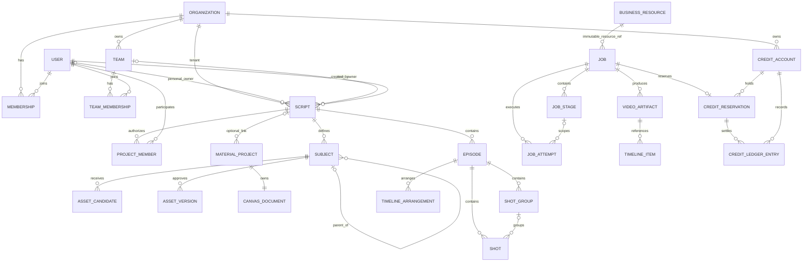

# 领域模型与 API 规格

## 1. 文档约定

- `E1/E2` 表示原站可观察事实；`D` 表示复刻目标契约；`U` 表示未验证。
- 示例 ID、标题、金额和存储键均为虚构值。
- 原站 API 基础路径为 `/v3api`（E2），第 5 节路径均相对该前缀。目标 API 统一使用 `/api/v1`（D）；第 6 节省略前缀的路径均相对 `/api/v1`。
- 调研没有主动调用写接口。标为写操作的端点来自前端调用代码、已存在业务数据的自然请求，或已披露的两次意外写请求。
- 静态代码端点统一引用 `EV-CODE-SCRIPT-01`、`EV-CODE-CANVAS-01`、`EV-CODE-VIDEO-01`、`EV-CODE-NEWS-01`、`EV-CODE-CREDIT-01`；原始 bundle 未留存，这些编号只证明前端含调用模板。
- 下表中的“建议响应”属于 `D`，不表示原站逐字返回相同格式。

## 2. 领域边界



`BUSINESS_RESOURCE` 是 ER 图中的概念联合，不是新增业务表；它由 Job 的 `resource_type/resource_id` 指向 Script、Episode、Subject、MaterialProject、ShotGroup、TimelineArrangement、新闻片段等实际聚合。MaterialProject 可不关联 Script；每个 Shot 最多属于一个 ShotGroup。

推荐按以下限界上下文拆分：

| 上下文 | 负责 | 不负责 |
| --- | --- | --- |
| IAM | 用户、组织、部门、会话、角色、资源授权 | 剧本内容、积分计价 |
| 项目/剧本 | 剧本、分集、正文版本、主体分析 | 资产二进制、模型调用 |
| 资产 | 主体父子关系、候选、审核、正式版本、授权元数据 | 分镜生成、最终合成 |
| 创作画布 | 节点、边、布局、草稿、增量和快照 | 作为业务真相的剧本/资产状态 |
| 分镜 | 镜头、镜头组、层级版本、提示词和引用 | 模型供应商调用 |
| AI 作业 | 通用作业、阶段、重试、供应商适配、产物登记 | 用户余额的直接修改 |
| 媒体 | 上传、探测、转码、截帧、合成、下载 | 业务权限决策 |
| 积分 | 账户、价格、预占、结算、释放和审计 | 判断生成是否成功 |
| 新闻播报 | 模板配置、锚点、七阶段工作流 | 通用视频底层能力 |

## 3. 通用类型

### 3.1 标识、时间和版本（D）

| 字段 | 类型 | 规则 |
| --- | --- | --- |
| `id` | UUIDv7/ULID 字符串 | 服务端生成，不包含业务含义 |
| `organization_id` | ID | 所有租户资源必填，禁止客户端覆盖会话租户 |
| `created_by` | ID | 从会话注入 |
| `created_at` | RFC 3339 UTC | 服务端时间 |
| `updated_at` | RFC 3339 UTC | 每次业务修改更新 |
| `version` | 正整数 | 乐观锁；成功写入后加一 |
| `deleted_at` | RFC 3339 UTC/null | 软删除；默认查询排除 |

### 3.2 作用域

`E2` 列表请求使用 `scope=personal|team`，创建新闻播报 multipart 也包含 `scope` 和 `org_id`。`D` 推荐将作用域建模为：

```ts
type ResourceScope = "personal" | "team";
```

- `personal`：所有者可见，组织管理员是否可审计由政策决定；
- `team`：团队/项目成员按角色和成员关系访问；
- `organization_id` 始终作为租户边界，部门作为授权条件；不要把租户、部门和资源作用域挤进同一枚举。

### 3.3 标准错误（D）

```json
{
  "error": {
    "code": "VERSION_CONFLICT",
    "message": "该分镜已被其他操作更新",
    "request_id": "req_demo_01",
    "retryable": false,
    "details": {
      "expected_version": 7,
      "current_version": 8
    }
  }
}
```

建议状态码：

| HTTP | 场景 |
| --- | --- |
| 400 | 格式错误、无法解析的参数 |
| 401 | 会话无效 |
| 403 | 已认证但无资源权限 |
| 404 | 资源不存在或为防越权而隐藏存在性 |
| 409 | 版本冲突、幂等键负载冲突、状态不允许 |
| 413 | 上传或请求体过大 |
| 422 | 业务校验失败，如素材数量或时长超限 |
| 429 | 用户、组织或供应商并发/配额受限 |
| 500 | 未分类内部错误 |
| 502/503/504 | 上游模型错误、暂不可用或超时 |

### 3.4 分页（E2/D）

`E2` 剧本页响应包含 `items` 和 `next_offset`。`D` 小规模后台可继续使用 offset；高频变化的作业和流水建议使用游标：

```json
{
  "items": [],
  "page": {
    "next_cursor": null,
    "has_more": false
  }
}
```

### 3.5 权威状态词汇（D）

本节是所有复刻文档的状态权威定义。业务聚合状态、公开作业状态、内部执行尝试、阶段状态和账务状态是不同字段，禁止共用一个枚举列。

```ts
type PublicJobStatus =
  | "queued"
  | "running"
  | "cancel_requested"
  | "succeeded"
  | "failed"
  | "canceled";

type JobAttemptStatus =
  | "created"
  | "queued"
  | "running"
  | "succeeded"
  | "failed"
  | "canceled";

type StageStatus =
  | "pending"
  | "ready"
  | "running"
  | "action_required"
  | "succeeded"
  | "failed"
  | "skipped"
  | "cancel_requested"
  | "canceled"
  | "stale";

type BillingState =
  | "not_required"
  | "reserved"
  | "settlement_pending"
  | "release_pending"
  | "settled"
  | "released"
  | "adjusted";
```

规则：

1. 输入校验、成本估算和积分预占属于提交事务；预占失败时不创建 Job，只返回错误并记录拒绝审计。
2. `PublicJobStatus` 一旦进入 `succeeded/failed/canceled` 就不可回退。`state_version` 通过 CAS 处理成功、失败和取消竞态。
3. 自动重试只新建 `JobAttempt`；逻辑 Job 保持 `running`，并用 `progress_stage=retry_wait`、`next_retry_at` 表示退避。
4. 用户在 Job 失败后手工重试会创建新 Job，并写 `retry_of_job_id`，绝不把旧失败 Job 改回 queued。
5. `action_required` 只属于 Stage；公开 Job 仍为 `running`，另返回 `action_required={type, stage, deadline}`。
6. `BillingState` 独立于 Job。Job 可以已终态但账务仍为 `settlement_pending/release_pending`；此时产物保持 `billing_hold`，不得下载或进入后续合成。
7. `queued -> failed` 仅用于提交事务完成后仍无法入队、排队超时或领取前输入失效；错误必须可解释并进入释放流程。
8. 任何用户取消都先写 `cancel_requested`；排队态可以在同一事务快速收敛到 `canceled`，但状态事件和审计不能省略。
9. `not_required` 是无需计费 Job 的 BillingState 终态：`reservation_id` 必须为空，不创建 CreditReservation，也不进入账务补偿 SLO 分母；任何计费 Job 禁止使用该值绕过预占。

## 4. 核心实体

### 4.1 User / Organization / Membership

`E2` `/auth/me` 返回用户及组织/部门关联字段；账号管理相关 managed/departments 接口对当前账号返回 403。认证外壳/加载态有 E1 证据，完整权限拒绝页未稳定留存。

下表为复刻目标实体（D），不是 `/auth/me` 原样 DTO：

| 实体（D） | 关键字段 | 说明 |
| --- | --- | --- |
| User | `id`, `username`, `display_name`, `status` | 用户身份，不直接存项目角色 |
| Organization | `id`, `name`, `status`, `settings` | 租户边界 |
| Department | `id`, `organization_id`, `parent_id`, `name` | 可选层级 |
| Membership | `user_id`, `organization_id`, `department_id`, `roles` | 多对多成员关系 |
| Team | `id`, `organization_id`, `name`, `status` | 团队作用域所有者，不能跨组织 |
| TeamMembership | `organization_id`, `team_id`, `user_id`, `role`, `status` | 团队成员与团队角色；禁用后立即失去团队资源访问 |
| ProjectMember | `organization_id`, `script_id`, `user_id`, `role` | 项目级授权（D） |

`scope=team` 的访问基线是同组织、状态有效的 TeamMembership。ProjectMember 可在具体 Script 上收窄或授予项目角色，但不能让已禁用团队成员恢复访问，也不能绕过 Team、User 或 Organization 的状态。创建和授权事务必须验证四者 organization_id 一致。

### 4.2 Script

原站读取 DTO（E2）：

```ts
interface ObservedScriptDTO {
  id: string;
  title: string;
  scope: "personal" | "team";
  org_id: string | null;
  owner_user_id: string | null;
  created_by_user_id: string | null;
  created_at: string;
  updated_at: string;
}
```

推荐复刻领域模型（D）：

```ts
interface ScriptModel {
  id: string;
  organization_id: string;
  owner_user_id: string | null;
  team_id: string | null;
  created_by_user_id: string;
  scope: "personal" | "team";
  kind: "standard" | "news_broadcast";
  title: string;
  status: "draft" | "active" | "archived";
  current_pipeline_id: string | null;
  version: number;
  created_at: string;
  updated_at: string;
  deleted_at: string | null;
}
```

`ScriptModel` 是目标 MVP 的项目聚合根，不再额外创建含义重叠的 Project 表。约束为：`scope=personal` 时 `owner_user_id` 必填且 `team_id` 为空；`scope=team` 时 `team_id` 必填，`owner_user_id` 为空，创建者单独保存在 `created_by_user_id`。适配层保留 `personal/team` 语义，并将 `team` 关联到团队/项目成员授权；原站可空字段必须显式处理。`kind`、`status`、`current_pipeline_id`、`version`、`deleted_at` 都是 D 级目标字段，不是已观察 DTO 字段。

### 4.3 Episode

列表与 breakdown 中观察到两个相关 DTO（E2）：

```ts
interface ObservedEpisodeListDTO {
  episode_id: string;
  script_id: string;
  episode_no: number;
  title: string;
  episode_version: number;
  updated_at: string;
}

interface ObservedEpisodeBreakdownDTO extends ObservedEpisodeListDTO {
  script_text: string;
  client_save_seq: number;
  schema_version: number;
  script_file_storage_key: string | null;
  created_at: string;
}
```

推荐复刻领域模型（D）：

| 字段 | 类型 | 规则 |
| --- | --- | --- |
| `id` | ID | 分集稳定标识 |
| `script_id` | ID | 所属剧本 |
| `episode_no` | integer | 展示顺序，不建议作为主键 |
| `title` | string | 可为空时回退“第 N 集” |
| `content` | text | 剧本文本 |
| `content_version` | integer | 文本乐观锁 |
| `hierarchy_version` | integer | 分镜层级独立乐观锁 |
| `analysis_status` | enum | 主体/分镜分析汇总状态 |

不能在缺少写契约的情况下把原站 `episode_version` 直接等同于目标 `content_version` 或 `hierarchy_version`。复刻建议把正文版本、分镜层级版本和客户端保存序号分开；迁移/适配时再根据真实写响应确定映射。

### 4.4 Subject / ParentSubject

可观察主体类型映射：

| UI | API 枚举（E2） | 建议枚举（D） |
| --- | --- | --- |
| 角色 | `character` | `character` |
| 场景 | `background` | `scene`，兼容层转换旧值 |
| 道具 | `prop` | `prop` |
| 声音 | `audio` | `audio` |

breakdown 主体 DTO 的直接字段（E2）是 `id`、`name`、`type`、`description`、`episode_nos`、`is_child`。资产库主体 DTO 使用另一套字段，包括 `subject_id`、`subject_name`、`subject_type`、`subject_description`、`parent_id`、`parent_name`、`is_parent`、分集关联、`review_status`、`review_status_label`、`pending_candidate_count`、图片/声音条目和白名单状态。

推荐复刻领域模型（D）：

```ts
interface SubjectModel {
  id: string;
  script_id: string;
  parent_subject_id: string | null;
  type: "character" | "scene" | "prop" | "audio";
  name: string;
  description: string;
  aliases: string[];
  episode_ids: string[];
  design_status: "not_designed" | "reviewable" | "approved";
  approved_image_asset_id: string | null;
  approved_audio_asset_id: string | null;
  version: number;
}
```

适配层负责将两套 DTO 规范化到 `SubjectModel`；`aliases`、稳定 `episode_ids`、正式资产 ID 和 `version` 都是 D 级补充字段。`E1/E2` 样本 API 返回的父主体、子主体和 UI 统计口径不完全一致，音频主体可能被某些列表隐藏。`D` 所有接口必须返回显式 `counts_by_type` 和 `counts_by_status`，并保证统计口径与当前筛选一致。

### 4.5 AssetCandidate / AssetVersion

`E2` 候选字段包括：`candidate_id`、`material_id`、`image_id`、`storage_key`、`kind`、`name`、`subject_id`、`subject_type`、`status`、`submitted_at`。

`E2` 样本候选 `status` 出现 `pending`。建议在目标系统中拆分两个状态机（D），并在适配层把原站值映射到目标值：

```ts
type CandidateStatus =
  | "draft"
  | "submitted"
  | "approved"
  | "rejected"
  | "withdrawn";

type AssetVersionStatus = "active" | "superseded" | "archived";
```

| 字段 | 说明 |
| --- | --- |
| `source_type` | `generated`、`uploaded`、`extracted_frame` |
| `source_job_id` | 追溯模型作业 |
| `prompt_snapshot` | 生成时提示词快照；按敏感等级加密 |
| `model_snapshot` | 提供商、模型和参数快照 |
| `storage_object_id` | 引用媒体对象，不直接暴露 key |
| `moderation_result` | 安全审核摘要 |
| `license_metadata` | 来源、授权主体、有效期 |
| `reviewed_by/at` | 审核审计 |

### 4.6 MaterialProject / CanvasDocument

`E1` 创作项目可关联或不关联剧本；`E2` 画布响应包含 `canvas_version`、`schema_version`、`client_save_seq`，并使用增量 PATCH。

```ts
interface ObservedCanvasDTO {
  canvas_version: number;
  schema_version: number;
  client_save_seq: number;
  // 节点、边和视口的完整原站 schema 未形成稳定契约。
  [key: string]: unknown;
}

interface CanvasDocumentModel {
  material_id: string;
  schema_version: number;
  canvas_version: number;
  last_client_save_seq: number;
  snapshot_object_id: string;
  updated_at: string;
}

interface ApplyCanvasDeltaCommand {
  base_canvas_version: number;
  client_id: string;
  client_save_seq: number;
  operations: CanvasOperation[];
}
```

`ObservedCanvasDTO` 是 E2 字段摘要；后两个接口是 D 级目标模型/命令。不得把原站可变 JSON 直接作为新系统领域模型生成代码。

`D` 操作必须分两类：

- 业务操作：节点内容、素材引用、提示词、连接关系，进入版本和审计；
- UI 瞬态：选择、悬停、视口、临时面板，只保存在浏览器或独立 user preference，不进入业务版本。

服务端按 `(material_id, client_id, client_save_seq)` 幂等，并在 `base_canvas_version` 过期时返回 409 和可重放所需的最新版本信息。

### 4.7 Shot

`E2` breakdown/工作台代码中可观察 DTO 字段：

```ts
interface ObservedShotDTO {
  scene_no: number | string;
  shot_group_id: string | null;
  group_no: number | null;
  shot_no: number;
  background: string;
  scene: string;
  content: string;
  action: string;
  cam_motion: string;
  cam_angle: string;
  emotion: string;
  light: string;
  line: string;
  sfx: string;
  duration: number;
  ai_method: string | null;
  ai_model: string | null;
  item_list: unknown[];
  narrative_purpose: string;
  description: string;
}

interface ShotModel {
  id: string;
  episode_id: string;
  scene_no: number | string;
  shot_group_id: string | null;
  group_no: number | null;
  shot_no: number;
  background: string;
  scene: string;
  shot_size: string;
  cam_angle: string;
  cam_motion: string;
  content: string;
  action: string;
  emotion: string;
  light: string;
  line: string;
  sfx: string;
  duration_seconds: number;
  ai_method: string | null;
  ai_model: string | null;
  subject_ids: string[];
  item_list: string[];
  narrative_purpose: string;
  description: string;
  row_order: number;
  version: number;
}
```

`ObservedShotDTO` 只保留当前代码字段名；`ShotModel` 是 D 级规范化模型。`id`、稳定主体引用、`row_order` 和独立 `version` 是目标补充字段，不能反向宣称原 DTO 已提供。

### 4.8 ShotGroup

`E2` 可观察 `ObservedShotGroupDTO` 字段包括 `prompt`、`shot_ids`、`shot_nos`、`subjects`、`audio_names`、`audio_elements`、`lines_text`、`description_text`。

目标 `ShotGroupModel` 规则（D）：

| 字段（D） | 规则 |
| --- | --- |
| `shot_ids` | 至少 1 个，顺序即组内播放顺序 |
| `duration_seconds` | UI 当前提供 5-15；服务端能力可接受 4-15 或自动值（E1/E2） |
| `prompt` | 从镜头结构编译，可人工编辑；保存来源与版本 |
| `subject_refs` | 引用主体及具体资产版本，不能只存名称 |
| `audio_elements` | 说话角色、台词、音色/资产、音效 |
| `generation_policy` | 比例、模型、数量、生成音频、水印等 |

`E1/E2` 多角色对白显示独立音色选择器；前端按约每秒 6 个汉字/音节进行台词负载提示。`D` 该阈值应作为可配置的语言/模型能力，而不是全局硬编码。

### 4.9 Job 抽象

```ts
interface Job {
  id: string;
  organization_id: string;
  created_by_user_id: string;
  job_type: string;
  resource_type: string;
  resource_id: string;
  resource_scope: ResourceScope;
  input_version: number;
  input_snapshot_hash: string;
  input_snapshot: object;
  status: PublicJobStatus;
  state_version: number;
  retry_of_job_id: string | null;
  idempotency_key_hash: string;
  reservation_id: string | null;
  progress_percent: number;
  progress_stage: string;
  progress_message: string | null;
  current_attempt_no: number;
  max_attempts: number;
  result_summary: object | null;
  error_class: string | null;
  error_code: string | null;
  error_message: string | null;
  billing_state: BillingState;
  created_at: string;
  queued_at: string | null;
  started_at: string | null;
  finished_at: string | null;
  cancel_requested_at: string | null;
  canceled_at: string | null;
}

interface JobAttempt {
  id: string;
  organization_id: string;
  job_id: string;
  stage_id: string | null;
  attempt_no: number;
  status: JobAttemptStatus;
  state_version: number;
  provider_key: string;
  provider_task_id_encrypted: string | null;
  provider_task_id_hash: string | null;
  lease_owner: string | null;
  lease_expires_at: string | null;
  next_retry_at: string | null;
  error_class: string | null;
  error_code: string | null;
  created_at: string;
  started_at: string | null;
  finished_at: string | null;
}

interface JobStage {
  id: string;
  organization_id: string;
  job_id: string;
  stage_key: string;
  stage_order: number;
  status: StageStatus;
  state_version: number;
  current_attempt_id: string | null;
  input_snapshot_hash: string;
  output_artifact_ids: string[];
  action_required: {
    type: string;
    details: object;
    deadline: string | null;
  } | null;
  started_at: string | null;
  finished_at: string | null;
  updated_at: string;
}
```

Job、Stage 与 Attempt 是三个实体：Job 表达一次用户意图，Stage 表达有序工作流节点，Attempt 表达某个 Job 或 Stage 的一次供应商执行。Job/Stage/Attempt 分别使用自己的 `state_version` CAS；Job 终态不可重开，Stage 的 `stale/action_required` 不得写入 Job 状态。Attempt 失败后可按策略创建下一个 Attempt。提供商超时不能让 Attempt 永久停在 `running`；租约过期后由协调器查询外部状态，再决定同一 Attempt 收敛或创建新 Attempt。

Job 的 `resource_type/resource_id` 是不可变业务资源引用，`resource_scope` 是创建时快照；每次读取或敏感动作仍必须通过资源引用重新解析当前所有权、团队成员和权限，快照不能授予访问。`created_by_user_id` 仅表示发起人，不等于当前所有者。

供应商任务 ID 的密文只用于必要回查；去重使用租户级密钥生成的 HMAC `provider_task_id_hash`，唯一键包含 `organization_id + provider_key + hash`。禁止对随机化密文直接建唯一索引，也禁止在日志中记录原值。

### 4.10 VideoGenerationJob

`E2` 原站字段包括：`job_id`、`provider_key`、`job_type`、`status`、`progress`、`progress_stage`、`error_message`、`input_json`、`result_json`、存储键、`duration`、`external_task_id`、时间戳和软删除时间。

观察到的内部能力：

- provider 键：`volcengine`、`jianyu`、`modelsai`；
- job type：`all_reference`；
- 模型示例：Seedance 2.0；
- 请求含 `provider_key`、`job_type`、`input`、`biz_context`；
- `input` 含模型、图片/音频/视频 reference、名称数组、prompt、ratio、duration、watermark、generate_audio；
- 某适配器固定补充 `resolution=720p`。

`D` 对外 API 不应暴露供应商私有结构。使用统一命令：

```ts
type VideoDurationCommand =
  | { mode: "fixed"; seconds: number }
  | { mode: "auto" };
```

```json
{
  "shot_group_id": "shot_group_demo_01",
  "capability_profile_id": "video_all_reference_v1",
  "capability_profile_version": 1,
  "output_count": 2,
  "ratio": "16:9",
  "duration": { "mode": "fixed", "seconds": 8 },
  "generate_audio": true,
  "watermark": false,
  "references": {
    "images": ["asset_demo_image_01"],
    "audio": ["asset_demo_voice_01"],
    "videos": []
  }
}
```

自动时长使用 `{"duration":{"mode":"auto"}}`，不得同时发送 `seconds`，也不得使用 `-1`、`0` 或空值表示自动。幂等键只通过 HTTP `Idempotency-Key` Header 传递，不在请求体重复定义。提供商适配器将 `capability_profile_id/capability_profile_version` 解析为实际 provider/model/价格/限流/分辨率，并把解析结果固化到作业快照。

### 4.11 VideoArtifact / TimelineArrangement

`E2` 时间线持久化条目包含：`unit_runtime_key`、`job_id`、`row_order`、`is_selected`、`trim_start_seconds`、`trim_end_seconds`。

```ts
type VideoArtifactAvailability =
  | "pending_validation"
  | "billing_hold"
  | "available"
  | "quarantined"
  | "retired"
  | "purged";

interface VideoArtifact {
  id: string;
  organization_id: string;
  source_job_id: string;
  source_resource_type: "shot_group" | "news_segment" | "timeline_render" | "external_upload";
  source_resource_id: string;
  shot_group_id: string | null;
  availability_status: VideoArtifactAvailability;
  state_version: number;
  storage_object_id: string;
  checksum_sha256: string;
  duration_seconds: number;
  width: number;
  height: number;
  provider_key: string;
  capability_profile_id: string;
  capability_profile_version: number;
  created_at: string;
  updated_at: string;
}

interface TimelineItem {
  id: string;
  organization_id: string;
  arrangement_id: string;
  video_artifact_id: string;
  source_job_id: string;
  shot_group_id: string;
  row_order: number;
  is_selected: boolean;
  trim_start_seconds: number;
  trim_end_seconds: number;
  version: number;
}
```

`VideoArtifact.availability_status` 是媒体可用性状态，不复用 Job 或 BillingState 枚举。计费产物通过媒体校验后进入 `billing_hold`，来源 Job 为 `succeeded` 且账务已 `settled`（或经批准的等价补偿终态）才可转为 `available`；非计费 Job 为 `succeeded + not_required` 时，媒体与安全校验通过后可直接进入 `available`。下载、时间线引用和下游合成只接受 `available`；`quarantined/retired/purged` 均拒绝新引用。每次转移使用版本 CAS 并写审计。

来源约束使用可校验的类型化引用：`shot_group` 必须令 `shot_group_id=source_resource_id`；`news_segment` 必须引用同 Job 的新闻片段或 Stage 产物且 `shot_group_id` 为空；`timeline_render/external_upload` 也不得伪造 ShotGroup。服务层按类型校验组合外键并在查询中始终附加 `organization_id`。

时间线约束：`0 <= trim_start_seconds < trim_end_seconds <= artifact.duration_seconds`。排列保存必须使用 HTTP `If-Match` 携带 `arrangement.version`；合成时复制不可变输入快照。

### 4.12 CreditAccount / CreditLedgerEntry

`E1/E2` 顶栏展示可用积分，积分弹窗分“已获取/已消耗/已返还”；观察到流水类型 `allocate_in`、`reserve`、`settle`、`release`。

推荐复式/事件账本。下表使用正数 `R=reserved_amount`、`A=actual_amount`，可用额始终为 `available=total-frozen`：

```ts
type ReservationBillingState = Exclude<BillingState, "not_required">;

interface CreditReservation {
  id: string;
  organization_id: string;
  account_id: string;
  job_id: string;
  state: ReservationBillingState;
  state_version: number;
  reserved_amount: number;
  settled_from_reserve: number;
  released_amount: number;
  extra_settled_amount: number;
  expires_at: string;
  created_at: string;
  updated_at: string;
}
```

`CreditReservation` 是预占与 BillingState 的权威聚合，`job_id` 唯一且与 `Job.reservation_id` 双向一致。Job 上的 `billing_state` 只是受约束的查询投影，通过账务 outbox/版本事件更新；账务转移只 CAS Reservation，不通过修改终态 Job 行来获得互斥。对账任务持续核对 Reservation、Job 投影、账本与产物门禁。

| 类型 | 含义 | 总余额变化 | 冻结额变化 | 可用额变化 |
| --- | --- | --- | --- | --- |
| `grant/allocate_in` | 获取或分配 | 增加 | 0 | 增加 |
| `reserve` | 创建作业预占 | 0 | 增加 | 减少 |
| `settle` | 按实际成本结算并释放整笔预占 | `-A` | `-R` | `R-A` |
| `release` | 未产生成本的失败/取消释放 | 0 | `-R` | `+R` |
| `adjustment` | 经审批的人工修正 | 增/减 | 0 | 增/减 |

`D` 明确定义：`available_amount = total_balance - frozen_amount`。原站流水的 `points_delta/frozen_delta` 保留带符号的记账值，不能直接套入正数业务金额公式。

结算事务把 `S=min(R,A)` 记为从预占结算、把 `L=R-S` 记为释放差额；若 `A>R`，额外 `E=A-R` 必须重新校验可用额和最大授权额。任意时刻满足 `R = S + L + still_frozen_amount`。数据库以唯一约束 `(account_id, job_id, ledger_action, settlement_sequence)` 或等价机制保证幂等。

Job 终态与账务终态解耦：计费 Job 进入成功/失败/取消后，`billing_state` 可以暂时为 `settlement_pending` 或 `release_pending`。目标是 99.99% 的计费终态 Job 在 60 秒内进入 `settled/released`；在此之前成功产物保持 `billing_hold`，失败/取消作业的冻结额进入高优先级对账，超过 SLA 必须告警。`not_required` 是非计费终态，不创建 Reservation，也从该指标分母排除。

### 4.13 NewsBroadcastJob

原站创建使用 multipart，含 `request_json`、`scope`、`org_id`、`host_image`、`voice_audio` 和多个 `visual_material_files`（E2）。下列是目标创建命令（D），不是原站 DTO：

目标中的 NewsBroadcastJob 是统一 Job 的 `job_type=news_broadcast` 特化，不建立第二套生命周期表；新闻配置进入不可变输入快照或领域扩展表，状态、Stage、Attempt、取消、重试和 BillingState 仍由统一 Job 模型负责。

```ts
interface CreateNewsBroadcastCommand {
  script_text: string;
  mode: "host" | "scene_only";
  resolution: "480p" | "720p" | "1080p";
  ratio: "16:9" | "9:16";
  host_gender?: "female" | "male";
  host_image_asset_id?: string;
  voice_asset_id?: string;
  lock_identity?: boolean;
  lock_outfit?: boolean;
  hero_scene_position: "none" | "opening" | "ending";
  visual_materials: Array<{
    asset_id: string;
    anchor: TextAnchor;
    usage: "reference" | "direct_insert";
  }>;
  scope: ResourceScope;
  team_id?: string;
}
```

目标命令不接受客户端指定 `organization_id`；服务端从认证上下文注入租户。`scope=personal` 时 `team_id` 必须为空，`scope=team` 时必须提供当前组织内且有权限的 `team_id`。`D` 推荐先将文件安全上传为媒体对象，再用 JSON 引用 ID 创建作业，避免一个超大 multipart 同时承担上传与事务创建。

七阶段键来自前端代码（E2，`EV-CODE-NEWS-01`），成功执行仍为 U：

1. `preparing`
2. `copy_analysis`
3. `visual_design`
4. `asset_prompting`
5. `video_generation`
6. `artifact_review`
7. `final_assembly`

## 5. 可观察 API 目录

### 5.1 认证、积分与账号

| 方法 | 路径 | 用途 | 证据/写风险 |
| --- | --- | --- | --- |
| GET | `/auth/me` | 当前用户、组织、权限 | E2 |
| GET | `/credits/accounts` | 积分账户和可用/冻结余额 | E2；页面约 10 秒轮询 |
| GET | `/credits/logs?account_id=...` | 积分流水 | E2；样本一次取 500 条 |
| POST | `/credits/grant` | 账户授予积分 | E2；管理员写操作，未调用 |
| POST | `/credits/allocate` | 组织/成员分配积分 | E2；管理员写操作，未调用 |

### 5.2 剧本、分集与分析

| 方法 | 路径 | 用途 | 证据/备注 |
| --- | --- | --- | --- |
| GET | `/scripts/page` | 分页、作用域、搜索 | E2 |
| POST | `/scripts` | 创建剧本 | E2；未调用 |
| GET | `/scripts/{script_id}` | 剧本详情 | E2 |
| GET | `/scripts/{script_id}/episodes` | 分集列表 | E2 |
| GET | `/scripts/{script_id}/pipeline-status` | 剧本处理流水线 | E2 |
| GET | `/scripts/{script_id}/extract-subjects-status` | 主体提取状态 | E2 |
| GET | `/scripts/{script_id}/episodes/{episode_id}/breakdown` | 分集、主体、镜头、镜头组 | E2 |
| PUT | `/episodes/{episode_id}/breakdown` | 保存分集结构 | E2；未调用 |
| POST | `/scripts/{script_id}/extract-subjects` | 发起主体提取 | E2；未调用 |
| GET | `/analysis-jobs/{job_id}` | 分析作业状态 | E2 |

流水线阶段（E2）：`split`、`extract`、`merge`、`enrich`、`parents`。

### 5.3 资产与画布

| 方法 | 路径 | 用途 | 证据/备注 |
| --- | --- | --- | --- |
| GET | `/scripts/{script_id}/asset-library/subjects` | 资产主体列表 | E2 |
| GET | `/scripts/{script_id}/asset-library/parent-subjects` | 父主体 | E2 |
| GET | `/scripts/{script_id}/asset/entries` | 逐项目资产条目/元数据附加读取 | E2；列表出现 N+1，页面具体消费用途未完全验证 |
| GET | `/scripts/{script_id}/asset-library/subjects/{subject_id}/review-candidates` | 审核候选 | E2 |
| GET | `/materials/page` | 创作项目列表 | E2 |
| GET | `/materials/{material_id}` | 创作项目详情 | E2 |
| GET | `/materials/{material_id}/canvas` | 画布快照 | E2 |
| PATCH | `/materials/{material_id}/canvas/delta` | 画布增量 | E2；交互中曾隐式触发一次 |
| POST | `/materials/{material_id}/images/generate-job` | 图片生成 | E2；未调用 |

`U` 审核通过、候选删除、上传和主体编辑的精确端点未在只读边界下完整验证，应由复刻产品按领域动作设计，不要猜测原站路径。

### 5.4 分镜与镜头组

| 方法 | 路径 | 用途 | 证据/备注 |
| --- | --- | --- | --- |
| GET | `/scripts/{script_id}/episodes/{episode_id}/shot-hierarchy` | 分镜层级 | E2 |
| GET | `/shots/{script_id}/episodes/{episode_id}/video-workbench` | 视频工作台聚合 | E2 |
| POST | `/scripts/{script_id}/episodes/{episode_id}/generate-shots` | 分镜生成 | E1/E2；误触后无确认即创建作业 |
| POST | `/scripts/{script_id}/episodes/{episode_id}/generate-shot-groups` | 镜头组合并 | E2；未调用 |
| POST | `/shot-groups/commands` | 镜头组结构命令 | E2；未调用 |

`E2` 结构命令使用 `base_version`，409 可能携带最新 hierarchy，符合乐观锁/冲突重放模式。

### 5.5 视频与时间线

| 方法 | 路径 | 用途 | 证据/备注 |
| --- | --- | --- | --- |
| GET | `/video-generation/active-provider` | 当前视频供应商配置 | E2 |
| GET | `/video-generation-jobs` | 作业/结果列表 | E2 |
| POST | `/video-generation-jobs` | 创建视频作业 | E2；未调用 |
| POST | `/video-generation-jobs/material-check` | 素材检查/可能自动修复 | E2；应按写操作处理 |
| POST | `/video-generation-jobs/upload` | 上传外部视频 | E2；未调用 |
| DELETE | `/video-generation-jobs/{job_id}/output` | 删除输出/软删除 | E2；未调用 |
| GET | `/video-timeline-arrangements` | 获取时间线排列 | E2 |
| PUT | `/video-timeline-arrangements` | 保存选择、排序、裁剪 | E2；未调用 |

### 5.6 新闻播报

| 方法 | 路径 | 用途 | 证据/备注 |
| --- | --- | --- | --- |
| POST | `/scripts/news-broadcast` | 创建新闻播报项目与作业 | E2；未调用 |
| GET | `/scripts/news-broadcast/jobs` | 新闻播报作业列表 | E2；自然页面请求中出现，响应结构未留存 |
| GET | `/scripts/news-broadcast/readiness` | 新闻播报能力/就绪性读取 | E2；自然页面请求中出现，语义细节未确认 |
| GET | 新闻播报作业详情端点 | 进度、阶段和产物 | E2/U；前端存在能力，精确路径未确认 |
| POST | 新闻播报取消端点 | 请求取消 | E2/U；前端存在取消交互，未调用且精确路径未确认 |

## 6. 推荐 API 设计（D）

### 6.1 命令与查询分离

- 查询用资源型 GET，允许缓存和聚合；
- 一般资源修改使用 HTTP `If-Match`；画布 delta、镜头层级等命令集合在请求体带 `base_version`，二者不重复表达同一版本；
- 创建/取消/重试等命令必须带 HTTP `Idempotency-Key`，请求体不重复携带；
- 高成本命令先调用 `estimate`，确认后带估算版本创建；
- 列表返回 UI 所需封面和统计，禁止客户端 N+1 拼装。

### 6.2 高成本作业两阶段协议

创建编辑器或估算前先读取版本化能力：

```http
GET /api/v1/video-capabilities?job_type=all_reference
```

```json
{
  "data": [
    {
      "capability_profile_id": "video_all_reference_v1",
      "capability_profile_version": 1,
      "modes": ["all_reference"],
      "ratios": ["16:9", "9:16"],
      "resolutions": ["720p"],
      "duration": {
        "min_seconds": 4,
        "max_seconds": 15,
        "allow_auto": true
      },
      "ui_duration": {
        "min_seconds": 5,
        "max_seconds": 15,
        "step_seconds": 1,
        "show_auto": false
      },
      "output_count": { "min": 1, "max": 5 },
      "reference_limits": {
        "max_images": 9,
        "max_audio": 3,
        "max_videos": 3,
        "max_mixed": 12,
        "requires_visual_when_audio_present": true
      },
      "effective_constraints": {
        "fixed_resolution": "720p"
      }
    }
  ],
  "capability_set_version": 7
}
```

能力响应不暴露 provider 私有参数或密钥；客户端以 `capability_profile_id/capability_profile_version` 提交，服务端估算与创建时再次校验版本。过期版本返回 409 并要求重新估算，作业快照保存解析后的能力与价格。

```http
POST /api/v1/video-jobs/estimate
```

```json
{
  "estimate_id": "estimate_demo_01",
  "expires_at": "2026-07-14T09:05:00Z",
  "capability_profile_id": "video_all_reference_v1",
  "capability_profile_version": 1,
  "output_count": 2,
  "estimated_credits": 40,
  "warnings": []
}
```

确认创建：

```http
POST /api/v1/video-jobs
Idempotency-Key: demo-create-001
If-Match: "shot-group-version-7"
```

请求引用 `estimate_id`。服务端在单个事务中校验估算未过期、输入版本未变、余额充足，创建作业并预占积分，然后通过 outbox 投递。

### 6.3 统一作业 API

以下均为目标路径，完整前缀为 `/api/v1`：

| 方法 | 路径 | 语义 |
| --- | --- | --- |
| GET | `/jobs` | 按 `ids`、`job_type`、作用域、状态和时间游标分页查询；`projection=status` 用于批量轻量补拉 |
| GET | `/jobs/{job_id}` | 读取公开 Job、当前 Attempt 摘要、Stage、BillingState 和允许动作 |
| GET | `/jobs/{job_id}/attempts` | 读取每次执行尝试，不暴露供应商凭据 |
| POST | `/jobs/{job_id}/cancel` | 幂等请求取消；需要 `Idempotency-Key` 和 `If-Match` |
| POST | `/jobs/{job_id}/retries` | 从失败 Job 创建新 Job；需要 `Idempotency-Key` 和 `If-Match`，返回新 ID 和 `retry_of_job_id` |
| GET | `/jobs/{job_id}/events` | 按 sequence/游标补拉事件 |

自动重试不调用 `/retries`，而是在同一 Job 下创建新 Attempt。公开 Job 终态不回退；人工重试总是得到新 Job。

统一 Job 端点必须按 `job_type` 分派到 [权限状态机第 5.12 节](./07-权限状态机与验收标准.md) 注册的 read/cancel/retry 能力；未注册类型返回 403/409，不能回退到泛化“Job 可读即可操作”。

### 6.4 作业事件

```json
{
  "event_id": "event_demo_01",
  "job_id": "job_demo_01",
  "sequence": 4,
  "type": "job.stage_changed",
  "status": "running",
  "stage": "video_generation",
  "progress_percent": 62,
  "occurred_at": "2026-07-14T09:02:15Z"
}
```

客户端通过 SSE/WebSocket 订阅；断线后携带最后 `sequence` 补拉，避免全局高频轮询。

### 6.5 素材预检必须显式区分只读与修复

观察到“检查素材”可能自动修复目标图片（E2），因此推荐拆成：

- `POST /material-validations`：只读逻辑检查，创建可追踪验证结果，不改资产；
- `POST /material-fix-jobs`：用户明确确认后创建修复作业，预估成本并产生新资产版本；
- 禁止一个按钮在未说明的情况下同时检查、改图和扣费。

## 7. 一致性与事务

### 7.1 作业创建

同一数据库事务内：

1. 校验租户和资源权限；
2. 锁定积分账户或使用串行化账本写；
3. 写入 `reserve`；
4. 创建 `job` 和输入快照；
5. 写 outbox 事件；
6. 提交后由投递器发送到队列。

队列重复投递时，worker 以 `job_id + attempt` 获取租约；供应商提交也要使用稳定外部幂等键。

### 7.2 成功结算

产物先上传临时对象并校验 MIME、时长、分辨率和校验和。计费输出的提交事务登记正式产物为 `billing_hold`、将 Job 置为 `succeeded`、把 BillingState 置为 `settlement_pending` 并写完成 outbox；账务消费者随后幂等结算。若结算能在同一事务完成，可直接写 `settled` 并开放产物；非计费 Job 为 `not_required` 时，校验通过可直接开放。否则 Job 保持成功终态，产物必须在账务收敛前拒绝下载和下游合成。任何失败都不得把临时对象或 `billing_hold` 产物展示为可交付版本。

### 7.3 失败与取消

- 不可重试错误：作业失败，释放未消耗预占；
- 可重试错误：保留预占并按策略重试，达到上限后失败释放；
- 取消请求：先进入 `cancel_requested`，协调器调用供应商取消；
- 供应商不支持取消：等待其终态，但产品可停止后续阶段；实际已消耗部分按价格政策结算；
- 补偿失败进入单独告警队列，不能只记录日志。

## 8. 数据库约束与索引（D）

| 表 | 关键约束/索引 |
| --- | --- |
| `scripts` | `(organization_id, updated_at desc)`；软删除过滤索引 |
| `team_memberships` | `unique(organization_id, team_id, user_id)`；Team/User 组合外键同组织；状态索引 |
| `project_members` | `unique(organization_id, script_id, user_id)`；Script/User 组合外键同组织 |
| `episodes` | `unique(script_id, episode_no) where deleted_at is null` |
| `subjects` | `(script_id, type, design_status)`；父主体同剧本外键 |
| `asset_candidates` | `(subject_id, status, submitted_at desc)` |
| `shots` | `unique(episode_id, row_order)` 或稀疏顺序键 |
| `shot_groups` | `(episode_id, row_order)`；`hierarchy_version` |
| `jobs` | `(organization_id, status, created_at)`；幂等元组唯一约束；资源引用索引 |
| `job_attempts` | `unique(organization_id, job_id, attempt_no)`；组合外键指向 Job；`(organization_id, status, lease_expires_at)` 租约扫描；`unique(organization_id, provider_key, provider_task_id_hash)`（非空时） |
| `job_stages` | `unique(organization_id, job_id, stage_key)`；`unique(organization_id, job_id, stage_order)`；组合外键指向 Job；状态版本 CAS |
| `job_events` | `unique(job_id, sequence)` |
| `credit_reservations` | `unique(organization_id, job_id)`；组合外键指向 Job；`(organization_id, state, updated_at)` 补偿扫描；状态版本 CAS |
| `credit_ledger_entries` | 幂等唯一键；`(account_id, created_at desc)` |
| `video_artifacts` | `(organization_id, availability_status, created_at)`；`(organization_id, source_job_id)`；`(organization_id, source_resource_type, source_resource_id)`；状态版本 CAS |
| `timeline_items` | `unique(organization_id, arrangement_id, video_artifact_id)`；组合外键保持排列与产物同租户；裁剪 CHECK |
| `canvas_deltas` | `unique(material_id, client_id, client_save_seq)` |
| `storage_objects` | `unique(organization_id, object_key_hash)`；不可暴露原始 key |

所有租户根表和可独立查询的子表都必须有 `organization_id`，数据库用包含 `organization_id` 的组合外键保证子表与父表同租户；访问层每次查询强制附加租户条件，并使用 PostgreSQL RLS 作为第二道防线。不得仅通过先查父表再推断租户而让子表查询绕过 RLS。

## 9. 契约测试清单

1. 相同幂等键和相同负载返回同一作业；相同键不同负载返回 409。
2. 旧 `base_version` 修改分镜返回 409，且不产生部分写入。
3. 跨组织访问统一返回 404/403，不泄露标题、数量和存储信息。
4. 对声明图片 9、音频 3、视频 3、混合 12 上限的 all-reference profile，图片第 10 张、音频第 4 条、视频第 4 条、混合第 13 个均返回结构化 422。
5. 对声明 `requires_visual_when_audio_present=true` 的 profile，只有音频引用时返回明确校验错误。
6. `duration.mode=fixed` 必须带 profile 范围内的 `seconds`，`duration.mode=auto` 禁止带 `seconds`；未知 mode、哨兵值和缺失字段均返回结构化 422。
7. 估算或创建携带过期 `capability_profile_version` 时返回 409，且不创建 Job 或预占。
8. 裁剪起点小于 0、终点越界、起点大于等于终点均拒绝。
9. 作业终态触发账务收敛；在补偿 SLA 内满足 `reserved_amount = settled_from_reserve + released_amount`、冻结余量为 0，重复失败事件不重复释放；SLA 内产物保持结算锁。
10. worker 崩溃、队列重复投递、供应商重复回调均不产生重复产物或扣费。
11. 签名下载 URL 过期、跨租户替换对象 ID、软删除产物均无法访问。
12. 画布重复 delta 幂等；UI 选择/视口变化不提升业务版本。

## 10. 未验证契约（U）

- 原站精确的登录提交、刷新令牌和 CSRF 机制；
- 管理员账号列表、角色修改、积分分配响应和审计结构；
- 主体增删改、候选审核和正式资产切换的精确写端点；
- 图片任务的完整作业字段与供应商错误映射；
- 新闻播报详情/取消 API 的精确路径，以及 jobs/readiness 的完整响应结构；
- 最终合成、打包下载、发布和渠道回调的服务端协议；
- 团队协作锁、评论、版本历史和通知事件。

这些内容应按本规格的领域约束独立设计，并在测试环境通过契约测试确认，不应从 UI 文案反推生产接口。
