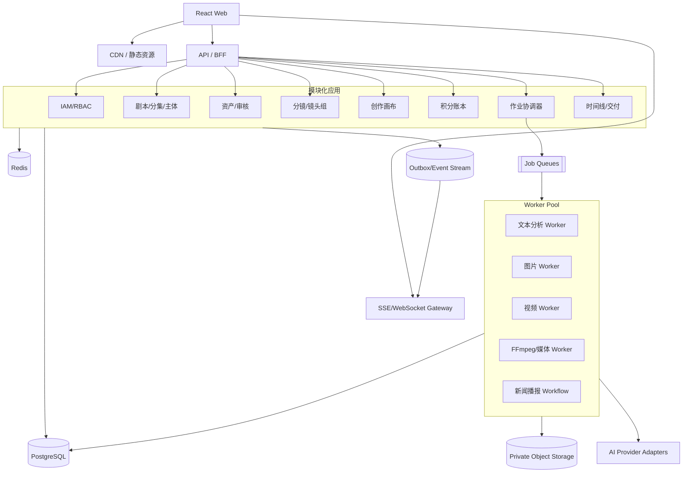
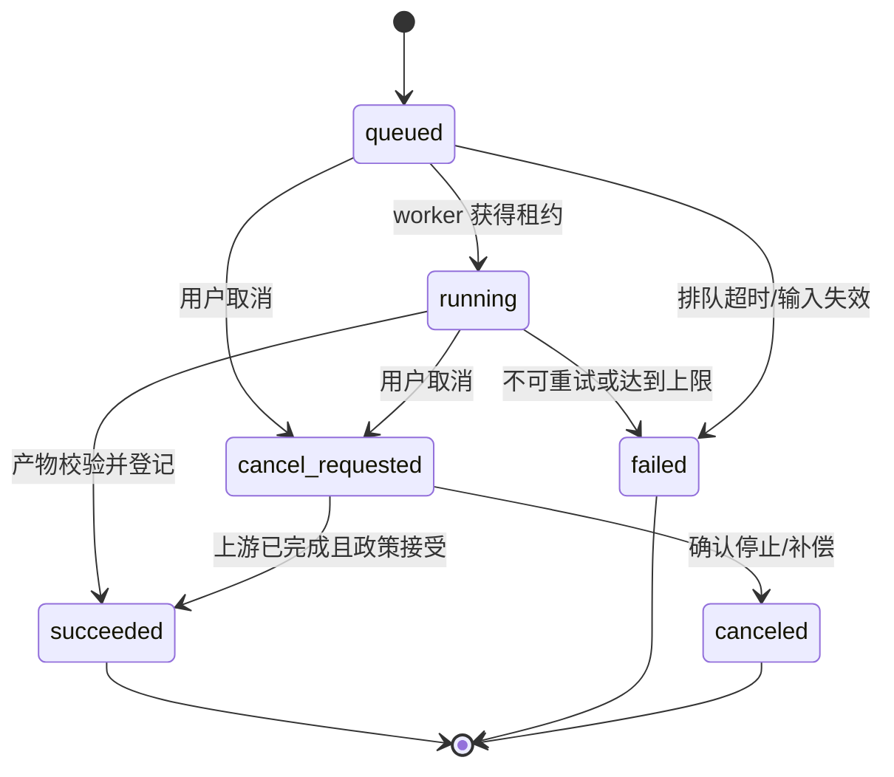
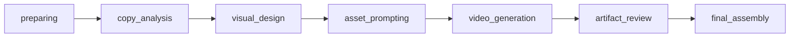

# 技术架构与 AI 编排

## 1. 目标与约束

复刻系统的核心难点不是页面数量，而是四个跨模块一致性问题：

1. 剧本、主体、资产、镜头和视频之间的稳定引用与版本传播；
2. 长耗时、多供应商 AI 任务的排队、恢复、重试、取消和结果归档；
3. 积分预占/结算/释放与业务作业终态的一致性；
4. 大量图片/音视频的私有存储、授权、转码和可追溯性。

`D` 架构必须优先解决这些问题，不能用“前端发请求后定时查状态”的页面逻辑代替领域工作流。

本文观察端 API 省略前缀时相对 `/v3api`；目标架构中的能力、作业和业务 API 省略前缀时统一相对 `/api/v1`。

## 2. 可观察技术基线（E2）

本节对应 `EV-CODE-TECH-01`。原始 bundle 未复制到文档目录，因此这些结论只用于前端技术基线，不能推断后端实现。

| 层 | 观察结果 | 限制 |
| --- | --- | --- |
| 构建 | Vite SPA，基础路径 `/v3/` | 不能推断部署流水线 |
| UI | React 19、Tailwind、Radix/shadcn 风格组件、Tabler Icons | 不能证明统一设计系统完整性 |
| 路由/状态 | React Router、TanStack Query、Axios 风格封装 | 只代表当前前端 |
| 交互 | dnd-kit、GSAP、复杂画布 bundle | 画布底层库可从 UI 形态推测，但不做确定断言 |
| API | `/v3api` | 后端语言未知 |
| 媒体 | 央视频 CDN/对象资源路径 | 存储厂商和安全策略未知 |
| 服务器 | 响应头显示 IIS | 不能据此断言是 .NET 后端 |
| 进度 | 多类 1-10 秒轮询 | 缺少统一事件订阅的可见证据 |

## 3. 三种实现方案

### 3.1 方案 A：模块化单体 + 独立 Worker（推荐起步）

**组成**：React SPA、模块化后端、PostgreSQL、Redis 队列、S3 兼容对象存储、FFmpeg worker、AI provider worker。

**优点**：

- 一套事务数据库容易保证作业、账本和 outbox 一致；
- 部署和本地开发成本最低，AI 编程代理也更容易保持跨模块契约一致；
- 后续可按队列和模块热点拆分 worker。

**缺点**：

- 团队扩大后模块边界需要强治理；
- BullMQ/Celery 等队列对超长多阶段工作流的可视化和补偿支持弱于专用工作流引擎。

**适用**：0-20 人团队、产品验证至中等规模生产。

### 3.2 方案 B：领域服务 + Temporal 类工作流引擎

**组成**：API Gateway、IAM/Project/Asset/Credit/Workflow/Media 服务、Temporal、PostgreSQL 分域、事件总线、对象存储。

**优点**：

- 新闻播报、视频生成、合成等多阶段流程天然支持持久化定时器、重试、取消和补偿；
- 独立扩展 AI、媒体和账本负载；
- 服务责任和权限边界更清晰。

**缺点**：

- 运维、可观测性、跨服务一致性和本地开发复杂度显著增加；
- 过早拆分会让需求迭代受事件契约和分布式事务拖累。

**适用**：已有平台工程能力、日作业量较大、多个研发小组并行。

### 3.3 方案 C：Serverless API + 托管队列/工作流

**组成**：边缘/函数 API、托管数据库、云队列/Step Functions、对象存储、按任务扩缩的媒体容器。

**优点**：

- 初期运维少，突发作业弹性好；
- 媒体处理可按任务计费。

**缺点**：

- FFmpeg、长轮询和大型画布快照容易触及函数时长/内存限制；
- 本地模拟、厂商迁移和跨步骤调试较困难；
- 账本强一致与幂等仍需严谨数据库设计，Serverless 不会自动解决。

**适用**：云平台绑定可接受、业务波峰明显、平台工程人力有限。

### 3.4 推荐路径

采用 A 起步，但从第一天把 AI 作业、媒体处理和事件投递做成独立 worker 进程；当多阶段流程、作业量或团队边界达到阈值时，将工作流层迁移到 B。数据库先共享实例但按 schema/模块所有权隔离，禁止任意跨模块写表。

## 4. 推荐总体架构（D）



## 5. 前端架构

### 5.1 应用外壳

建议沿用 React 19 + TypeScript + Vite，因为与已观察交互形态相符且适合 SPA 工作台。按路由拆包：

```text
src/
  app/                 路由、会话、错误边界、全局事件
  features/
    scripts/           列表、分集、正文、主体
    assets/            资产库、候选、审核
    materials/         创作项目和画布
    storyboards/       分镜和镜头组
    videos/            作业、版本和素材检查
    timeline/          排列、裁剪和合成
    news-broadcast/    新闻播报配置与进度
    credits/           余额和流水
    admin/             成员、角色、配额
  entities/            领域类型和规范化缓存键
  shared/              UI、API 客户端、上传、可访问性
```

### 5.2 状态划分

| 状态 | 工具/存储 | 示例 |
| --- | --- | --- |
| 服务端状态 | TanStack Query | 剧本、主体、作业、流水 |
| 表单草稿 | React Hook Form/局部 reducer | 剧本文本、镜头组编辑 |
| 复杂编辑器 | 专用 store + command log | 画布、时间线 |
| URL 状态 | Router search params | 当前分集、tab、筛选、页码 |
| 跨页事件 | SSE cache updater | 作业进度、余额变化、审核结果 |

禁止将服务端实体复制到多个全局 store 后分别修改。写命令成功后以服务端版本作为真相，SSE 事件按 `entity_version` 丢弃旧更新。

### 5.3 页面性能

- 画布、播放器、波形和时间线按需加载；
- 列表 API 一次返回封面/统计，消除资产库 N+1；
- 表格和节点超过阈值后虚拟化；
- 图片使用缩略图变体、响应式尺寸和懒加载；
- 对象 URL 使用后及时 revoke；视频只预加载 metadata；
- 页面隐藏时暂停非关键请求；SSE 断线才降级轮询。

### 5.4 写操作体验

统一 `CommandButton` 模式：

1. 本地校验；
2. 若有成本，获取估算；
3. 显示输入摘要、预计积分、数量和影响范围；
4. 用户确认后携带幂等键提交；
5. 按钮进入稳定 loading，防止重复提交；
6. 返回作业 ID 后跳转/订阅；
7. 失败展示可操作原因，不只弹通用 Toast。

画布显示“已保存/保存中/离线/冲突”状态。UI 选择、视口和面板开关不触发业务 PATCH。

## 6. 后端模块

### 6.1 IAM 与租户

- 会话解析后生成不可伪造的 `AuthContext(user_id, organization_id, roles)`；
- 资源查询必须同时带资源 ID 和 organization ID；
- 个人资源再校验 owner，团队资源校验项目成员与角色；
- 管理员入口只是 UI 便利，服务端每个命令仍单独鉴权；
- 权限决定记录到审计日志：主体、动作、资源、结果、策略版本。

### 6.2 项目/剧本

- 文本版本与分析结果版本分离；
- 主体提取输出作为候选快照，用户确认/合并后成为稳定主体；
- 上游文本变更产生 `analysis_stale`，不立即破坏已审核资产；
- 提供影响分析：哪些主体、分镜、镜头组和作业基于旧版本。

### 6.3 资产与审核

- 媒体二进制只由 storage object ID 引用；
- 候选、审核决策和正式资产版本分表，避免一个 `status` 同时表达三件事；
- 生成、上传、截帧都走同一媒体摄取管线；
- 已引用资产版本不可硬删除；新版本发布后旧版本保留用于历史作业重现；
- 审核动作支持职责分离和理由。

### 6.4 分镜/镜头组

- 使用命令模型维护插入、删除、移动、合并、拆分，命令携带 `base_version`；
- 每次成功命令生成新 hierarchy version 和变更事件；
- 提示词编译器从结构化镜头、主体和约束生成初稿，人工编辑保存为 override；
- 上游字段改变时只重算未被人工覆盖的段落，避免覆盖创作者修改。

### 6.5 积分账本

- 账本是余额唯一事实来源，账户表中的余额是受约束投影；
- reserve、settle、release 通过数据库事务和唯一幂等键执行；
- 价格规则版本化，作业保存 price snapshot；
- 对账任务定期检查冻结时间过长、终态作业未结算、账本不平；
- 人工调整需要双重授权或至少强审计。
- Job 的 `billing_state` 独立收敛；成功产物在 `settled` 前保持 `billing_hold`，失败/取消作业在 `released` 前进入补偿监控。

## 7. AI 工作流引擎

### 7.1 通用作业生命周期



这是公开 Job 状态，对应 [05-领域模型与API.md](./05-领域模型与API.md) 第 3.5 节。自动重试不回退 Job 状态：失败 Attempt 终态保持不变，在同一 Job 下创建新 Attempt，Job 保持 `running` 并显示 `retry_wait` 进度阶段；人工重试失败 Job 则创建带 `retry_of_job_id` 的新 Job。

每个 Attempt 使用租约：`lease_owner`、`lease_expires_at`、heartbeat。协调器只在租约过期后接管，避免两个 worker 同时提交供应商。Job 和 Attempt 都使用 `state_version` CAS，迟到回调不能覆盖已确定终态。

### 7.2 作业步骤接口

```ts
interface WorkflowStep<I, O> {
  name: string;
  validate(input: I): Promise<ValidationResult>;
  estimate(input: I): Promise<CostEstimate>;
  execute(ctx: StepContext, input: I): Promise<StepHandle<O>>;
  poll?(ctx: StepContext, handle: StepHandle<O>): Promise<StepProgress<O>>;
  cancel?(ctx: StepContext, handle: StepHandle<O>): Promise<void>;
  compensate?(ctx: StepContext, output: O): Promise<void>;
}
```

`StepContext` 提供租户、作业、尝试号、deadline、trace、幂等键和密钥引用，禁止步骤直接读取用户会话 Cookie。

### 7.3 Provider Adapter

内部能力模型：

```ts
interface VideoCapability {
  capabilityProfileId: string;
  capabilityProfileVersion: number;
  modes: Array<"text" | "first_frame" | "first_last_frame" | "all_reference">;
  ratios: string[];
  resolutions: string[];
  duration: { min: number; max: number; auto: boolean };
  uiDuration: { min: number; max: number; step: number; showAuto: boolean };
  outputCount: { min: number; max: number };
  references: {
    maxImages: number;
    maxAudio: number;
    maxVideos: number;
    maxMixed: number;
    requiresVisualWhenAudioPresent: boolean;
  };
  supportsGeneratedAudio: boolean;
  supportsWatermarkToggle: boolean;
  supportsCancel: boolean;
  fixedProviderOverrides: Record<string, string | number | boolean>;
}
```

适配器职责：

- 能力发现与统一校验；
- 内部引用解析为短期签名 URL 或安全上传；
- 参数映射，例如某提供商固定 720p；
- 外部幂等、提交、查询、取消和错误归类；
- 回调验签；
- 结果下载、校验、清理供应商临时数据；
- 计量上报。

前端不硬编码“模型 A 支持哪些时长”。由后端 `/video-capabilities` 返回版本化单一事实，明确 UI 5-15 秒子集与 API 4-15/自动值完整能力，消除未声明的实现漂移。当前 all-reference profile 必须表达图片 9、音频 3、视频 3、混合 12、音频不可单独输入、输出数量 1-5，以及某适配器固定 720p 等规则；作业输入固化 capability profile/version 和价格快照。

### 7.4 Prompt Compiler

提示词分层：

1. 系统安全与格式约束；
2. 项目视觉圣经（风格、色彩、镜头语言）；
3. 主体身份与正式资产版本；
4. 镜头结构和时间段；
5. 台词、音色和音效；
6. 模型专用约束；
7. 用户 override。

编译结果保存 hash、模板版本、输入实体版本和最终文本，以便复现。敏感正文根据数据政策加密，日志只记录 hash 和长度。

### 7.5 素材解析与验证

素材验证分四层：

| 层 | 检查 |
| --- | --- |
| 领域 | 素材属于同租户/项目、状态可用、引用未删除 |
| 能力 | 图片/音频/视频/混合数量、比例、时长、模式 |
| 媒体 | MIME、编码、分辨率、音轨、时长、可解码性 |
| 安全 | 病毒、内容安全、授权、签名 URL 有效期 |

“自动修复目标图片”必须是单独的可确认步骤，生成新版本，不能隐藏在只读检查中。

### 7.6 新闻播报工作流



每阶段输入/输出不可变并可重入。失败重试从最近成功检查点继续；取消阻止后续阶段并清理临时对象。文案锚点使用字符偏移 + 引用文本 hash + 语义片段，文案修改时检测漂移，而不是静默错配素材。

## 8. 媒体与对象存储

### 8.1 摄取管线

1. API 创建上传会话，校验租户、文件类型和配额；
2. 浏览器直传私有临时桶；
3. 完成回调后 worker 校验魔数、病毒、时长、分辨率和编码；
4. 生成缩略图、代理视频、波形和元数据；
5. 内容安全与授权检查通过后进入可用状态；
6. 原始文件与派生文件通过 storage object 关联。

### 8.2 存储键

内部键建议：`org/{org_id}/{resource_type}/{resource_id}/{version}/{random}`。客户端永远不传完整 key，也不能通过替换路径访问他人对象。

### 8.3 FFmpeg worker

- 输入采用对象 ID 解析，固定 allowlist 协议，防 SSRF；
- 在隔离容器运行，限制 CPU、内存、磁盘、时长和输出大小；
- 禁止继承不可信元数据作为命令行；
- 合成前探测各片段编码并规范化；
- 产物记录 codec、分辨率、帧率、音频、时长、大小和 SHA-256；
- 失败保留结构化诊断，临时文件按策略清理。

## 9. 事件与实时更新

### 9.1 Outbox

任何业务事务同时写 outbox。投递器至少一次发送，消费者按 `event_id` 幂等。关键事件：

- `script.updated`
- `subject.analysis_completed`
- `asset.approved`
- `storyboard.version_changed`
- `job.status_changed`
- `artifact.created`
- `credits.balance_changed`
- `timeline.updated`

### 9.2 浏览器推送

- 用户频道：个人作业与通知；
- 项目频道：剧本、资产和分镜变更；
- 组织频道：配额/成员变化，仅管理员；
- 每个事件带单调 sequence，客户端断线补拉；
- 推送只含最小元数据，正文和签名 URL 仍通过授权 GET 获取。

这可替代原站多个独立 1-10 秒轮询。若推送不可用，客户端使用统一 `GET /jobs?ids=...&projection=status` 自适应批量补拉，不建立第二套状态接口。

## 10. 数据与缓存

### 10.1 PostgreSQL

- 业务实体、版本、作业、账本和审计使用关系数据库；
- JSONB 仅保存供应商快照、可演进配置或不可查询结果摘要；
- 核心关系不能全部塞进画布 JSON；
- 所有写入事务显式设置租户上下文；高风险表可启用 RLS。

### 10.2 Redis

仅用于：短期缓存、速率限制、队列、分布式租约辅助、SSE fanout。不得把余额、作业终态或正式资产只存 Redis。

### 10.3 搜索

初期 PostgreSQL trigram/全文索引足够支持项目和主体搜索。剧本量、跨项目检索和语义检索增长后再引入 OpenSearch/向量库，避免首版过度设计。

## 11. 安全架构

### 11.1 主要威胁

| 威胁 | 防护 |
| --- | --- |
| IDOR/跨租户访问 | 资源 ID + 租户过滤、项目成员校验、RLS、负向测试 |
| 签名 URL 泄漏 | 短时效、最小权限、日志脱敏、Referer 策略 |
| 上传恶意媒体 | 魔数/解码/病毒扫描、隔离转码、资源限制 |
| Prompt 注入影响工具 | 模型不直接持有业务凭据；输出结构校验；工具 allowlist |
| 重复生成/重复扣费 | 幂等键、唯一约束、账本事务、按钮防重 |
| 回调伪造 | 供应商签名、时间戳/nonce、源限制、幂等事件 |
| 管理员滥用 | 最小权限、强认证、双人审批、不可变审计 |
| 声音/肖像滥用 | 授权证明、用途限制、水印/溯源、删除和撤回流程 |

### 11.2 密钥

供应商密钥存放在 KMS/Secret Manager，只由特定 worker service account 读取。数据库只存 secret reference。密钥轮换不需重新部署前端。

### 11.3 内容安全

输入文本、上传媒体和生成产物分别审核；失败策略分阻断、人工复核和警告。每次审核保存策略版本，确保历史结果可解释。

## 12. 可观测性与 SLO

### 12.1 Trace

从浏览器请求生成 `trace_id`，贯穿 API、outbox、队列、worker、供应商请求、对象存储和账本。外部任务 ID 加密存储且不写普通日志。

### 12.2 指标

| 类别 | 指标 |
| --- | --- |
| API | p50/p95/p99、错误率、租户限流、数据库等待 |
| Queue | 深度、最老消息、排队时间、重试/死信 |
| Provider | 提交/查询延迟、成功率、错误码、取消率、单位成本 |
| Media | 转码时长、失败率、输入/输出大小、临时盘 |
| Credits | 预占滞留、补偿延迟、不平账数量 |
| Product | 从剧本到首片段耗时、各阶段转化、人工返工率 |

### 12.3 建议 SLO

- 非媒体 API 月可用性 99.9%；
- 作业状态事件 99% 在状态变化后 5 秒内可见；
- 计费 Job 终态后积分结算或释放 99.99% 在 60 秒内完成；超时产物保持结算锁并触发告警；`not_required` 非计费 Job 不计入分母；
- 任何作业不应无心跳停留 `running` 超过租约阈值；
- 下载授权 API p95 小于 300ms（不含媒体传输）。

## 13. 部署拓扑

### 13.1 初期

```text
web-cdn
api x 2+
outbox-dispatcher x 2
text-worker x N
image-worker x N
video-worker x N
media-worker x N（独立 CPU/临时盘）
postgresql HA
redis HA
private object storage
```

worker 按队列独立扩缩，不能让昂贵视频任务阻塞文本分析。每个组织和用户设置并发令牌，供应商也有独立限流器。

### 13.2 灾备

- PostgreSQL 持续备份和时间点恢复；
- 对象存储版本/生命周期策略；
- 作业输入快照和账本进入备份；
- 队列可从数据库 outbox/作业状态重建；
- 每季度执行恢复演练，验证 RPO/RTO，而不是只检查备份任务成功。

## 14. 测试策略

| 层 | 重点 |
| --- | --- |
| 单元 | 状态机、素材限制、价格、提示词编译、裁剪校验 |
| 属性测试 | 账本守恒、事件乱序/重复、版本单调、裁剪不越界 |
| 契约 | Provider adapter、API schema、回调验签、错误映射 |
| 集成 | DB + outbox + queue + worker + storage |
| 故障注入 | worker 崩溃、供应商超时、回调丢失、DB 死锁、存储失败 |
| 端到端 | 普通漫剧、新闻播报、失败补偿、权限越权 |
| 性能 | 大剧本、1000 镜头、画布大图、批量作业、积分热点账户 |
| 安全 | IDOR、上传、SSRF、签名 URL、管理员、提示词工具边界 |

供应商测试使用契约模拟器和少量沙箱冒烟，CI 不应依赖真实昂贵模型。

## 15. 分阶段落地

1. **基础域**：IAM、租户、对象存储、PostgreSQL、审计、账本、通用作业和 outbox。
2. **剧本域**：剧本/分集/主体和文本分析 worker，建立版本传播。
3. **资产域**：媒体摄取、图片生成、候选审核和正式版本。
4. **分镜域**：结构化镜头、命令/乐观锁、镜头组和提示词编译。
5. **视频域**：能力注册、素材预检、视频 adapter、作业和多版本。
6. **交付域**：播放器、截帧、时间线、裁剪、合成和下载。
7. **模板域**：新闻播报七阶段 workflow。
8. **企业域**：团队协作、管理员、配额、报表、内容安全和 SSO。

每阶段都必须先通过状态机、幂等、权限和失败补偿测试，再开放下一类高成本操作。

## 16. 原站特征的取舍

| 原站特征 | 复刻决策 |
| --- | --- |
| React/Vite 工作台 | 可沿用，生态成熟且符合交互需求 |
| 多模块顶栏 | 沿用信息模型，但补作业中心和显式权限入口 |
| 高频轮询 | 改为事件推送 + 退避轮询兜底 |
| 资产列表 N+1 | 改聚合查询/批量加载 |
| 画布增量 PATCH | 保留版本化增量，但剥离 UI 瞬态并提供冲突恢复 |
| 高成本按钮直发 | 改为估算 + 二次确认 + 幂等命令 |
| 素材检查可能自动修复 | 拆成纯验证和显式修复作业 |
| UI/API 能力不一致 | 由后端 capability registry 驱动 UI |
| 供应商私有参数进入业务请求 | 隔离到 provider adapter |
| 当前未见字幕/音乐/转场/调色 | 不假装已存在；作为后续独立编辑域评估 |
