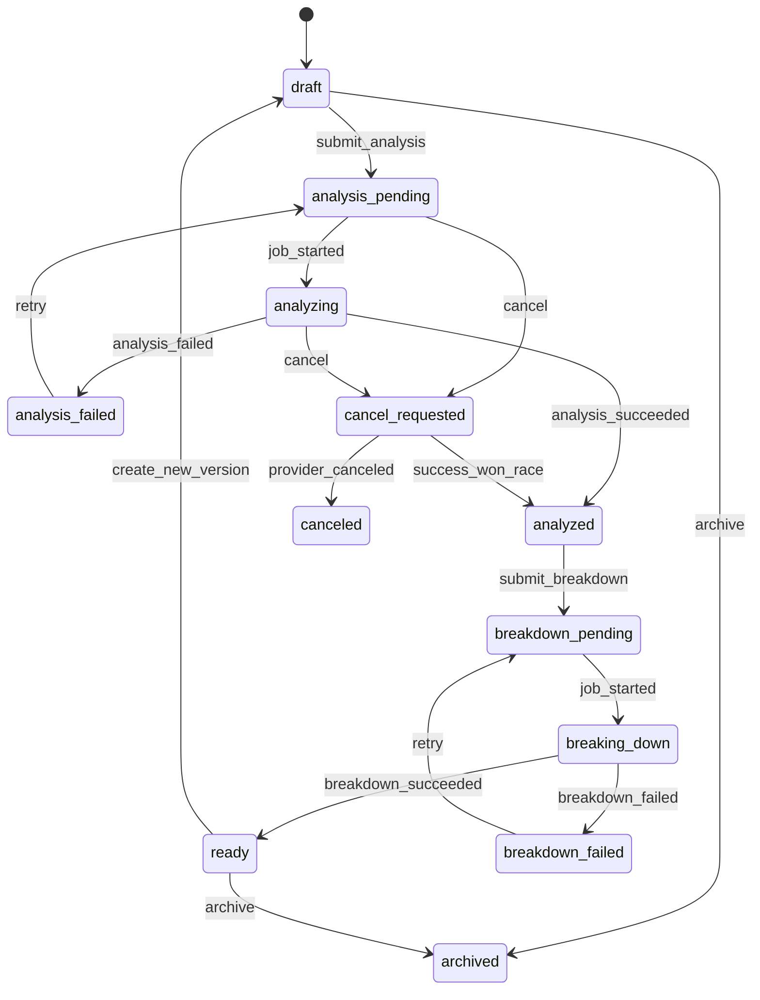
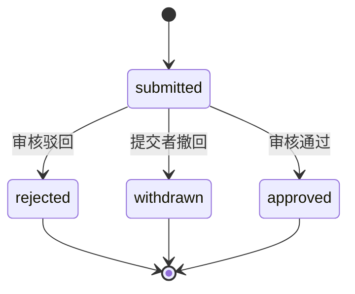
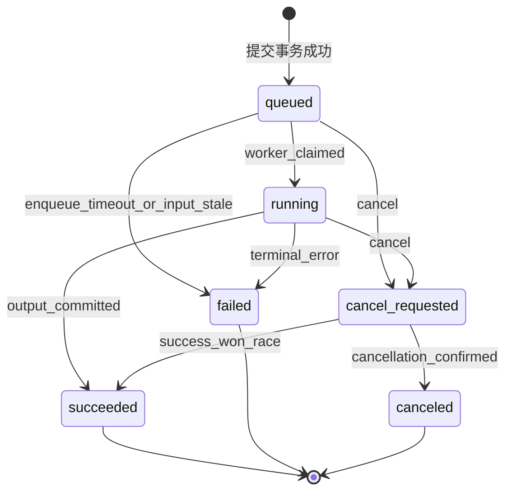
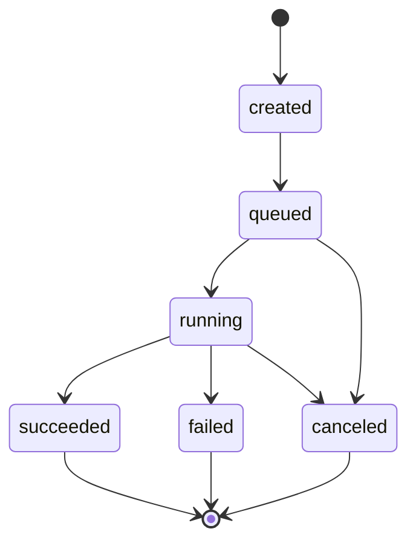
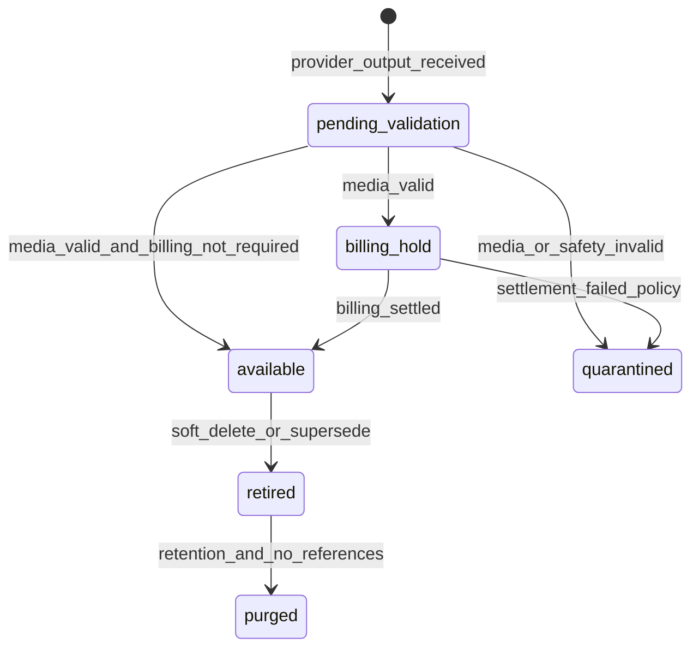
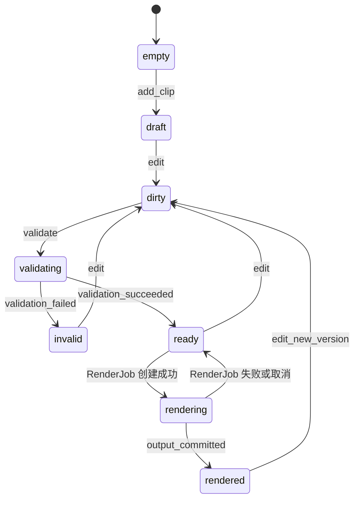
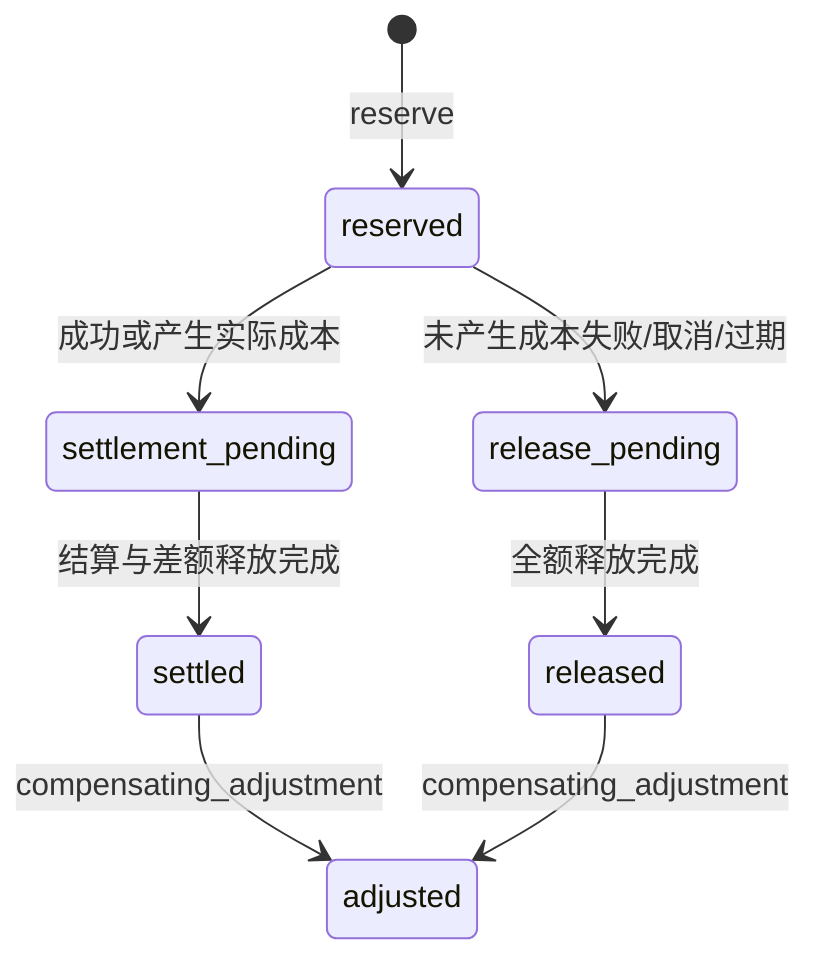

# 权限、状态机与验收标准

> 文档状态：复刻开发基线（离线整理版）
>
> 适用范围：剧本、资产、审核、创作画布、分镜、视频、下载、积分、账号与组织能力
>
> 证据基线日期：2026-07-14
>
> 读者：产品、架构、前端、后端、测试、安全、运维及执行复刻任务的 AI Agent

## 1. 文档目标与强制边界

本文定义产品复刻所需的权限模型、业务状态机、错误与补偿约束、审计要求和可自动化验收标准。本文既不是现网接口文档，也不把未观察到的能力补写成现网事实。

强制边界如下：

1. 所有示例标识均为虚构值，例如 `usr_demo_01`、`team_demo_01`、`org_demo_01`、`script_demo_01`、`job_demo_01`。
2. 不记录真实账号、余额、UUID、项目名、素材内容、剧本内容或其他实时业务数据。
3. “现状”只允许由 `E1`、`E2`、`E3` 支撑；`D` 表示复刻目标设计；`U` 表示未知且不得自行推断。
4. 当前证据未发现发布工作流，因此“发布”不进入现状完成范围。任何未来发布设计都必须单独立项、重新取证和安全评审。
5. 管理员页面的具体字段、角色和动作未知。本文可以定义推荐能力模型，但不得声称现网管理员已经具备这些能力。
6. 菜单隐藏不能替代页面守卫，页面守卫不能替代 API 鉴权；API 是最终授权边界。
7. 所有生成、审核、删除、下载、积分和账号管理动作都必须具备可审计、可幂等、可补偿的后端语义。

## 2. 证据等级与标注规则

| 等级 | 定义 | 可用于什么 | 不可用于什么 |
| --- | --- | --- | --- |
| `E1` | 页面可见文本、控件、状态、路由或真实交互直接观察 | 描述页面结构、可见状态、控件启停 | 推断未点击动作的后端副作用 |
| `E2` | 网络请求、响应状态、响应字段或接口行为直接观察 | 描述接口路径、状态码、字段、已返回状态 | 推断未返回字段、管理员或其他角色行为 |
| `E3` | 多个 `E1/E2` 事实可以共同支持的保守结论 | 建立有限的领域关系或业务约束 | 把合理猜测写成已实现能力 |
| `D` | 为可复刻、可维护和可测试而提出的目标设计 | 形成实现契约、状态机、验收规则 | 声称现网已经如此实现 |
| `U` | 未覆盖、无权限、入口未发现或证据不足 | 明确测试缺口和待决策项 | 以默认值、行业惯例或想象填空 |

### 2.1 已知证据摘要

| 编号 | 证据结论 | 等级 |
| --- | --- | --- |
| EV-SCRIPT-LIST-01 | 认证后主导航可见剧本、资产、创作画布和视频类入口 | `E1` |
| EV-VIDEO-LIST-01 | 视频区域按个人与团队项目区分列表作用域 | `E1` |
| EV-VIDEO-WORKBENCH-01 / EV-VIDEO-ALL-01 | 视频工作台 UI 存在空态、运行中、完成、失败等展示状态 | `E1` |
| EV-VIDEO-WORKBENCH-01 | 视频工作台按项目和剧集组织分镜、镜头组与结果视频 | `E1` |
| EV-SHOT-LIBRARY-01 | 分镜库路由可直接访问，但不在已观察主导航中 | `E1` |
| EV-ACCOUNT-LOADING-01 | 账号管理路由可进入认证外壳或加载态；未把完整错误页作为稳定证据 | `E1` |
| EV-ACCOUNT-DENIED-01 | 受管账号与部门接口对当前主体返回 HTTP 403 | `E2` |
| `EV-CREDIT-UI-01`、`EV-CREDIT-UI-02`、`EV-CREDIT-UI-03` | 积分弹窗区分获取、消耗、返还三类账务视图 | `E1` |
| EV-CREDIT-API-02 | 积分日志包含账户、预占、来源、日志类型、余额与冻结额变动等字段 | `E2` |
| U-SCOPE-ROLE-01 | 团队成员、组织管理员和平台管理员的具体能力未知 | `U` |
| U-PUBLISH-01 | 未发现发布中心、渠道绑定、发布审核、定时发布或发布记录入口 | `U` |

### 2.2 文档语句规则

- “已观察”“当前主体”“返回 403”必须引用 `E1/E2`。
- “应当”“必须”“禁止”“推荐”属于 `D` 设计规范。
- “可能”“推测”不能作为验收依据，应改写为 `U` 待确认项。
- 一个条目同时含事实和设计时，必须拆成两句并分别标注，例如：
  - `[E2]` 当前账号接口返回 403。
  - `[D]` 目标系统还必须在页面路由与服务层同时拒绝。

## 3. 身份、角色与作用域模型

### 3.1 核心主体与资源

| 类型 | 虚构示例 | 关键属性 |
| --- | --- | --- |
| 用户 | `usr_demo_01` | 状态、所属组织、团队成员关系、角色、认证强度 |
| 组织 | `org_demo_01` | 状态、套餐、策略版本、数据保留策略 |
| 团队 | `team_demo_01` | 所属组织、成员、团队角色、默认资源策略 |
| 剧本项目（Script） | `script_demo_01` | 项目聚合根、`scope`、个人所有者或团队、创建者、版本、状态 |
| 资产 | `asset_demo_01` | 所有者、来源、用途、许可、引用计数、状态 |
| 审核单 | `review_demo_01` | 对象、提交者、审核者、结论、版本 |
| 分镜 | `shot_demo_01` | 剧集、场、镜头组、版本、生成状态 |
| 视频任务 | `job_demo_01` | 输入快照、提供方、状态、尝试次数、积分预占 |
| 时间线 | `timeline_demo_01` | 版本、片段、锁版本、合成状态 |
| 积分账户 | `credit_demo_01` | 账面余额、冻结额、版本、状态 |

### 3.2 资源作用域

| 内容资源作用域 | 所有权 | 默认可见性 | 推荐共享方式 | 跨域约束 |
| --- | --- | --- | --- | --- |
| `personal` | 单一用户 | 仅所有者 | 显式复制或转为团队项目 | 组织管理员默认也不读取内容正文 |
| `team` | 团队 | 团队内按角色 | 添加成员、项目角色或资源授权 | 用户必须是有效团队成员且组织一致 |

`[E1]` 已观察到个人和团队项目页签。`[D]` 复刻内容资源只采用上述两个 `scope` 值；组织和平台是授权域，不是内容资源 scope。所有租户资源仍必须保存 `organization_id`：组织域限制成员、部门、配额和管理动作，平台域只限制受控运维能力，二者都不得绕过 personal/team 内容授权。

`[D]` Script 是目标 MVP 的项目聚合根。`scope=personal` 时 `owner_user_id` 必填且 `team_id` 为空；`scope=team` 时 `team_id` 必填且个人 owner 为空。ProjectMember 直接以 `script_id` 关联，不再引入另一张语义重复的 Project 表。

### 3.3 推荐角色

以下角色属于目标设计 `D`，不代表现网角色名称：

| 角色 | 主要职责 | 默认数据范围 | 明确禁止 |
| --- | --- | --- | --- |
| `member` | 浏览获授权项目和资源 | 授权项目 | 账号、积分分配、组织策略 |
| `creator` | 创建与编辑内容、发起生成 | 本人及获授权项目 | 审核自己提交的受控内容、管理成员 |
| `reviewer` | 审核指定内容 | 审核队列及只读上下文 | 修改原始内容、分配积分 |
| `project_admin` | 项目成员、配置和资源治理 | 指定项目 | 组织级账号、跨项目积分调整 |
| `org_admin` | 组织、部门、成员与组织策略 | 单一组织 | 平台级配置、默认读取成员私人正文 |
| `credit_admin` | 积分分配、调整和对账 | 单一组织积分账户 | 内容审核、成员角色提升 |
| `platform_operator` | 服务运行与租户支持 | 元数据优先 | 默认读取租户内容、直接修改积分 |
| `platform_security_admin` | 安全策略与审计调查 | 审计数据 | 内容生产、积分业务操作 |

### 3.4 RBAC 与 ABAC 组合

目标授权决策采用“RBAC 给能力、ABAC 收窄范围”的组合模型：

```text
allow = authenticated
     && subject.status == "active"
     && role_has_capability(subject.roles, action)
     && scope_policy_allows(subject, resource)
     && resource_state_allows(resource.state, action)
     && environment_policy_allows(request)
     && !explicit_deny(subject, resource, action)
```

ABAC 至少评估以下属性：

| 属性类别 | 必需属性 |
| --- | --- |
| 主体 | `user_id`、`org_id`、团队成员关系、角色、账号状态、认证强度 |
| 资源 | `scope`、`owner_id`、`team_id`、`org_id`、项目、状态、敏感级别 |
| 动作 | 读、创建、编辑、生成、审核、下载、删除、分配、管理 |
| 环境 | 请求时间、来源、设备信任、IP 风险、请求 ID、幂等键 |
| 关系 | 是否创建者、当前审核人、项目成员、部门上下级、资源引用关系 |

决策优先级：显式拒绝 > 状态限制 > ABAC 范围 > RBAC 允许 > 默认拒绝。任何缺失 `org_id`、`scope` 或资源所有者的受控资源都应失败关闭，不能默认放行。

### 3.5 职责分离

1. 创建者不能审批自己提交的强制审核对象；至少需要 `reviewer` 且 `reviewer_id != submitter_id`。
2. `credit_admin` 可以分配积分，但不能授予自己 `org_admin` 或提高自己的额度上限。
3. `org_admin` 可以管理组织成员，但不能直接修改不可变账本。
4. `platform_operator` 处理运行故障时只获得脱敏元数据；临时内容访问必须走工单、双人审批和自动过期授权。
5. 账号禁用、角色提升、积分手工调整和审计导出属于高风险动作，必须二次确认并记录理由。

## 4. 菜单、页面与 API 三层权限

### 4.1 三层职责

| 层级 | 职责 | 拒绝表现 | 是否安全边界 |
| --- | --- | --- | --- |
| 菜单 | 降低误操作、隐藏无关入口 | 不展示菜单或按钮 | 否 |
| 页面 | 路由守卫、页面级状态、减少无效请求 | 403 页面、返回安全页或只读降级 | 部分 |
| API | 对每次请求做主体、动作、资源、作用域和状态校验 | 401/403/404/409/422 | 是 |

`[E1]` 账号管理入口未出现在主导航，但直接路由可进入认证外壳或加载态；完整错误页未作为稳定证据。`[E2]` 受管账号和部门接口返回 403，证明服务端存在权限拒绝。`[D]` 复刻系统必须同时实现稳定的页面级拒绝态和服务端授权，不能只复制菜单隐藏。

### 4.2 授权决策顺序

1. 校验会话或访问令牌；失败返回 401。
2. 校验账号状态、组织状态和会话撤销版本；失败返回 401 或 403。
3. 解析资源归属，不接受客户端传入的组织归属作为可信事实。
4. 计算 RBAC 能力集合。
5. 应用个人、团队、组织、资源所有权和显式授权等 ABAC 条件。
6. 校验资源当前状态是否允许动作。
7. 对敏感动作校验 MFA、二次确认、理由、幂等键和配额。
8. 记录允许或拒绝审计事件。
9. 执行业务事务；返回前附带 `request_id`。

### 4.3 路由与接口拒绝规范

| 场景 | 页面 | API | 防枚举策略 |
| --- | --- | --- | --- |
| 未登录 | 跳转登录并保留安全的目标路径 | 401 | 不暴露资源是否存在 |
| 已登录但无模块权限 | 403 页面或安全首页 | 403 | 可显示模块名，不显示数据 |
| 有模块权限但资源跨组织 | 通用“不可访问” | 404 或统一 403 | 推荐 404 隐藏资源存在性 |
| 有查看权但无动作权 | 页面只读、按钮隐藏或禁用 | 403 | API 必须再次拒绝 |
| 资源状态不允许 | 展示状态原因 | 409 | 返回当前状态和允许动作 |
| 参数非法 | 就地校验 | 422 | 客户端禁止自动重试 |

## 5. 能力编码与动作矩阵

### 5.1 能力命名

能力统一命名为 `<domain>.<resource>.<action>`，例如：

```text
script.item.read
script.item.update
asset.candidate.select
review.item.approve
canvas.workflow.execute
shot.item.generate
video.result.download
credit.org.allocate
account.member.role_assign
```

本节全部动作矩阵组成唯一能力注册表；其他文档和 API 只能引用这些代码，禁止引入别名。所有“批量”动作都需要独立能力，不得由单条动作隐式推导。下载、导出、删除、积分和账号动作均为敏感能力。启动时和契约测试必须拒绝未知能力码、重复语义码或没有 API/角色/ABAC 映射的代码。

### 5.2 剧本动作矩阵

| 动作 | 能力 | 推荐最小角色 | ABAC/状态约束 | 无权限表现 | 证据 |
| --- | --- | --- | --- | --- | --- |
| 查看列表/详情 | `script.item.read` | `member` | 个人所有者或项目成员 | 页面不展示；API 403/404 | `E1/D` |
| 新建 | `script.item.create` | `creator` | 目标作用域可写、组织有效 | 隐藏新建；API 403 | `E1/D` |
| 编辑 | `script.item.update` | `creator` | 草稿或退回态；版本匹配 | 只读；API 409/403 | `D` |
| 提交分析 | `script.analysis.create` | `creator` | 输入版本冻结、积分可预占 | 按钮禁用；API 409 或 422 及稳定业务码 | `E2/D` |
| 重试分析 | `script.analysis.retry` | `creator` | 仅失败终态；创建带 `retry_of_job_id` 的新 Job | 隐藏；API 409 | `D` |
| 取消分析 | `script.analysis.cancel` | `creator` | 仅排队/运行态 | 禁用；API 409 | `D` |
| 删除/归档 | `script.item.archive` | `creator` 或 `project_admin` | 无运行任务、无强引用 | 二次确认；API 409/403 | `D` |
| 转为团队项目 | `script.scope.promote` | `project_admin` | 所有者同意、目标团队有效 | 隐藏；API 403 | `E1/D` |

### 5.3 资产动作矩阵

| 动作 | 能力 | 推荐最小角色 | ABAC/状态约束 | 风险控制 | 证据 |
| --- | --- | --- | --- | --- | --- |
| 查看资产 | `asset.item.read` | `member` | 授权项目或本人资产 | 签名 URL 短时有效 | `E1/D` |
| 上传 | `asset.item.upload` | `creator` | 文件类型、大小、病毒与版权校验 | 隔离区扫描后可用 | `U/D` |
| 生成候选 | `asset.candidate.generate` | `creator` | 提示词版本冻结、积分预占 | 幂等键、内容安全 | `E1/E2/D` |
| 取消候选作业 | `asset.candidate.cancel` | `creator` | Job 为排队/运行态、主体仍可写 | 统一 Job API、补偿一次 | `D` |
| 重试候选作业 | `asset.candidate.retry` | `creator` | Job 为失败终态、输入版本仍有效 | 创建新 Job，不改写旧 Job | `D` |
| 查看候选 | `asset.candidate.read` | `creator` | 候选集与项目同域 | 禁止跨项目猜 ID | `E1/D` |
| 选择候选 | `asset.candidate.select` | `creator` | 候选成功且未失效 | 乐观锁，重复选择幂等 | `U/D` |
| 提升为正式资产 | `asset.candidate.promote` | `creator` | 已选择、版权元数据完整 | 生成不可变来源链 | `D` |
| 下载 | `asset.item.download` | `member` | 显式下载能力、许可未过期 | 每次签发重新鉴权 | `E1/D` |
| 删除 | `asset.item.delete` | 所有者或 `project_admin` | 引用计数为 0、无活跃任务 | 软删除、二次确认 | `D` |

### 5.4 审核动作矩阵

| 动作 | 能力 | 推荐最小角色 | 约束 | 冲突处理 | 证据 |
| --- | --- | --- | --- | --- | --- |
| 提交审核 | `review.item.submit` | `creator` | 内容版本固定且校验通过 | 同版本重复提交返回原审核单 | `U/D` |
| 查看队列 | `review.queue.read` | `reviewer` | 队列与组织/项目匹配 | 跨组织 404 | `U/D` |
| 领取 | `review.item.claim` | `reviewer` | 未领取或租约过期 | CAS 失败返回 409 | `U/D` |
| 通过 | `review.item.approve` | `reviewer` | 非提交者、版本未变 | 已终态重复请求幂等 | `U/D` |
| 驳回 | `review.item.reject` | `reviewer` | 必填结构化原因 | 已终态返回 409 或原结果 | `U/D` |
| 撤回 | `review.item.withdraw` | 提交者 | 未形成审核结论 | 与审核并发时 CAS | `U/D` |
| 复审 | `review.item.reopen` | `project_admin` | 有新版本或申诉理由 | 生成新审核版本 | `U/D` |

当前未观察到审核中心，整节均为目标设计 `D`，现网状态为 `U`。

### 5.5 创作画布动作矩阵

| 动作 | 能力 | 推荐最小角色 | ABAC/状态约束 | 失败语义 | 证据 |
| --- | --- | --- | --- | --- | --- |
| 打开画布 | `canvas.project.read` | `member` | 项目可见 | 403/404 | `E1/D` |
| 编辑节点/连线 | `canvas.project.update` | `creator` | 非锁定版本、编辑租约有效 | 409 版本冲突 | `E1/D` |
| 保存 | `canvas.version.save` | `creator` | 携带 `base_version` | 409 并返回最新版本 | `E1/D` |
| 执行单节点 | `canvas.node.execute` | `creator` | 节点输入完整、能力与积分满足 | 422 不重试；任务失败可重试 | `E1/D` |
| 执行工作流 | `canvas.workflow.execute` | `creator` | 图无环或符合编排规则 | 原子创建批次任务 | `D` |
| 取消工作流 | `canvas.workflow.cancel` | `creator` | Job 为排队/运行态、画布版本仍可见 | 统一 Job API、停止未开始节点 | `D` |
| 重试工作流 | `canvas.workflow.retry` | `creator` | Job 为失败终态、输入快照仍有效 | 创建新 Job，只覆盖失败影响范围 | `D` |
| 复制画布 | `canvas.project.clone` | `creator` | 复制目标作用域可写 | 复制引用而非泄露私有资产 | `D` |
| 删除画布 | `canvas.project.archive` | 所有者或 `project_admin` | 无活跃任务 | 软删除 | `D` |

### 5.6 分镜动作矩阵

| 动作 | 能力 | 推荐最小角色 | 约束 | 风险控制 | 证据 |
| --- | --- | --- | --- | --- | --- |
| 查看分镜库 | `shot.project.read` | `member` | 项目可见 | 隐藏入口不替代 API 鉴权 | `E1/E2` |
| 查看分镜详情 | `shot.item.read` | `member` | 剧集/场归属项目 | 直接路由再次鉴权 | `E1/D` |
| 生成分镜 | `shot.item.generate` | `creator` | 输入版本、画幅、规格、数量合法 | 必须预估成本并确认 | `E1/D` |
| 打开候选图 | `shot.candidate.read` | `creator` | 任务成功且候选存在 | 空态禁用 | `E1/D` |
| 选择候选图 | `shot.candidate.select` | `creator` | 候选未失效、版本匹配 | 幂等、乐观锁 | `U/D` |
| 重新生成 | `shot.item.regenerate` | `creator` | 保留旧版本和来源链 | 新任务、新预占 | `E1/D` |
| 终止任务 | `shot.job.cancel` | `creator` | 仅排队/运行态 | 取消竞态规则 | `E1/D` |
| 下载分镜 | `shot.result.download` | `member` | 下载能力、结果成功 | 短时签名 URL | `E1/D` |
| 删除分镜/候选 | `shot.item.delete` | 所有者或 `project_admin` | 无视频/时间线引用 | 二次确认、软删除 | `D` |

### 5.7 视频动作矩阵

| 动作 | 能力 | 推荐最小角色 | 约束 | 风险控制 | 证据 |
| --- | --- | --- | --- | --- | --- |
| 查看视频项目 | `video.project.read` | `member` | 个人所有者或团队成员 | 403/404 | `E1` |
| 查看任务/结果 | `video.result.read` | `member` | 任务与项目同域 | 结果 URL 不可公开猜测 | `E1` |
| 编辑镜头组 | `video.group.update` | `creator` | 输入版本未被活跃任务冻结 | 409 版本冲突 | `E1/D` |
| 检查素材 | `video.material.validate` | `creator` | 只读预检，不扣积分 | 返回结构化缺失项 | `E1/D` |
| 生成视频 | `video.job.create` | `creator` | 素材通过、积分预占、数量合法 | 成本确认、幂等 | `E1/D` |
| 批量生成 | `video.job.batch_create` | `creator` | 逐项授权、批次上限 | 部分失败明细、禁止静默重试 | `E1/D` |
| 取消任务 | `video.job.cancel` | `creator` | 排队/运行态 | 取消竞态、释放积分 | `E1/D` |
| 重试视频任务 | `video.job.retry` | `creator` | Job 为失败终态、输入版本仍有效 | 创建新 Job、保留旧结果 | `D` |
| 删除结果 | `video.result.delete` | 所有者或 `project_admin` | 未被时间线引用 | 二次确认、软删除 | `E1/D` |
| 编排时间线 | `video.timeline.update` | `creator` | 结果成功、版本匹配 | 本地草稿与服务端版本分离 | `E1/D` |
| 合成成片 | `video.render.create` | `creator` | 时间线校验通过并冻结版本 | 独立任务和积分预占 | `U/D` |
| 取消合成 | `video.render.cancel` | `creator` | RenderJob 为排队/运行态 | 统一 Job API、保留源片段 | `D` |
| 重试合成 | `video.render.retry` | `creator` | RenderJob 为失败终态、时间线版本仍有效 | 创建新 RenderJob、复用源片段 | `D` |
| 发布 | 未注册（未来专项） | 未定义 | 未发现入口和接口 | 不进入本期现状验收 | `U` |

### 5.8 新闻播报动作矩阵

| 动作 | 能力 | 推荐最小角色 | ABAC/状态约束 | 风险控制 | 证据 |
| --- | --- | --- | --- | --- | --- |
| 成本预估 | `news.workflow.estimate` | `creator` | Script 可编辑、素材已授权 | 纯预估，不创建 Job 或预占 | `E2/D` |
| 创建工作流 | `news.workflow.create` | `creator` | `scope/team_id` 合法、能力版本有效、积分可预占 | 二次确认、幂等、输入快照 | `E1/E2/D` |
| 查看工作流 | `news.workflow.read` | `member` | 个人所有者或团队项目成员 | 大字段与敏感素材按需授权 | `E2/D` |
| 处理阶段门禁 | `news.stage.resolve` | `creator` 或 `reviewer` | 当前 Stage 为 `action_required`、版本匹配 | `If-Match`、职责分离、审计 | `U/D` |
| 取消工作流 | `news.workflow.cancel` | `creator` | Job 为排队/运行态且资源可写 | 统一 Job API、取消竞态、账务补偿 | `E2/D` |
| 人工重试 | `news.workflow.retry` | `creator` | Job 为失败终态、输入版本仍有效 | 统一 Job API，创建新 Job | `D` |
| 查看阶段产物 | `news.artifact.read` | `member` | 工作流可读、产物未隔离 | 签名 URL 短期有效 | `E2/D` |
| 审核阶段产物 | `review.item.approve` / `review.item.reject` | `reviewer` | 复用审核矩阵、不能自审 | 版本 CAS、理由和审计 | `U/D` |
| 创建最终合成 | `news.assembly.create` | `creator` | 必需 Stage 成功、产物可用、账务已收敛 | 固定输入版本、成本确认、幂等 | `E2/D` |
| 下载最终视频 | `video.render.download` | `member` | 最终产物可用且许可有效 | 复用下载矩阵、短期授权 | `E2/D` |

统一 `/jobs` API 根据 `job_type=news_broadcast` 映射到上述 `news.workflow.*` 能力；不得因为路径通用而退化成“任意可读 Job 均可取消/重试”。新闻审核和最终下载复用既有能力码，不创建语义别名。

### 5.9 下载动作矩阵

| 动作 | 能力 | 约束 | 实现要求 | 证据 |
| --- | --- | --- | --- | --- |
| 下载单资产 | `asset.item.download` | 资源可读且许可有效 | 一次性或短期签名 URL | `E1/D` |
| 打包下载 | `asset.bundle.download` | 每个条目逐项授权 | 异步打包；清单记录失败项 | `E1/D` |
| 下载视频 | `video.result.download` | 结果成功、未删除 | 水印/原片能力分离 | `E1/D` |
| 下载成片 | `video.render.download` | 合成成功、版本固定 | 记录导出规格与哈希 | `U/D` |
| 下载审计数据 | `audit.log.export` | 安全管理员、审批完成 | 脱敏、加密、限时 | `U/D` |

下载 URL 不能成为永久授权。签发和实际下载都必须校验有效期；高敏资源还应在下载时校验账号未禁用、资源未撤权。

### 5.10 积分动作矩阵

| 动作 | 能力 | 推荐最小角色/主体 | 约束 | 证据 |
| --- | --- | --- | --- | --- |
| 查看本人余额 | `credit.self.read` | 所有认证用户 | 仅本人账户 | `E1/E2` |
| 查看本人明细 | `credit.self.ledger_read` | 所有认证用户 | 仅本人账本，字段脱敏 | `E1/E2` |
| 预占 | `credit.system.reserve` | 任务服务 | 来源唯一、余额可用 | `E2/E3/D` |
| 结算 | `credit.system.settle` | 任务服务 | 预占有效、终态唯一 | `E2/E3/D` |
| 释放 | `credit.system.release` | 任务服务 | 未结算、释放原因明确 | `E1/E2/E3/D` |
| 组织分配 | `credit.org.allocate` | `credit_admin` | 额度、审批、目标同组织 | `U/D` |
| 手工调整 | `credit.org.adjust` | 双人审批 | 不修改旧账，只写冲正账 | `U/D` |
| 对账导出 | `credit.org.reconcile` | `credit_admin` | 脱敏、审计、水印 | `U/D` |

### 5.11 账号与组织动作矩阵

| 动作 | 能力 | 推荐最小角色 | 约束 | 当前证据 |
| --- | --- | --- | --- | --- |
| 查看受管账号 | `account.member.read` | `org_admin` | 同组织、敏感字段脱敏 | 当前主体 API 403，管理员未知 `E2/U` |
| 查看部门 | `account.department.read` | `org_admin` | 同组织 | 当前主体 API 403，管理员未知 `E2/U` |
| 邀请成员 | `account.member.invite` | `org_admin` | 域名/席位/重复邀请校验 | `U` |
| 禁用成员 | `account.member.disable` | `org_admin` | 不能禁用最后一个管理员 | `U/D` |
| 分配角色 | `account.member.role_assign` | `org_admin` | 禁止越级、禁止自我提权 | `U/D` |
| 管理部门 | `account.department.manage` | `org_admin` | 禁止循环层级、迁移需事务 | `U/D` |
| 分配积分 | `credit.org.allocate` | `credit_admin` | 不能超组织可分配额 | `U/D` |
| 查看审计 | `account.audit.read` | `platform_security_admin` 或组织审计角色 | 作用域和字段脱敏 | `U/D` |

### 5.12 统一 Job 能力分派

| `job_type` | GET Job/Attempt/Event | POST cancel | POST retries |
| --- | --- | --- | --- |
| `script_analysis` | `script.item.read` | `script.analysis.cancel` | `script.analysis.retry` |
| `asset_candidate` | `asset.candidate.read` | `asset.candidate.cancel` | `asset.candidate.retry` |
| `canvas_workflow` | `canvas.project.read` | `canvas.workflow.cancel` | `canvas.workflow.retry` |
| `shot_generation` | `shot.candidate.read` | `shot.job.cancel` | `shot.item.regenerate` |
| `video_generation` | `video.result.read` | `video.job.cancel` | `video.job.retry` |
| `video_render` | `video.project.read` | `video.render.cancel` | `video.render.retry` |
| `news_broadcast` | `news.workflow.read` | `news.workflow.cancel` | `news.workflow.retry` |

统一 `/jobs` handler 必须先解析不可变 `job_type`，再执行本表能力、资源引用和状态 ABAC。`/attempts`、`/events` 复用同一读能力；`cancel/retries` 不得只凭读权限。未注册 job_type、能力别名或缺少资源映射时默认拒绝并记录审计。

## 6. 状态机总则

1. 聚合状态与异步作业状态分离。例如剧本“可创作”不等于最后一次分析任务“成功”。
2. 每个作业状态只能沿定义边迁移；未知边返回 409，不能静默修正。
3. 终态包括成功、失败、取消；终态回调重复到达必须幂等。
4. `cancel_requested` 是必要中间态，不能把“用户点击取消”等同于提供方已经停止。
5. 业务对象保存 `version`；普通资源修改使用 HTTP `If-Match`，画布/层级命令使用 `base_version`；冲突返回 409。
6. 所有运行任务保存不可变输入快照、模型/提供方、参数、费用策略版本和提示词版本。
7. UI 展示状态必须由服务端状态映射，不得只依赖前端定时器推演。

权威状态分层见 [05-领域模型与API.md](./05-领域模型与API.md) 第 3.5 节：

| 层 | 权威枚举/实体 | 说明 |
| --- | --- | --- |
| 提交 | 校验、估算、预占事务 | 失败时不创建 Job，只返回错误和拒绝审计 |
| 公开 Job | `queued/running/cancel_requested/succeeded/failed/canceled` | 终态不可回退；`state_version` CAS |
| JobAttempt | `created/queued/running/succeeded/failed/canceled` | 自动重试创建新 Attempt，旧 Attempt 不改写 |
| Stage | `pending/ready/running/action_required/succeeded/failed/skipped/cancel_requested/canceled/stale` | 细分工作流阶段；action_required 不新增 Job 状态 |
| Billing | `not_required/reserved/settlement_pending/release_pending/settled/released/adjusted` | 与 Job 终态独立收敛 |

## 7. 剧本流水线状态机

### 7.1 聚合状态



### 7.2 转移约束

| 当前状态 | 事件 | 目标状态 | 守卫 | 事务副作用 |
| --- | --- | --- | --- | --- |
| `draft` | `submit_analysis` | `analysis_pending` | 内容非空、版本匹配、可预占积分 | 冻结输入版本、创建作业和预占 |
| `analysis_pending` | `job_started` | `analyzing` | 队列租约有效 | 记录开始时间和 attempt |
| `analyzing` | `analysis_succeeded` | `analyzed` | 输出 schema 校验通过 | 原子持久化输出、结算积分 |
| `analyzing` | `analysis_failed` | `analysis_failed` | 错误已分类 | 记录失败、按策略结算或释放 |
| `analysis_failed` | `retry` | `analysis_pending` | 用户确认输入仍有效 | 创建新 Job 并关联失败 Job；旧终态不回退 |
| `analyzed` | `submit_breakdown` | `breakdown_pending` | 分析版本仍为当前版本 | 创建拆解任务 |
| `breaking_down` | `breakdown_succeeded` | `ready` | 剧集/场/镜头结构合法 | 原子发布新拆解版本 |
| 任一可取消运行态 | `cancel` | `cancel_requested` | 尚未终态 | 记录请求；异步通知提供方 |
| `cancel_requested` | `success_won_race` | `analyzed` 或 `ready` | 成功回调先提交且输出有效 | 按明确策略结算并提示取消未生效 |

## 8. 资产候选状态机

生成作业、候选集合、单个候选和正式资产版本是四个实体，不共用状态列：

| 实体 | 目标状态（D） | 关键规则 |
| --- | --- | --- |
| CandidateGenerationJob | 使用统一公开 Job/Attempt 状态 | 只负责生成，不表达用户选择 |
| CandidateSet | `building/ready/expired/archived` | 一次 Job 输出一个不可变集合版本 |
| Candidate | `submitted/approved/rejected/withdrawn` | 原站样本 `pending` 由适配层映射到 submitted |
| AssetVersion | `active/superseded/archived` | 提升后形成正式不可变资产版本 |



候选集规则：

1. 一次生成请求产生一个不可变 `candidate_set_version`。
2. 候选项只能属于一个候选集，禁止跨项目选择。
3. 选择/审核动作使用 `If-Match`，同一候选重复命令返回当前结果。
4. 正式资产记录候选来源、生成参数、许可、内容安全结果和哈希。
5. 已被分镜、视频或时间线引用的正式资产不能物理删除。
6. 空候选、失败候选和过期候选不能被提升。

## 9. 通用异步作业状态机

公开 Job 状态：



提交前的校验/预占失败不是 Job 状态；它返回 403/409/422 并写审计。自动重试时 Job 保持 `running`，以 `progress_stage=retry_wait` 和 `next_retry_at` 表达退避，在 Attempt 表新增一行。手工重试失败 Job 会创建新 Job。

Attempt 状态：



### 9.1 作业字段

```text
job_id
job_type
resource_type / resource_id
resource_scope
input_version
input_snapshot_hash
public_status / state_version
current_attempt_no / max_attempts
idempotency_key_hash
reservation_id
billing_state
error_class
error_code
created_at / queued_at / started_at / finished_at
cancel_requested_at / canceled_at
```

每个 JobAttempt 另存 `attempt_no/status/state_version/provider/provider_job_id/lease/next_retry_at/error/started_at/finished_at`。Job 与 Attempt 的转移均使用 `state_version` CAS，二者终态都不可改写。

### 9.2 错误分类

| 分类 | 示例 | 是否自动重试 | 积分处理 |
| --- | --- | --- | --- |
| `validation` | 参数缺失、非法规格 | 否 | 不预占或立即释放 |
| `permission` | 无权限、跨组织 | 否 | 不预占 |
| `quota` | 积分不足、并发上限 | 否 | 不创建作业 |
| `provider_transient` | 超时、限流、临时 5xx | 是，指数退避 | 保留预占并设过期时间 |
| `provider_permanent` | 内容拒绝、模型不支持 | 否 | 按策略释放或收取已发生费用 |
| `internal_transient` | 队列、数据库短暂故障 | 是 | 不重复预占 |
| `internal_permanent` | 输出 schema 不合法且不可修复 | 否 | 释放或冲正 |
| `canceled` | 用户或管理员取消 | 否 | 按是否已发生供应商成本结算/释放 |

## 10. 视频生成状态机

VideoJob 使用第 9 节统一 Job/Attempt 状态；一个镜头组可有多个 Job，一个 Job 可有多个 Attempt。VideoArtifact 独立建模：



视频域约束：

1. `[E1]` UI 已观察到完成、失败及聚合计数；`running` 由 UI 计数语义支持。本文不把未留存的任务 API 响应体作为状态证据。
2. `[D]` 自动重试创建新 Attempt；人工重试失败 Job 创建新 Job，不能把失败记录改写为运行中。
3. `[D]` 成功结果保存时长、规格、校验哈希、提供方、来源镜头组和输入版本。
4. `[D]` 删除结果是软删除；被时间线引用时返回 409，并列出引用数量而非泄露其他项目详情。
5. `[D]` 批量生成的每个子任务独立结算；`running/partial_success/succeeded/failed/canceled` 是批次派生状态，不属于单 Job 枚举。
6. `[D]` 内容安全拒绝属于明确失败类型，前端必须展示可操作原因，不能只显示“失败”。

## 11. 新闻生产七阶段状态机

`[E2]` `EV-CODE-NEWS-01` 中观察到七个前端阶段键；实际运行和转移仍为 U。下表保留观察键，职责是 E3 推断，门禁是 D 目标设计：

| 顺序 | 观察阶段键（E2） | 阶段职责（E3） | 目标门禁（D） |
| --- | --- | --- | --- |
| 1 | `preparing` | 固化配置、素材、能力与价格快照 | 授权、媒体、安全和资源就绪 |
| 2 | `copy_analysis` | 文案分段、节奏和语义锚点 | 高风险事实/文案需要确认 |
| 3 | `visual_design` | 主持人或场景视觉方案 | 锚点和画幅方案有效 |
| 4 | `asset_prompting` | 形成可执行提示词和资产输入 | 版权、肖像、声音和素材能力通过 |
| 5 | `video_generation` | 片段级音视频生成 | 失败片段可独立重试 |
| 6 | `artifact_review` | 自动/人工质量与内容审核 | Stage 可进入 `action_required` |
| 7 | `final_assembly` | 固化片段版本并合成最终视频 | 账务结算、媒体探测和最终质检通过 |

每个阶段使用统一 `StageStatus`：`pending/ready/running/action_required/succeeded/failed/skipped/cancel_requested/canceled/stale`。流程总体状态由阶段和公开 Job 派生，不直接人工改写。

关键规则：

1. `copy_analysis` 或 `artifact_review` 进入 action_required 时，不推进后续必需阶段。
2. `asset_prompting` 必须保存每个素材的来源和许可；未知许可不能进入最终合成。
3. `video_generation` 支持片段级重试，不能因一个片段失败重跑所有成功片段。
4. `final_assembly` 固定片段版本和所有输入哈希，确保可复现。
5. 七阶段完成后的目标状态是 `ready_to_download`，不是 `published`；发布未发现，禁止自动衔接。
6. 修改上游定稿内容后，下游阶段变为 `stale`，必须显式确认重新生成范围。

## 12. 时间线与合成状态机

`[E1]` 已观察到成功视频选择、预览、时间刻度和片段轨道。`[U]` 未验证服务端保存、成片合成和导出流程。以下保存与合成规则均为 `D`。



`rendering` 是时间线聚合的派生状态；实际 RenderJob 仍使用统一 Job/Attempt 状态。预占失败时不创建 RenderJob，时间线保持 ready；取消竞态只发生在 RenderJob，不写入时间线状态列。

时间线必须满足：

- 每个片段引用未删除、可访问且成功的视频结果。
- 时间范围合法，无负时长、NaN、越界或不可解释重叠。
- 时间线作为普通版本化资源，保存请求使用 HTTP `If-Match` 携带 `arrangement.version`；并发保存失败返回 409 和最新版本摘要。
- 合成任务绑定不可变 `timeline_version`，后续编辑创建新版本，不改变运行任务输入。
- 下载成片前校验合成结果哈希、内容安全和当前访问权限。
- 客户端选择草稿在离开页面时必须明确提示“未保存”，不能误导为已持久化。

## 13. 积分 reserve-settle-release 状态机

`[E1/E2]` 已观察获取、消耗、返还视图，以及预占、冻结额和结算相关字段。`[E3]` 可保守判断积分系统不是单一余额直接扣减。以下账务语义为目标设计 `D`。



### 13.1 账户语义

```text
total_balance >= 0
frozen_amount >= 0
available_amount = total_balance - frozen_amount
available_amount >= 0
```

令 `R=reserved_amount`、`A=actual_amount`，均为正数业务金额：

| 操作 | 总余额变化 | 冻结额变化 | 可用额变化 | 说明 |
| --- | --- | --- | --- | --- |
| `reserve(R)` | 0 | `+R` | `-R` | 锁住预计成本 |
| `settle(A)` | `-A` | `-R` | `R-A` | 结算实际成本并释放预占差额 |
| `release(R)` | 0 | `-R` | `+R` | 未消费时全额释放 |
| `adjust(delta)` | `+/-delta` | 0 | `+/-delta` | 只能新增冲正账，不改历史账 |

当 `A>R` 时，结算事务必须校验额外可用积分与最大授权额；不足时保持 `settlement_pending`，保留原冻结额并隔离输出，禁止下载或进入后续合成。只有补充可用额后重试结算，或经双人审批生成补偿账，才能离开该状态；系统不得自动透支。当 `A<R` 时，差额 `R-A` 在同一事务中以 release 账本动作恢复可用额。

### 13.2 账务不变量

1. 同一 `reservation_id` 最多一个有效预占。
2. Reservation 聚合的“按实际结算”和“未消费全额释放”终态互斥；结算事务内部可以同时写 settle 与差额 release 两类账本记录。
3. 业务作业与预占一一关联；无预占不得进入付费队列。
4. 每笔账本记录保存 `source_type`、`source_id`、`log_type`、变动前后值和请求 ID。
5. 所有金额使用整数最小单位，禁止浮点数。
6. 账本不可更新、不可删除；纠错使用相反方向的冲正记录。
7. 预占必须有过期时间和扫描释放机制，但扫描器也必须幂等。
8. Job 终态不等于 BillingState 终态；计费 Job 的 `settlement_pending/release_pending` 最多允许存在补偿 SLA，成功产物在 settled 前保持 `billing_hold`。
9. 目标 SLO 为 99.99% 的计费 Job 在终态后 60 秒内进入 settled/released；超时立即告警并进入对账队列。`not_required` 是无 Reservation 的非计费终态，从分母排除，其产物仍需通过媒体与安全校验。

## 14. 幂等、取消、失败补偿与审计

### 14.1 幂等键

以下写动作必须要求 `Idempotency-Key`：

- 创建分析、分镜、图片、视频、合成任务；
- 取消作业，以及失败终态后的人工重试；
- 批量任务；
- 保存审核结论；
- 预占、结算、释放、分配和调整积分；
- 邀请、禁用、角色分配；
- 删除、归档、下载打包。

服务端唯一键建议：

```text
(org_id, actor_id, capability, resource_id, idempotency_key_hash)
```

同一键、同一规范化请求体返回第一次结果；同一键、不同请求体返回 409 `IDEMPOTENCY_KEY_REUSED`。幂等结果保留时间必须覆盖客户端、队列和供应商回调的最大重试窗口。

### 14.2 取消竞态

| 竞态 | 处理规则 |
| --- | --- |
| 取消先于 worker 领取 | 原子标记取消，worker 不启动，释放预占 |
| worker 已运行、提供方支持取消 | 进入 `cancel_requested`，等待确认 |
| worker 已运行、提供方不支持取消 | 标记请求，等待终态；UI 明确“取消不保证成功” |
| 成功与取消同时到达 | 以数据库 CAS 首个终态为准；另一方读取终态，不重复结算 |
| 取消后迟到成功回调 | 根据已确定策略保留隔离输出或丢弃；不能重复扣费 |
| 终态后重复取消 | 返回当前终态，不创建新补偿 |

### 14.3 失败补偿

| 失败点 | 补偿动作 |
| --- | --- |
| 预占成功，作业创建失败 | 事务回滚；若跨服务则发送幂等 `release` |
| 作业入队失败 | Job 保持 `queued`，outbox 幂等重试入队；超过时限后将 Job 置为 `failed` 并进入释放流程 |
| 提供方成功，输出存储失败 | 保留提供方结果引用，重试落库；禁止重新调用生成 |
| 输出落库成功，结算失败 | Job 的 `billing_state=settlement_pending`，产物保持 `billing_hold`；重试结算且禁止重复生成 |
| 结算成功，状态更新失败 | 通过 outbox/账本事实修复作业终态 |
| 取消确认成功，释放失败 | 作业保持取消终态，异步对账释放并告警 |
| 回调重复或乱序 | 依据状态版本和事件 ID 去重，旧事件忽略并审计 |
| 部分批量失败 | 每个子任务独立终态与账务，批次返回完整成功/失败清单 |

### 14.4 审计事件

敏感读写与所有拒绝决策都应记录不可变审计事件：

```text
audit_id
occurred_at
actor_id / actor_roles / actor_org_id
action / capability
resource_type / resource_id / resource_org_id
decision: allow | deny
deny_reason
before_state / after_state
request_id / trace_id
idempotency_key_hash
client_ip_hash / user_agent_family
result_code
job_id / reservation_id
reason
```

审计要求：

1. 不记录密码、令牌、Cookie、完整下载 URL、原始提示词中的敏感信息。
2. 拒绝事件必须记录命中的策略版本和拒绝原因，但对客户端使用防枚举文案。
3. 角色提升、账号禁用、积分调整、审计导出需记录前后值和人工理由。
4. 审计日志追加写、分区保留、独立权限、完整性校验。
5. 任务、积分和内容审计通过 `request_id`、`trace_id`、`source_id` 串联。

## 15. HTTP 与业务错误契约

| HTTP | 业务含义 | 客户端行为 | 是否重试 |
| --- | --- | --- | --- |
| 400 | 请求无法解析 | 展示通用错误，修正客户端 | 否 |
| 401 | 未认证或会话失效 | 重新登录；不循环刷新 | 否 |
| 403 | 已认证但无能力 | 展示无权限；禁止重放 | 否 |
| 404 | 资源不存在或防枚举隐藏 | 返回安全列表 | 否 |
| 409 | 状态、版本或幂等冲突 | 刷新资源并让用户决策 | 否，除非明确 CAS 重试 |
| 413 | 上传或请求体过大 | 保留表单，要求缩小文件或拆分请求 | 否 |
| 422 | 参数/业务校验失败 | 显示字段错误；停止自动重试 | 否 |
| 429 | 速率或并发限制 | 按 `Retry-After` 退避 | 是，有上限 |
| 500 | 未分类内部错误 | 记录请求 ID | 只读可有限重试，写请求依赖幂等键 |
| 502/503/504 | 上游或服务暂不可用 | 指数退避、熔断 | 是，有上限 |

标准错误体：

```json
{
  "error": {
    "code": "RESOURCE_STATE_CONFLICT",
    "message": "当前状态不允许该操作",
    "request_id": "req_demo_01",
    "retryable": false,
    "details": {
      "current_state": "running",
      "allowed_actions": ["read", "cancel"]
    }
  }
}
```

生产环境错误体不得返回堆栈、SQL、存储地址、供应商凭据或跨组织资源信息。

## 16. 验收测试约定

### 16.1 虚构测试数据

| 标识 | 说明 |
| --- | --- |
| `org_demo_a`、`org_demo_b` | 两个完全隔离的组织 |
| `team_demo_a1`、`team_demo_a2` | 组织 A 内两个团队 |
| `usr_owner_a` | 组织 A 的个人资源所有者，角色 `creator` |
| `usr_member_a` | 组织 A 普通成员，角色 `member` |
| `usr_reviewer_a` | 组织 A 审核人，角色 `reviewer` |
| `usr_org_admin_a` | 组织 A 管理员候选，仅用于目标设计测试 |
| `usr_credit_admin_a` | 组织 A 积分管理员 |
| `usr_other_b` | 组织 B 用户 |
| `script_personal_a` | `usr_owner_a` 的个人剧本项目聚合根 |
| `script_team_a1` | 团队 A1 的剧本项目聚合根 |
| `asset_demo_a` | `script_team_a1` 中的资产 |
| `shot_demo_a` | `script_team_a1` 中的分镜 |
| `video_demo_a` | `script_team_a1` 中的视频结果 |
| `timeline_demo_a` | `script_team_a1` 中的时间线 |
| `credit_demo_a` | 组织 A 的测试积分账户 |

所有验收环境必须使用可重建的虚构数据集；不得复制真实环境账号、余额、项目、任务 ID 或业务内容。

### 16.2 优先级与通过规则

- `P0`：安全、数据隔离、账务、不可逆动作、幂等与审计。任何失败都阻止发布。
- `P1`：核心流水线、状态一致性、失败恢复、下载权限。失败阻止对应模块发布。
- `P2`：易用性、可访问性、信息架构和非关键空态。必须有修复计划。
- `U` 项不能伪造通过结果；应标记 `BLOCKED_BY_DISCOVERY`。
- 每个 Given-When-Then 用例至少验证 UI 状态、HTTP 状态、业务错误码、数据库状态和审计事件中的适用部分。

## 17. 身份、越权与作用域验收

| ID | 级别 | Given | When | Then |
| --- | --- | --- | --- | --- |
| AUTH-001 | P0 | 用户未登录 | 直接访问任一认证页面并调用对应 API | 页面跳转登录；API 返回 401；不返回资源字段；产生一次认证失败审计 |
| AUTH-002 | P0 | 会话已过期或被撤销 | 页面继续轮询余额或读取项目 | 客户端停止业务轮询并进入登录流程；不得形成 401 重试风暴 |
| AUTH-003 | P0 | `usr_member_a` 已被禁用但旧令牌尚未自然过期 | 使用旧令牌读取或写入 | 所有 API 拒绝；缓存权限在规定时限内失效；审计记录账号禁用版本 |
| AUTH-004 | P0 | 主菜单不展示账号管理 | 普通用户直接输入 `/accounts` | 认证外壳进入安全拒绝态；不得渲染成员或部门数据；后台接口仍独立拒绝 |
| AUTH-005 | P0 | 当前主体无账号管理能力 | 调用受管账号与部门 API | 两个请求均返回 403 和稳定业务码；响应不含任何成员或部门条目 |
| AUTH-006 | P1 | 用户有页面查看权但没有编辑权 | 打开内容详情并构造编辑请求 | 页面只读；编辑按钮隐藏或禁用；手工 API 请求返回 403 |
| AUTH-007 | P0 | `usr_other_b` 知道组织 A 的虚构资源标识 | 请求剧本、资产、分镜、视频和下载 URL | 统一返回 404 或防枚举 403；响应时延与不存在资源接近；不泄露标题、所有者或组织 |
| AUTH-008 | P0 | `usr_member_a` 只属于团队 A1 | 请求团队 A2 的项目 | 菜单/列表不可见；页面/API 拒绝；审计记录作用域不匹配 |
| AUTH-009 | P0 | `usr_owner_a` 拥有个人项目 | 同组织管理员尝试读取个人正文且无显式授权 | 默认拒绝；管理员只能看到必要治理元数据，不读取正文 |
| AUTH-010 | P0 | 角色刚被撤销 | 已打开页面继续提交敏感动作 | API 使用最新策略拒绝；前端刷新能力；不能依赖旧菜单状态 |
| AUTH-011 | P0 | `platform_operator` 仅有运维角色 | 请求租户剧本、资产原文或视频下载 | 默认拒绝；若无临时工单授权，不能绕过租户边界 |
| AUTH-012 | P0 | 创建者提交需审核内容 | 创建者调用通过审核接口 | 返回 403 `SEGREGATION_OF_DUTIES`；审核单保持待审；记录拒绝审计 |
| AUTH-013 | P1 | 批量请求包含本组织可操作资源和跨组织资源 | 执行批量删除或下载 | 服务端逐项鉴权；按预先定义的原子或部分成功语义返回，不得静默处理越权项 |
| AUTH-014 | P1 | 权限决策使用缓存 | 管理员撤销成员项目权限 | 新请求在明确的失效 SLA 内被拒绝；下载签名和长轮询也随策略失效 |
| AUTH-015 | P2 | 图标按钮没有可访问名称 | 键盘或读屏用户浏览工具栏 | 复刻系统必须提供 `aria-label`、焦点状态与 tooltip；不能复制无名称控件 |

## 18. 剧本流水线验收

| ID | 级别 | Given | When | Then |
| --- | --- | --- | --- | --- |
| SCR-001 | P1 | `creator` 对草稿剧本有编辑权 | 提交合法分析请求 | 剧本进入 `analysis_pending`；输入版本冻结；作业、预占和审计关联同一请求 ID |
| SCR-002 | P0 | 同一分析请求已成功创建 | 使用相同幂等键和相同请求体再次提交 | 返回原作业，不新增作业、不重复预占、不重复调用提供方 |
| SCR-003 | P0 | 幂等键已绑定请求体 A | 使用同一键提交请求体 B | 返回 409 `IDEMPOTENCY_KEY_REUSED`；无业务副作用 |
| SCR-004 | P1 | 分析作业处于 `queued` | 用户取消 | 状态原子进入 `cancel_requested/canceled`；worker 不启动；预占释放一次 |
| SCR-005 | P0 | 成功回调与取消请求并发 | 两者同时提交终态 CAS | 只能有一个确定终态；积分只结算或释放一次；另一请求返回当前终态 |
| SCR-006 | P1 | 分析 Job 已失败且允许人工重试 | 用户点击重试 | 创建带 `retry_of_job_id` 的新 Job；旧 Job 不可修改；不重复创建剧本版本 |
| SCR-007 | P1 | 分析因 422 参数错误拒绝 | 客户端收到错误 | 剧本保持草稿；不创建作业、不预占；客户端不自动重试 |
| SCR-008 | P0 | 分析任务绑定剧本版本 3 | 用户另存剧本版本 4，随后版本 3 回调成功 | 输出保存到版本 3 的任务记录；不得覆盖版本 4；UI 标记旧结果 |
| SCR-009 | P1 | 剧本存在活跃分析或拆解作业 | 用户尝试归档 | 返回 409 并列出允许动作；用户必须先等待或取消 |
| SCR-010 | P1 | 拆解成功生成剧集/场/镜头 | 服务原子提交输出 | 剧本进入 `ready`；结构全部可读或全部不可读，不能部分可见 |
| SCR-011 | P1 | 拆解输出不符合 schema | worker 尝试提交 | 作业失败并保留原分析结果；不得写入半成品结构 |
| SCR-012 | P1 | 个人剧本拟转为团队项目 | 所有者确认且目标团队有效 | 作用域、授权与审计原子更新；原个人下载 URL 失效 |

## 19. 资产与候选验收

| ID | 级别 | Given | When | Then |
| --- | --- | --- | --- | --- |
| AST-001 | P0 | 用户无候选生成能力 | 构造生成请求 | API 403；不创建预占或作业；记录拒绝审计 |
| AST-002 | P1 | 提示词、规格或数量非法 | 提交候选生成 | API 422 返回字段级错误；不创建作业；前端停止重试 |
| AST-003 | P1 | 候选任务成功但返回空集合 | 打开候选区 | 展示明确空态；选择/提升按钮禁用；账务按业务策略结算或释放并可追踪 |
| AST-004 | P0 | 候选集版本为 5 | 两个客户端同时选择不同候选并携带版本 5 | 只有一个 CAS 成功；另一个返回 409 和最新选择 |
| AST-005 | P0 | 同一候选已经选中 | 重复提交相同选择和幂等键 | 返回现有选择；不新增版本或审计噪声 |
| AST-006 | P0 | 组织 B 用户知道组织 A 候选标识 | 请求查看或选择 | 返回 404/403；不泄露缩略图、提示词或来源 |
| AST-007 | P1 | 候选已提升为正式资产 | 查询来源链 | 能追溯候选集、输入哈希、提供方、许可和安全检查，不含秘密凭据 |
| AST-008 | P0 | 正式资产被分镜或时间线引用 | 请求删除 | 返回 409；返回本项目内引用数量；资产保持可用 |
| AST-009 | P0 | 下载签名已过期 | 使用旧 URL 下载 | 返回 401/403；对象存储不得忽略应用层过期策略 |
| AST-010 | P0 | 下载签名未过期但用户权限已撤销 | 再次请求应用下载入口或高敏直链 | 应用拒绝；高敏直链通过短 TTL 或撤销机制尽快失效 |
| AST-011 | P1 | 上传文件含恶意内容或类型伪装 | 上传并等待扫描 | 文件保留在隔离区；不得进入资产库或被生成任务引用 |
| AST-012 | P1 | 候选保留期到期 | 过期扫描器运行两次 | 候选只过期一次；已提升资产不受影响；扫描器幂等 |

## 20. 审核验收

| ID | 级别 | Given | When | Then |
| --- | --- | --- | --- | --- |
| REV-001 | P0 | 提交者也是 `reviewer` | 审批自己的审核单 | 返回 403；状态仍待审；记录职责分离拒绝 |
| REV-002 | P0 | 审核单未领取 | 两名审核者并发领取 | 只有一个获得租约；另一方返回 409 和当前领取状态 |
| REV-003 | P1 | 审核基于内容版本 7 | 提交后内容变为版本 8 | 版本 7 审核不能使版本 8 生效；页面提示内容已变化 |
| REV-004 | P0 | 审核已经通过 | 重复相同通过请求 | 返回原结果；不重复触发下游任务或通知 |
| REV-005 | P1 | 审核者驳回内容 | 未填写结构化原因 | 返回 422；审核单保持处理中 |
| REV-006 | P0 | 提交者撤回与审核者通过并发 | 同时提交 | 依据版本 CAS 仅一方成功；不能出现“已撤回且已通过” |
| REV-007 | P1 | 驳回后提交新版本 | 发起复审 | 新审核单引用新版本；旧审核历史只读保留 |
| REV-008 | P0 | 普通成员构造审核 API | 提交任意结论 | 403；不根据 UI 是否展示按钮决定授权 |

审核现网能力为 `U`。在没有真实取证前，这些用例只作为目标实现标准，不能标注“与现网一致”。

## 21. 创作画布验收

| ID | 级别 | Given | When | Then |
| --- | --- | --- | --- | --- |
| CAN-001 | P1 | 用户只有画布查看能力 | 打开画布并尝试拖动节点或保存 | 页面只读；API 403；本地不能伪装保存成功 |
| CAN-002 | P0 | 两个客户端都基于画布版本 10 | 先后保存不同修改 | 第一个成功为版本 11；第二个返回 409 和冲突摘要 |
| CAN-003 | P1 | 节点缺少必需输入 | 执行节点 | 返回 422；节点标出缺失端口；无作业与积分预占 |
| CAN-004 | P0 | 节点引用跨组织资产 | 执行节点 | 授权失败；不能由 worker 在后台绕过前台权限 |
| CAN-005 | P0 | 工作流执行请求重复 | 相同幂等键提交多次 | 只创建一个批次及一组子任务 |
| CAN-006 | P1 | 工作流部分节点失败 | 查看批次 | 成功节点结果保留；失败节点原因可追踪；重试只覆盖依赖影响范围 |
| CAN-007 | P1 | 用户离开存在未保存修改的画布 | 导航到其他页面 | 明确提示未保存；选择取消离开后状态保留 |
| CAN-008 | P1 | 用户复制团队画布到个人作用域 | 完成复制 | 无权复制的团队私有资产被排除或要求重新授权，不产生隐式泄露 |

## 22. 分镜验收

| ID | 级别 | Given | When | Then |
| --- | --- | --- | --- | --- |
| SHT-001 | P0 | 分镜库未出现在菜单 | 无权限用户直接访问 `/shots` 及详情路由 | 页面与 API 都拒绝；隐藏路由不构成授权 |
| SHT-002 | P1 | 有权限用户打开分镜详情 | 查看集、场、画幅、规格和数量下拉 | 值与 URL/服务端状态一致；不存在 query 与 UI 选择不一致 |
| SHT-003 | P1 | 画幅、规格或数量不在允许枚举 | 构造请求 | API 422；不调用生成服务、不预占积分 |
| SHT-004 | P1 | 当前镜头没有候选 | 打开详情 | 候选按钮禁用并展示空态，不出现空白弹窗 |
| SHT-005 | P0 | 用户没有生成权限 | 调用分镜生成接口 | 403；无积分或任务副作用 |
| SHT-006 | P0 | 分镜生成请求已创建 | 重复同一幂等请求 | 返回同一作业；只预占一次 |
| SHT-007 | P1 | 作业处于排队态 | 用户取消 | 作业取消、预占释放、候选保持为空 |
| SHT-008 | P0 | 作业成功回调与取消并发 | 同时提交 | 单一终态；候选集和账务一致 |
| SHT-009 | P1 | 分镜结果被视频镜头组引用 | 请求删除分镜 | 返回 409；视频项目不产生悬空引用 |
| SHT-010 | P1 | 结果可下载 | 签发下载链接 | 每个文件重新鉴权，链接短时有效，审计记录下载动作 |

## 23. 视频、时间线与合成验收

| ID | 级别 | Given | When | Then |
| --- | --- | --- | --- | --- |
| VID-001 | P1 | 项目同时有成功和失败视频任务 | 打开镜头组合并 | 每组运行中/完成/失败计数与任务列表一致，刷新后不丢失 |
| VID-002 | P1 | 视频 Job 已失败且允许人工重试 | 用户重试 | 创建带 `retry_of_job_id` 的新 Job；旧失败结果保留；输入版本与费用策略可追踪 |
| VID-003 | P0 | 用户无视频生成权限 | 手工调用生成接口 | 403；不预占、不入队、不调用提供方 |
| VID-004 | P0 | 视频生成请求重复到达 | 相同幂等键和请求体提交 | 只创建一个作业和一个预占 |
| VID-005 | P1 | 批量生成含 3 个有效组和 1 个非法组 | 提交批量请求 | 按已定义原子策略整体 422，或按部分策略逐项返回；实现与文档一致且不静默跳过 |
| VID-006 | P1 | 批次出现部分成功 | 查看批次详情 | 状态为 `partial_success`；逐项错误、结果和账务可见 |
| VID-007 | P0 | 成功视频被时间线引用 | 请求删除视频 | 返回 409；时间线保持可播放 |
| VID-008 | P1 | 用户只点击视频条目预览 | 查看网络和数据库 | 不创建新作业、不保存时间线、不扣积分 |
| VID-009 | P1 | 用户勾选素材形成客户端时间线草稿 | 未执行保存便刷新页面 | 系统明确草稿是否丢失；不得误显示“已保存” |
| VID-010 | P0 | 两个客户端基于时间线版本 4 编辑 | 同时保存 | 一个生成版本 5；另一个 409，不覆盖成功写入 |
| VID-011 | P1 | 时间线引用已删除、失败或越界片段 | 执行校验 | 进入 `invalid` 并逐项指出错误；不能创建合成作业 |
| VID-012 | P0 | 时间线版本 5 已发起合成 | 用户继续编辑为版本 6 | 运行任务仍绑定版本 5；版本 6 不改变当前输出 |
| VID-013 | P0 | 合成请求重复 | 相同幂等键提交 | 只创建一个合成任务与预占 |
| VID-014 | P1 | 合成 Job 已失败但源片段仍有效 | 用户重试合成 | 复用源片段，只创建带 `retry_of_job_id` 的新合成 Job，不重生成视频 |
| VID-015 | P0 | 用户无下载能力 | 直接请求单视频或打包下载 | 403；不创建打包任务或签名 URL |
| VID-016 | P1 | 打包列表混入无权资源 | 创建打包任务 | 每项鉴权；按明确策略拒绝整个请求或返回失败清单，不泄露文件名 |
| VID-017 | P1 | 成片通过质检 | 查看终态动作 | 只出现预览/下载等已定义动作，不自动进入发布状态 |
| VID-018 | P1 | 视频提供方配置变更 | 已运行作业完成 | 作业保留启动时提供方和配置版本，不被当前配置改写 |
| VID-019 | P0 | all-reference 输入已有 9 张图片 | 添加第 10 张图片并提交 | 返回结构化 422；不创建 Job、不预占积分 |
| VID-020 | P0 | all-reference 输入已有 3 条音频 | 添加第 4 条音频并提交 | 返回结构化 422；不创建 Job、不预占积分 |
| VID-021 | P0 | all-reference 输入已有 3 条视频 | 添加第 4 条视频并提交 | 返回结构化 422；不创建 Job、不预占积分 |
| VID-022 | P0 | all-reference 混合输入已有 12 个素材 | 添加第 13 个素材并提交 | 返回结构化 422；逐类型上限仍需独立校验 |
| VID-023 | P0 | 输入只含合法音频且无图片/视频 | 提交生成 | 返回 `AUDIO_ONLY_INPUT_NOT_SUPPORTED`；不创建 Job、不预占积分 |
| VID-024 | P1 | capability profile 声明 UI 5-15 秒、服务端 4-15 秒或自动值 | 分别通过 UI 和 API 设置边界值 | UI 由能力接口渲染且不接受范围外选项；API 按 profile 接受 4 秒/自动值或返回结构化能力错误，不静默改值 |
| VID-025 | P0 | 目标 provider profile 声明固定 720p | 以该 provider 创建作业 | 适配器固定映射 720p；Job 保存 profile/version 和映射后参数，UI 在提交前明确能力限制 |

## 24. 新闻七阶段验收

| ID | 级别 | Given | When | Then |
| --- | --- | --- | --- | --- |
| NEWS-001 | P1 | `copy_analysis` 处于 `action_required`，稿件尚未人工定稿 | 请求进入 `visual_design` | 返回 409 `REVIEW_GATE_REQUIRED`；不创建下游 Job |
| NEWS-002 | P0 | `asset_prompting` 使用一个未知许可素材 | 请求进入 `video_generation` | 门禁拒绝并指出许可缺失；不创建生成 Job，不能形成可下载终态 |
| NEWS-003 | P1 | `video_generation` 有 10 个片段，其中 1 个 Job 失败 | 人工重试失败项 | 只创建 1 个带 `retry_of_job_id` 的新 Job；9 个成功结果保持不变 |
| NEWS-004 | P1 | `copy_analysis` 内容在 `video_generation` 后被修改 | 保存新定稿版本 | `visual_design` 至 `final_assembly` 标记 `stale`；系统计算受影响范围并要求确认 |
| NEWS-005 | P0 | `video_generation` 批次取消与部分成功并发 | 回调和取消同时发生 | 每个子任务独立终态；批次聚合准确；积分逐项一致 |
| NEWS-006 | P1 | 七阶段全部成功且质检通过 | 查看流程终态 | 总体为 `ready_to_download`，不出现 `published` |
| NEWS-007 | P1 | 某可选阶段按配置跳过 | 进入下一阶段 | 只有明确标记可跳过的阶段可为 `skipped`；审计记录策略版本 |
| NEWS-008 | P1 | 新闻作业查询接口返回数据 | UI 展示任务 | 阶段、进度、失败原因与 API 一致，不由前端虚构百分比 |

七个阶段键来自 `EV-CODE-NEWS-01`，证据等级为 `E2`；阶段职责是 `E3`，目标门禁与状态规则是 `D`，真实运行及转移仍为 `U`。测试报告必须保留这一分层，不能把目标设计写成现网成功实测。

## 25. 积分与账务验收

| ID | 级别 | Given | When | Then |
| --- | --- | --- | --- | --- |
| CRD-001 | P0 | 账面余额足够且冻结额为 0 | 预占预计成本 | 账面余额不变、冻结额增加、可用额减少；产生唯一预占和账本记录 |
| CRD-002 | P0 | 预占已成功 | 相同来源和幂等键重复预占 | 返回原预占；冻结额不再增加 |
| CRD-003 | P0 | 可用额只够一个请求 | 两个请求并发预占相同额度 | 只有一个成功；另一个余额不足；账户永不出现负可用额 |
| CRD-004 | P0 | 预占预计成本高于实际成本 | 结算实际成本 | 账面余额扣实际值，冻结额释放全部预计值；差额恢复可用 |
| CRD-005 | P0 | 实际成本高于预计成本且额外可用额足够 | 结算 | 原子扣除实际值并释放预占；记录差额，不出现中间负值 |
| CRD-006 | P0 | 实际成本高于预计成本且额外可用额不足 | 结算 | 进入 `settlement_pending`；保留原冻结额、隔离输出、禁止下载；不能形成负余额或静默交付 |
| CRD-007 | P0 | 作业在未消费前取消 | 释放预占 | 账面余额不变，冻结额归零；重复释放返回原结果 |
| CRD-008 | P0 | `settle` 与全额 `release` 同时到达 | 并发提交 | Reservation 只有一个终态决策；另一命令读取终态或 409；若结算金额小于预占，可在同一结算事务写实际扣费与差额释放两条账本记录，并满足 `R = settled_from_reserve + released_amount` |
| CRD-009 | P0 | 提供方成功回调重复 5 次 | 消费回调 | 只结算一次；任务只成功一次；重复事件被审计去重 |
| CRD-010 | P0 | 预占过期但作业仍在未知状态 | 过期扫描器运行 | 按策略先核验作业/提供方再释放；不能盲目释放后又结算 |
| CRD-011 | P0 | 扫描器对同一过期预占运行两次 | 重复执行 | 第二次无账务变动；状态和指标稳定 |
| CRD-012 | P0 | 管理员需要纠正账务 | 提交手工调整 | 新增冲正账；历史账不变；需要理由与双人审批 |
| CRD-013 | P0 | 普通用户查看本人账本 | 查询 | 仅返回本人账户；任务 ID 可按策略截断；不返回其他主体字段 |
| CRD-014 | P0 | 普通用户构造组织积分分配请求 | 调用 API | 403；账户无变化；记录高风险拒绝审计 |
| CRD-015 | P1 | 账本、作业和预占出现不一致 | 对账任务运行 | 生成差异报告和告警；自动修复只使用幂等补偿，不改历史账 |
| CRD-016 | P1 | 页面长时间打开 | 余额轮询 | 共享查询缓存；后台标签暂停或降低频率；不产生并发轮询放大 |
| CRD-017 | P0 | Job 已 `succeeded` 但账务仍为 `settlement_pending` | 请求预览下载或进入合成 | 产物保持 `billing_hold`；拒绝交付和下游合成；结算重试不重复调用提供方 |
| CRD-018 | P0 | 计费 Job 终态后的账务补偿持续超过 60 秒 | 补偿监控评估 | 立即告警并进入对账队列；发布门槛要求滚动窗口内至少 99.99% 的计费终态 Job 在 60 秒内进入 `settled/released`；`not_required` 不计入分母 |

## 26. 账号、组织与管理员未知项验收

| ID | 级别 | Given | When | Then |
| --- | --- | --- | --- | --- |
| ACC-001 | P0 | 当前主体无账号管理权限 | 打开账号管理路由 | 认证外壳不得泄露业务数据；成员与部门请求均 403；目标页面进入稳定拒绝态 |
| ACC-002 | P0 | 普通用户知道受管账号接口 | 直接调用 | 403；响应不含数量、姓名、部门或角色 |
| ACC-003 | P0 | 组织 A 管理员候选 | 请求组织 B 成员或部门 | 404/403；不能以管理员身份跨组织 |
| ACC-004 | P0 | `org_admin` 尝试给自己增加更高角色 | 提交角色变更 | 返回 403 或要求更高层双人审批；不能自我提权 |
| ACC-005 | P0 | 组织仅剩一个有效管理员 | 禁用或降级该管理员 | 返回 409；组织必须保留恢复路径 |
| ACC-006 | P0 | 成员被禁用 | 使用已有长连接、下载 URL 和任务创建页 | 新写请求立即拒绝；高敏访问按撤销策略失效 |
| ACC-007 | P0 | `credit_admin` 不是 `org_admin` | 分配积分并尝试改成员角色 | 合法积分动作可执行；角色动作 403，职责分离成立 |
| ACC-008 | P1 | 邀请已存在成员 | 重复邀请 | 返回现有成员/邀请状态；不重复占用席位或发送通知风暴 |
| ACC-009 | P1 | 部门移动会形成循环 | 提交移动 | 422；组织树保持不变 |
| ACC-010 | P0 | 成员角色发生高风险提升 | 提交并审批 | 审计含前后角色、审批人和理由；会话权限缓存失效 |

以下项目维持 `U`，不得在验收报告中标“已复刻现网”：

| 未知项 | 阻塞的结论 | 解锁方式 |
| --- | --- | --- |
| `U-ACC-01` 管理员真实角色名称与层级 | 无法建立现网角色映射 | 使用获授权管理员测试账号只读取证 |
| `U-ACC-02` 账号管理页面字段与动作 | 无法确认成员、部门、积分分配 UI | 读取管理员页面、API schema 与确认弹窗 |
| `U-ACC-03` 团队成员与项目角色 | 无法确认个人/团队授权继承 | 探索团队页签和成员权限矩阵 |
| `U-ACC-04` 组织级内容作用域 | 无法确认组织项目是否存在 | 观察组织上下文与资源 API |
| `U-ACC-05` SSO、MFA、设备与会话管理 | 无法确认安全设置 | 专项账号安全取证 |

## 27. 并发、重复请求与可靠性验收

| ID | 级别 | Given | When | Then |
| --- | --- | --- | --- | --- |
| REL-001 | P0 | 写请求因网络超时，客户端不知道结果 | 使用相同幂等键重试 | 返回第一次结果；不重复生成、扣费、审核或删除 |
| REL-002 | P0 | 同一提供方回调被重复和乱序投递 | 服务接收事件 | 按事件 ID、attempt 和状态版本去重；旧事件不回滚新终态 |
| REL-003 | P1 | 提供方连续返回 429/5xx | worker 重试 | 指数退避加抖动，遵守上限；不创建新预占；熔断指标可见 |
| REL-004 | P1 | 数据库提交成功但消息发送失败 | outbox 扫描 | 事件最终投递一次或多次但消费幂等；业务状态不丢失 |
| REL-005 | P0 | 队列消息被两个 worker 同时领取 | 两者执行 | 只有持有租约者调用提供方；另一个退出；不能双扣费 |
| REL-006 | P1 | worker 在运行中失联 | 租约过期 | 作业进入可恢复状态；按提供方任务 ID 查询，不盲目重新生成 |
| REL-007 | P0 | 客户端收到 422 | 前端通用请求层处理 | 同一请求不自动重试；显示一次可操作错误；记录校验指标 |
| REL-008 | P0 | 客户端缺陷在短时间发送大量相同非法请求 | 服务持续返回 422 | 服务按主体/路由限速和去重；不创建作业/预占；触发“422 风暴”告警 |
| REL-009 | P0 | 恶意主体变化幂等键制造 422 风暴 | 连续提交 | WAF/应用限速生效；不压垮校验、数据库、积分或供应商服务 |
| REL-010 | P1 | 页面在后台标签页 | 余额与任务轮询持续运行 | 轮询降频/暂停；恢复前台后立即刷新一次；不并发补发全部轮询 |
| REL-011 | P1 | 多个组件同时请求同一余额 | 页面加载 | 使用共享缓存或请求合并；单周期只发必要请求 |
| REL-012 | P1 | 状态查询暂时 503 | 前端轮询 | 指数退避；保留最后已知状态并标记“更新延迟”，不推演为失败 |
| REL-013 | P0 | 结算服务暂时不可用 | 生成结果已经持久化 | 进入 `settlement_pending` 并告警；不重复调用提供方、不丢账 |
| REL-014 | P1 | 批量任务部分回调迟到 | 查询批次 | 聚合状态可重复计算；最终一致；已完成子项不回到运行中 |

### 27.1 422 风暴专项指标

必须监控：

- 按路由、客户端版本、主体和业务错误码统计 422 速率；
- 同一规范化请求体的重复次数；
- 422 请求是否错误地产生了作业、预占、队列消息或供应商调用；
- 前端自动重试次数，目标值必须为 0；
- 限流触发、告警、熔断与恢复时间。

## 28. 审计与安全验收

| ID | 级别 | Given | When | Then |
| --- | --- | --- | --- | --- |
| AUD-001 | P0 | 任一敏感动作被允许 | 动作完成 | 审计记录主体、能力、资源、前后状态、请求 ID、结果和理由 |
| AUD-002 | P0 | 任一越权动作被拒绝 | API 返回 403/404 | 审计记录策略和拒绝原因；客户端响应不泄露敏感策略细节 |
| AUD-003 | P0 | 登录、生成、积分和任务跨服务执行 | 查询链路 | 可用 `request_id/trace_id/source_id` 关联完整链路 |
| AUD-004 | P0 | 审计事件包含请求上下文 | 写入日志 | 不包含密码、令牌、Cookie、完整签名 URL或敏感正文 |
| AUD-005 | P0 | 攻击者尝试修改审计历史 | 执行更新/删除 | 数据层拒绝；产生安全告警；审计存储完整性校验失败可检测 |
| AUD-006 | P1 | 角色提升、积分调整或账号禁用 | 完成操作 | 审计保存前后值、审批人、理由和策略版本 |
| AUD-007 | P1 | 安全管理员导出审计数据 | 发起导出 | 需要审批、脱敏、水印、加密和短期下载；导出本身被审计 |
| AUD-008 | P1 | 审计保留期到达 | 保留任务运行 | 按组织策略和法规处理；法律保留对象不被误删 |
| AUD-009 | P0 | 审计服务暂不可用 | 高风险写动作到达 | 按策略失败关闭或写入可靠本地/outbox 缓冲；不能静默丢审计 |

## 29. 发布未发现边界验收

`[U]` 当前证据未发现发布入口、渠道账号、发布表单、发布任务、审核、定时、撤回或发布记录。该边界必须以负向能力写入本期验收：

| ID | 级别 | Given | When | Then |
| --- | --- | --- | --- | --- |
| PUB-001 | P0 | 初始复刻版本按本文件实施 | 检查 RBAC、菜单和路由 | 不声明任何现网发布能力；不存在默认 `video.publish.*` 角色授权 |
| PUB-002 | P0 | 用户猜测 `/publish`、`/channels` 等路由 | 直接访问 | 返回 404 或明确“功能未纳入当前版本”，不触发任何外部副作用 |
| PUB-003 | P0 | 客户端构造发布 API 请求 | 提交 | 后端不存在该接口或返回稳定 `FEATURE_NOT_AVAILABLE`；不能把下载误作发布 |
| PUB-004 | P1 | 新闻七阶段或成片合成成功 | 流程到达终态 | 终态为可预览/可下载，不自动变为 `published` |
| PUB-005 | P1 | 产品文档或 UI 文案提及发布 | 进行需求评审 | 必须引用新的实证或明确标记 `D`；不能引用本文件作为现网证据 |
| PUB-006 | P0 | 未来拟新增发布模块 | 启动开发 | 先完成渠道权限、凭据保护、审核、幂等、定时、撤回和审计专项设计与审批 |

发布功能未来至少需要渠道、渠道账号、创建、定时、取消和撤回等独立能力；具体能力码必须在发布专项中扩展唯一注册表并完成 API、角色和 ABAC 映射，本期不预注册名称。

## 30. 空态、禁用态与错误态验收

| ID | 级别 | Given | When | Then |
| --- | --- | --- | --- | --- |
| UI-001 | P1 | 剧集没有分镜结果 | 打开分镜结果 | 展示明确空态和下一步；危险生成动作不因空态自动触发 |
| UI-002 | P1 | 剧集没有成功视频 | 打开所有视频 | 展示空态；预览、截帧、下载按状态禁用 |
| UI-003 | P1 | 没有选择任何素材 | 打开时间线 | 打包下载和需要素材的动作禁用，并解释原因 |
| UI-004 | P1 | 作业运行中 | 查看详情 | 状态来自服务端；取消按钮按能力和提供方状态启停 |
| UI-005 | P1 | 作业失败 | 查看结果 | 展示结构化失败类型、是否可重试和支持信息，不只显示“失败” |
| UI-006 | P2 | 页面存在图标按钮 | 键盘、读屏和鼠标访问 | 有可访问名称、焦点环、tooltip；布局不因状态变化跳动 |
| UI-007 | P1 | 页面接口返回 403 | 渲染页面 | 不闪现受保护内容；不先渲染数据再清空 |
| UI-008 | P1 | 页面接口返回 409 | 用户继续编辑 | 保留本地修改，提供刷新/对比/另存选项，不能静默覆盖 |
| UI-009 | P1 | 页面接口返回 422 | 表单展示错误 | 精确定位字段；停止自动提交；保留用户输入 |
| UI-010 | P1 | 返回按钮位于二级详情 | 用户点击 | 返回明确列表或已定义父视图，不能在页签历史中产生歧义 |

## 31. 数据一致性与恢复验收

| ID | 级别 | Given | When | Then |
| --- | --- | --- | --- | --- |
| CON-001 | P0 | 作业显示成功 | 对账作业、输出、账本和审计 | 四者均存在且关联；任一缺失触发告警和补偿 |
| CON-002 | P0 | 作业显示失败或取消 | 对账冻结积分 | 不存在无期限冻结；若需保留费用，有明确结算记录 |
| CON-003 | P1 | 项目被归档 | 运行恢复任务 | 不重新激活项目；孤立回调进入隔离处理 |
| CON-004 | P0 | 资源从团队作用域迁移 | 检查旧链接、权限缓存和搜索索引 | 所有派生访问路径按新作用域更新或失效 |
| CON-005 | P1 | 搜索索引晚于主库 | 权限已撤销后搜索 | 结果在服务端过滤；不能仅依赖索引中的旧 ACL |
| CON-006 | P1 | 备份恢复到测试环境 | 启动服务 | 所有身份、对象存储 URL和密钥已替换；不向真实供应商发送任务 |
| CON-007 | P0 | 账本恢复或迁移 | 运行不变量检查 | `balance >= frozen >= 0` 且所有预占有合法终态或待处理状态 |
| CON-008 | P1 | 作业事件表重放 | 重建聚合状态 | 结果确定且幂等，不产生新供应商调用或账务变更 |

## 32. 验收覆盖追踪

| 需求域 | 主要用例 | 完成标准 |
| --- | --- | --- |
| RBAC/ABAC/作用域 | AUTH-001 至 AUTH-015 | 个人、团队、组织和平台边界均有正反例 |
| 菜单/页面/API 三层 | AUTH-004 至 AUTH-006、ACC-001 至 ACC-002 | 菜单隐藏后直接路由与接口仍拒绝 |
| 剧本流水线 | SCR-001 至 SCR-012 | 所有转移、取消、失败、版本和幂等均覆盖 |
| 资产候选 | AST-001 至 AST-012 | 生成、空态、选择、提升、删除与下载覆盖 |
| 审核 | REV-001 至 REV-008 | 职责分离、并发、版本与终态覆盖 |
| 画布 | CAN-001 至 CAN-008 | 查看/编辑/保存/执行/复制作用域覆盖 |
| 分镜 | SHT-001 至 SHT-010 | 隐藏路由、枚举、候选、生成、取消、下载覆盖 |
| 视频与合成 | VID-001 至 VID-018 | 任务、批次、时间线、合成、下载与提供方覆盖 |
| 新闻七阶段 | NEWS-001 至 NEWS-008 | 门禁、局部重试、失效传播和终态覆盖 |
| 积分 | CRD-001 至 CRD-016 | reserve-settle-release、并发、冲正、对账覆盖 |
| 账号组织 | ACC-001 至 ACC-010 | 403 实证、跨组织、自我提权和最后管理员覆盖 |
| 可靠性 | REL-001 至 REL-014 | 重复、乱序、租约、422 风暴、轮询覆盖 |
| 审计 | AUD-001 至 AUD-009 | 允许/拒绝、脱敏、完整性、导出和故障覆盖 |
| 发布边界 | PUB-001 至 PUB-006 | 不把未发现能力写成已实现，不产生外部发布副作用 |

## 33. 自动化分层建议

1. 单元测试：策略函数、状态转移、金额不变量、错误映射、幂等请求体哈希。
2. 属性测试：随机状态事件序列不得产生非法回退；随机账务并发不得出现负可用额或重复终态。
3. API 契约测试：401/403/404/409/422、错误体、请求 ID和敏感字段缺失。
4. 数据库并发测试：版本 CAS、唯一幂等键、预占/结算互斥、审核领取租约。
5. 队列集成测试：重复、乱序、延迟、worker 崩溃、outbox 重放。
6. 浏览器测试：菜单、路由守卫、空态、禁用态、未保存提示、403 不闪现数据。
7. 安全测试：跨组织 ID 枚举、直接对象引用、角色自我提升、签名 URL复用。
8. 对账测试：作业、输出、预占、账本和审计五方一致。

## 34. 发布门禁与完成定义

一个模块只有同时满足以下条件才能标记完成：

- 所有适用 `P0`、`P1` 用例通过；
- 没有把 `U` 项标成现网事实；
- 权限同时覆盖菜单、页面、API；
- 所有写动作完成幂等、并发、取消和失败补偿测试；
- 所有付费作业通过积分不变量和对账；
- 所有敏感动作和拒绝动作产生脱敏审计；
- 未运行的测试明确标记原因、风险和后续验证方式；
- 发布功能仍保持未实现/未承诺，除非完成新的专项取证与设计评审。

## 35. AI 实施护栏

执行本文件的 AI Agent 必须遵守：

1. 先实现 API 权限和状态约束，再实现菜单隐藏；不得用前端条件替代服务端授权。
2. 不根据角色名称字符串散落判断；使用集中能力策略和版本化策略配置。
3. 不手写“成功后直接扣余额”的简化逻辑；使用预占、结算、释放及不可变账本。
4. 不把重复请求当新请求；所有高价值写动作都需要幂等键。
5. 不自动重试 401、403、404、409、422；只对已分类临时错误有限退避。
6. 不在日志、测试快照或文档中写真实凭据、令牌、Cookie、账号、余额、UUID、项目名或业务内容。
7. 不补造管理员、审核、发布、设置等未知页面；以 `U` 记录并等待取证。
8. 不执行真实生成、删除、账号变更、积分分配或外部发布来验证代码；使用隔离测试环境和虚构数据。
9. 任何状态机新增状态或边都必须同步更新转移表、错误契约、审计和 Given-When-Then 用例。
10. 完成声明必须附新鲜测试证据，不能依据代码存在或 Agent 自述。

## 36. 待决策清单

| ID | 问题 | 当前状态 | 决策前默认行为 |
| --- | --- | --- | --- |
| DEC-001 | 管理员角色和账号管理字段是什么 | `U` | 不实现现网映射，只保留目标策略接口 |
| DEC-002 | 团队项目角色是否覆盖或叠加组织角色 | `U` | 显式授权、默认拒绝 |
| DEC-003 | 个人资源是否允许组织管理员治理 | `U` | 管理员只看治理元数据，不看正文 |
| DEC-004 | 失败任务是否收取已发生供应商成本 | `U` | 费用策略版本化，测试环境不产生真实费用 |
| DEC-005 | 取消后迟到成功结果是否保留 | `U` | 隔离结果，不自动对用户可见，不重复结算 |
| DEC-006 | 时间线是否服务端持久化、是否支持合成 | `U` | 客户端明确标记未保存，不声称已有合成 |
| DEC-007 | 新闻七阶段的真实运行、转移、职责和 UI 呈现 | `U` | 保留已观察的七个 `E2` 阶段键；运行规则采用本文 `D` 设计，不称为现网成功复刻 |
| DEC-008 | 是否存在发布能力 | `U` | 本期不实现、不授权、不产生外部副作用 |
| DEC-009 | 下载是否需要水印、审批和原片能力 | `U` | 默认短时签名、审计和最小规格 |
| DEC-010 | 审核是否为强制流程 | `U` | 高风险内容默认需审核，普通内容由策略决定 |

本文中的 `D` 设计为可开发基线；所有 `U` 项必须在实现前通过产品决策或合规的只读取证转化为明确需求。
