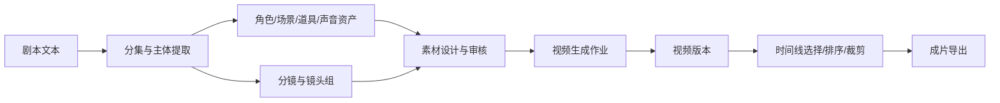

# 智绘漫剧平台独立调研与复刻规格

> 调研日期：2026-07-14
>
> 调研方式：真实 Chromium 浏览器、页面可访问性快照、截图、网络请求观察、前端静态资源只读分析
>
> 适用对象：产品经理、交互设计师、前端/后端/算法/测试工程师，以及承担复刻开发的 AI 编程代理

## 1. 文档定位

本目录是一套面向“功能等价复刻”的清洁室规格。它描述平台当前账号可见的页面、业务流程、状态机、数据模型、API 形态、AI 任务编排和验收标准，但不复制原站源码、品牌素材、真实用户数据或受保护内容。

调研结论并非所有内容都具有相同确定性。每份文档使用以下标记：

| 标记 | 含义 | 使用原则 |
| --- | --- | --- |
| `E1` | 页面直接实测 | 真实浏览器中可见、可重复观察的事实 |
| `E2` | 网络/API/前端代码证据 | 请求、响应结构、路由或静态资源中能直接定位的事实 |
| `E3` | 合理推断 | 多条证据支持，但未被服务端或产品方直接确认 |
| `D` | 复刻建议 | 为可维护性、安全性或体验提出的目标设计，不代表原站现状 |
| `U` | 未验证 | 当前账号、样本数据或只读边界下无法确认的内容 |

未经标记的规范性语句默认是本复刻产品的目标要求，而不是对原站实现的断言。

## 2. 文档导航

| 文档 | 解决的问题 | 推荐读者 |
| --- | --- | --- |
| [00-研究方法与证据索引.md](./00-研究方法与证据索引.md) | 调研边界、证据链、覆盖范围、限制是什么 | 全员 |
| [01-产品需求文档-PRD.md](./01-产品需求文档-PRD.md) | 产品为什么做、为谁做、做哪些能力 | 产品、研发负责人 |
| [02-页面与功能规格.md](./02-页面与功能规格.md) | 每个页面的布局、控件、交互和异常态是什么 | 产品、设计、前端、测试 |
| [03-普通漫剧制作流程.md](./03-普通漫剧制作流程.md) | 从剧本到分镜、资产、视频与时间线的完整流程 | 产品、算法、全栈、测试 |
| [04-新闻播报制作流程.md](./04-新闻播报制作流程.md) | 新闻播报快捷生产线如何配置、运行和交付 | 产品、算法、全栈、测试 |
| [05-领域模型与API.md](./05-领域模型与API.md) | 核心实体、字段、关系、接口和幂等约束是什么 | 后端、前端、算法、测试 |
| [06-技术架构与AI编排.md](./06-技术架构与AI编排.md) | 推荐如何实现前端、服务端、存储、队列和 AI 编排 | 架构师、全栈、运维 |
| [07-权限状态机与验收标准.md](./07-权限状态机与验收标准.md) | 权限、任务状态、积分账本和验收场景如何定义 | 产品、后端、测试、安全 |
| [08-全平台探索覆盖清单.md](./08-全平台探索覆盖清单.md) | 哪些页面已覆盖、哪些功能受边界限制、还缺什么 | 项目负责人、测试 |

过程记录见 [NOTES.md](./NOTES.md)。原始证据保存在本机 `output/playwright/`，其中包含真实项目名称、内部标识和动态账户数据，已通过本目录 `.gitignore` 排除，不应提交或对外分发。

## 3. 一句话产品模型

平台是一个以“剧本”为业务根对象、以“主体资产”为一致性中枢、以“异步 AI 作业”为生产引擎、以“分镜/镜头组/视频版本/时间线”为逐级产物的漫剧制作工作台，同时提供一条配置更少的新闻播报快捷生产线。

## 4. 复刻实施原则

1. 先实现业务闭环，再追求视觉一致。P0 闭环是剧本、主体、资产、分镜、镜头组、视频作业、版本选择和时间线导出。
2. 所有 AI 操作都按“创建作业、排队、执行、产物审核、失败补偿”建模，不把长任务绑定在同步 HTTP 请求上。
3. 主体 ID、镜头 ID、镜头组 ID 和资产版本是跨步骤稳定引用；用户修改上游后必须显式提示下游失效范围。
4. 高成本按钮必须展示成本估算并二次确认。原站出现过无确认即发起高成本任务的实测风险，复刻时不得继承。
5. 积分采用不可篡改账本和预占/结算/释放机制；余额展示只是账本投影，不能直接改数。
6. 画布需要区分临时 UI 状态与业务数据。节点选择或视口变化不应隐式污染正式版本，自动保存也必须可撤销、可审计。
7. 多租户资源必须同时校验用户、组织、项目作用域，不能只依赖前端隐藏入口。
8. 避免复制原站商标、受版权保护的素材和内部文本；以本文档的功能契约重新设计界面与实现。

## 5. 建议开发顺序

| 阶段 | 目标 | 核心交付 |
| --- | --- | --- |
| M0 基座 | 建立账号、组织、项目、对象存储、队列、账本 | 登录、RBAC、异步作业、审计、文件上传 |
| M1 剧本中枢 | 形成可编辑、可分析的剧本数据 | 剧本列表、分集、主体提取、主体编辑 |
| M2 资产与分镜 | 形成角色一致性与镜头结构 | 资产库、候选审核、分镜、镜头组 |
| M3 视频闭环 | 形成可重试的视频生成和版本管理 | 素材检查、视频作业、结果版本、积分补偿 |
| M4 成片编排 | 形成可交付的序列 | 时间线排序、选择、裁剪、合成、下载 |
| M5 快捷模板 | 补充新闻播报等模板化工作流 | 主持人/场景配置、阶段化流水线、成片交付 |
| M6 企业能力 | 扩展团队协作和运营治理 | 团队作用域、管理员、配额、统计、内容安全 |

## 6. AI 开发代理使用方式

建议一次只让 AI 实现一个明确模块，并同时提供：对应文档章节、接口契约、状态机、验收用例和禁止修改范围。任何实现任务都应要求 AI：

- 先声明证据级别与仍需产品确认的 `U` 项；
- 先写迁移/接口/状态机设计，再实现 UI；
- 对异步任务覆盖成功、失败、取消、超时、重试、积分返还；
- 对租户越权、重复提交、版本冲突和对象存储越权做负向测试；
- 不把演示数据、提供商密钥、真实素材 URL 或账号信息写入仓库。
